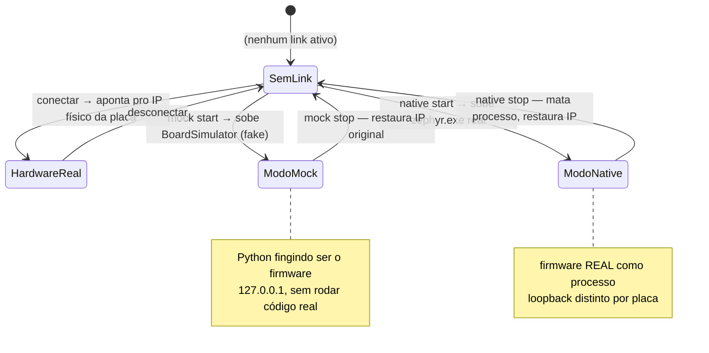
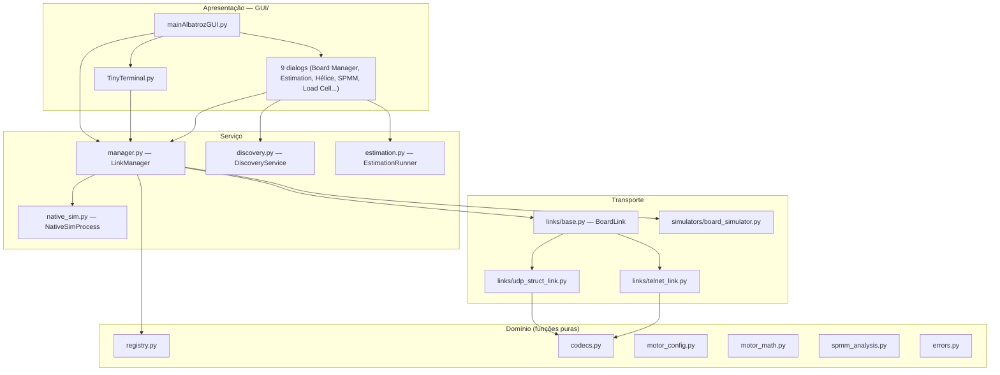
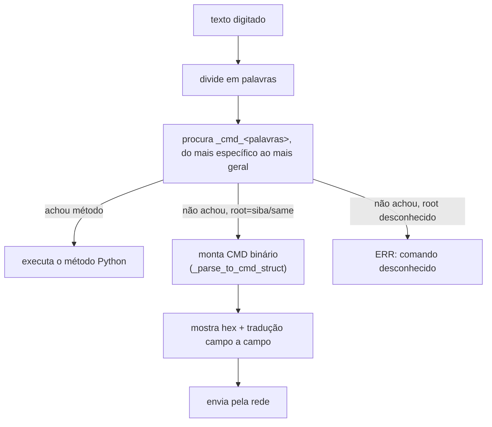
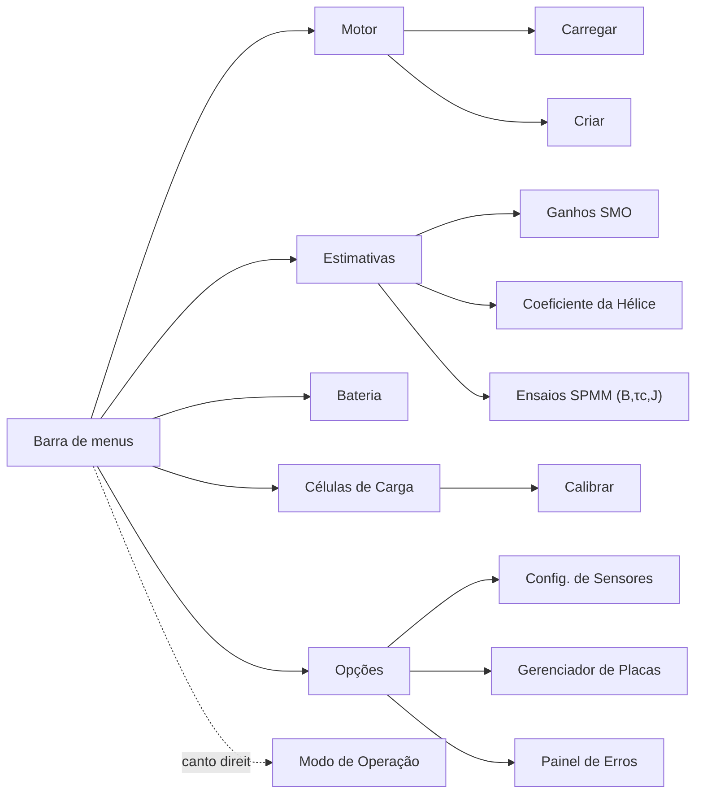
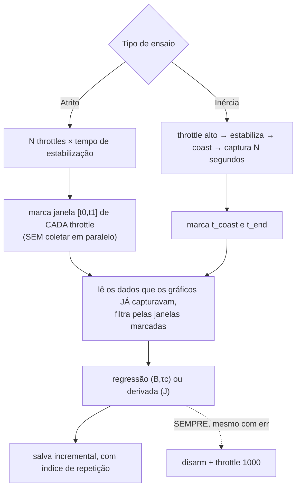

# Aplicacao_Pi — GUI unificada da bancada (Albatroz)

## Para que serve este programa

Esta é a aplicação de PC (roda também num Raspberry Pi) que **comanda e lê
as três placas** da bancada de ensaios de motopropulsão da equipe Albatroz
Aerodesign — [SIBA](../SIBA/Readme.md) (aerodinâmica + bateria + ESC),
[SAME](../SAME/Readme.md) (estimativa elétrica do motor) e
[SPMM](../SPMM/README.md) (bancada provisória de atrito/inércia). Sem essa
aplicação, cada placa só fala um protocolo binário/texto de baixo nível —
é ela que transforma esses bytes em gráficos em tempo real, calibração
guiada, e nos números que efetivamente interessam para quem projeta a
aeronave: coeficientes de empuxo e torque da hélice, atrito e inércia do
conjunto girante, ganhos do observador de motor.

**Por que isso importa para quem calcula o desempenho da aeronave**: o
time de desempenho/aerodesign precisa, para prever alcance, autonomia e
envelope de voo, de um modelo confiável do conjunto motor+hélice — não só
"quanto empuxo esse motor dá a plena carga", mas como o empuxo, o torque e
o consumo variam com a rotação e com a velocidade do ar incidente. Sem uma
bancada instrumentada, esses números viriam só de datasheet (que raramente
bate com o conjunto de peças específico realmente montado) ou de voos de
teste (caros, arriscados, e difíceis de variar uma condição de cada vez).
Esta aplicação é o que fecha o laço entre "girar o motor na bancada" e
"ter uma tabela de coeficientes ($C_T$, $C_Q$, $B$, $\tau_c$, $J$, ganhos
do observador) prontos para entrar no modelo de desempenho da aeronave" —
sem precisar que quem está calculando desempenho leia telemetria bruta ou
escreva scripts de regressão do zero.

Escrita em **Python com PySide6** (Qt) para os gráficos e a interface, com
os cálculos numéricos em **NumPy** puro (sem dependências pesadas de
álgebra linear onde não é necessário — ver a seção de ensaios da SPMM
abaixo para o motivo).

Projeto de TCC — Equipe Albatroz Aerodesign, UDESC Joinville.

## Como rodar

```bash
python mainApp.py     # usa o venv Python 3.13 em .venv/
```

Ao abrir, o programa primeiro confere se todas as dependências do
`pyproject.toml` estão instaladas (instalando as que faltarem
automaticamente) e mata qualquer processo `zephyr.exe` órfão de uma
execução anterior que tenha travado sem limpar — isso existe porque, sem
essa limpeza, um processo de `native_sim` esquecido continuaria
respondendo na mesma porta UDP que uma nova instância tentaria usar,
misturando dados de duas fontes diferentes e sendo bem difícil de
diagnosticar (o sintoma seria "a telemetria está estranha" sem pista
nenhuma de que existem dois firmwares rodando ao mesmo tempo).

---

## As três formas de conectar em uma placa, e quando usar cada uma

Antes de descrever os módulos internos, vale entender essa decisão porque
ela aparece em quase toda tela da aplicação (no combo "Modo de Operação",
no Gerenciador de Placas, no terminal). Para cada placa (SIBA, SAME, SPMM)
existem três formas independentes de "ligar":

1. **Hardware real** — a placa física, ligada por cabo Ethernet
   (SIBA/SAME) ou também Ethernet mas falando Telnet (SPMM), num IP
   link-local fixo (por exemplo, `169.254.97.200` para a SIBA). É o modo
   de verdade, usado em bancada com o motor de fato girando.

2. **Simulador em Python (mock)** — quando não há placa nenhuma
   disponível e só se quer testar a interface (por exemplo, ajustar o
   layout de um gráfico, ou testar um fluxo de calibração sem gastar
   tempo de bancada), a aplicação sobe uma thread Python que **finge** ser
   o firmware: ela decodifica os comandos recebidos e devolve telemetria
   senoidal com ruído. É importante entender que esse modo **não executa
   nenhuma linha do firmware de verdade** — ele simula a calibração com
   uma lógica simplificada de correspondência de nomes entre o comando
   recebido e as variáveis simuladas. Se o `.yaml` do protocolo mudar (um
   campo novo, um enum renomeado), esse simulador pode não perceber a
   mudança e continuar respondendo de um jeito que não bate mais com o
   firmware real — por isso ele só deve ser usado para testar a interface
   gráfica, nunca para validar se "o protocolo está funcionando".

3. **`native_sim`** — o meio-termo mais confiável: o **firmware de
   verdade**, compilado não para o microcontrolador RISC-V, mas para rodar
   como um processo comum do Linux (usando a arquitetura POSIX que o
   próprio Zephyr oferece — sem emulação de CPU nenhuma, é uma compilação
   nativa para x86/ARM do PC). Esse processo troca pacotes UDP reais com a
   aplicação, nas mesmas portas que a placa física usaria, só que em
   loopback (`127.0.0.x`) em vez do IP link-local — e como é o firmware de
   verdade rodando, qualquer bug de protocolo, de parsing, ou de lógica
   (não de hardware físico) aparece exatamente como apareceria na placa
   real. Isso resolve um problema concreto que já aconteceu neste
   projeto: com o simulador Python (modo 2), a interface podia parecer
   estar funcionando perfeitamente enquanto o firmware de verdade, se
   testado, rejeitaria os pacotes por um motivo qualquer de formato — só
   descoberto quando alguém finalmente testasse na bancada física.
   `native_sim` elimina esse risco de falso-positivo sem precisar de
   bancada. Limitação: só funciona no Linux (o binário gerado é um ELF
   POSIX de Linux), e cada placa usa um endereço de loopback diferente
   (SIBA `127.0.0.200`, SAME `127.0.0.100`, SPMM `127.0.0.1`) para as três
   poderem rodar ao mesmo tempo sem se confundirem.



---

## Estrutura do programa e o porquê de cada camada

O código é organizado em quatro camadas, de baixo para cima — essa
separação existe porque a SPMM fala um protocolo **completamente
diferente** (Telnet + log binário) do que a SIBA/SAME (comando binário
compacto de 8 bytes): sem separar "como os bytes trafegam" de "o que a
aplicação faz com eles", cada função nova precisaria tratar os dois
protocolos com `if`s espalhados por todo canto. Com a separação, quem
gerencia o ciclo de vida de uma conexão (camada de Serviço) não precisa
saber se está falando com uma placa UDP ou Telnet — ela só chama `send`,
e a implementação concreta de cada uma cuida do resto.



### Camada de transporte (`Communication_Data/links/` e `simulators/`)

Define o contrato comum a qualquer placa: uma thread própria de entrada/
saída (`BoardLink`, uma classe abstrata), com um método `send()` para
mandar dado e contadores de pacotes recebidos/enviados que servem tanto
para os LEDs de status na tela quanto para o diagnóstico de rede (seção
"Testando a conexão", abaixo). Duas implementações concretas:

- **`UdpStructLink`** (SIBA/SAME): um único socket UDP faz recepção e
  envio no mesmo laço — a cada volta do laço, tenta receber um pacote (com
  um timeout curto de 0,1 segundo, para não travar indefinidamente) e, se
  houver algo na fila de envio, manda.
- **`TelnetLink`** (SPMM): mais complexa porque o protocolo da SPMM tem
  duas vias completamente separadas fisicamente — os **comandos** vão por
  uma sessão TCP (Telnet, porta 23), e o **log de telemetria** chega por
  um socket UDP à parte (porta 5000). O envio de comando (`send`) abre (ou
  reaproveita) a sessão TCP e escreve o texto; a recepção só escuta o
  socket UDP e decodifica cada pacote binário em uma amostra por vez.
  Existe também um mecanismo de segurança crítico aqui: sempre que esse
  link é encerrado — por qualquer motivo, inclusive a aplicação travando —
  ele manda `disarm` seguido de `throttle 1000` antes de fechar a conexão,
  porque o motor **nunca** pode continuar girando se o programa que o
  comanda parar de responder.

### Camada de domínio (`registry.py`, `codecs.py`, `motor_config.py`, `motor_math.py`, `spmm_analysis.py`, `errors.py`)

São **funções puras** — sem rede, sem thread, sem estado global — que
fazem a tradução entre bytes/YAML e valores com significado:

- `registry.py` lê os arquivos `Config/SIBA.yaml`/`SAME.yaml`/`SPMM.yaml`
  (o bloco `link:` de cada um) e monta um objeto simples por placa com IP,
  portas e qual protocolo usar — assim, o resto do programa não precisa
  saber, "na unha", que a SIBA usa a porta 5000 e a SAME usa a 4444: essa
  informação vem de um arquivo de configuração, editável sem mexer em
  código.
- `codecs.py` empacota/desempacota os pacotes binários (`CMD` de 8 bytes,
  `TELEMETRY_LOG`, e o log da SPMM) usando o módulo `struct` do Python,
  com o formato `<BBBfb>` (o `<` força little-endian, compatível com o
  RISC-V de destino).
- `motor_config.py` lida com os arquivos de perfil de motor
  (`Config/motors/*.yaml`) e sabe montar a lista de `CMD`s necessários
  para aplicar um perfil inteiro no hardware da SAME.
- `motor_math.py` tem as transformadas de Clarke/Park em NumPy, usadas
  quando o ensaio de atrito é feito lendo a SIBA (RPM) e a SAME (correntes
  de fase) em vez da bancada SPMM — ver a seção de ensaios abaixo.
- `spmm_analysis.py` tem a regressão linear e o cálculo de $J$ dos
  ensaios da SPMM — ver a seção de ensaios abaixo.
- `errors.py` traduz o `error_code` (mapa de bits) que a SIBA manda na
  telemetria para mensagens em português — por exemplo, o bit 4 vira
  "Bateria superaquecendo (temperatura acima do limite de alarme)" em vez
  de só "bit 4 ativo".

### Camada de serviço (`manager.py`, `discovery.py`, `estimation.py`, `native_sim.py`)

- **`LinkManager`** é o orquestrador central: mantém um `BoardLink` por
  placa, decide qual implementação concreta criar a partir do que o
  `registry` disser sobre aquela placa, e expõe os três modos de conexão
  descritos acima (`start_link`, `set_mock_mode`, `start_native_sim`).
- **`DiscoveryService`** resolve a pergunta "essa placa está presente
  agora?" de um jeito específico por protocolo: para SIBA/SAME, manda um
  comando neutro (que não muda nada no estado da placa) e espera qualquer
  pacote de telemetria como confirmação; para a SPMM, abre a sessão Telnet
  e manda o comando `rpm`, e qualquer resposta já confirma presença — a
  ideia de "pong" (por analogia a um ping/pong).
- **`EstimationRunner`** roda os scripts de estimação (ganhos do SMO,
  coeficiente da hélice) como **subprocessos** Python separados — não
  dentro da mesma thread da interface — e retransmite, linha a linha, a
  saída padrão desses scripts para quem quiser mostrar o progresso (os
  diálogos de estimação, ver abaixo). Rodar como subprocesso evita que um
  script de otimização pesado (a busca de ganhos do SMO usa Evolução
  Diferencial, que pode rodar por vários segundos) trave a interface
  gráfica enquanto calcula.
- **`NativeSimProcess`** sobe/derruba o processo `native_sim` do firmware
  e retransmite o log dele para o console.

### Camada de apresentação (`GUI/`)

A janela principal (`mainAlbatrozGUI.py`) e nove janelas auxiliares
("dialogs"), cada uma dedicada a uma tarefa — detalhadas na seção
"O que dá para fazer, tela por tela" abaixo.

---

## O protocolo de comando/telemetria, por dentro

A SIBA e a SAME falam um protocolo idêntico em **formato** (8 bytes de
comando, uma struct de telemetria), mas com conteúdo (quais enums, quais
campos) diferente por placa — cada uma tem seu próprio arquivo `.yaml`.
Veja `../SIBA/Readme.md` e `../SAME/Readme.md` para o conteúdo completo de
cada struct; aqui o que importa é como o Python lida com esse formato:

```python
CMD_FORMAT = "<BBBfb"  # func(1B) instr(1B) target(1B) value(4B float) action(1B)

def encode_cmd(func, instr, target, value, action):
    return struct.pack(CMD_FORMAT, func, instr, target, float(value), action)
```

O `<` no formato força **little-endian** — a ordem de bytes que o
microcontrolador RISC-V usa nativamente; sem isso, num PC com arquitetura
que usasse a ordem contrária (big-endian, hoje incomum mas não impossível),
os bytes do `float` sairiam invertidos e o firmware leria um número sem
sentido nenhum. A struct de telemetria (`TELEMETRY_LOG`) é decodificada de
forma semelhante, mas o formato exato (quantos campos, em que ordem) é lido
dinamicamente do `.yaml` da placa em vez de estar escrito fixo no código
Python — isso é o que permite ao mesmo código Python (`codecs.py`) lidar
com o layout diferente da SIBA e da SAME sem duplicar a lógica de
decodificação.

O protocolo da **SPMM** é diferente por natureza: não é um comando de
formato fixo, é texto simples mandado por uma sessão Telnet
(`b"throttle 1500\r\n"`, por exemplo) — quem decide o que cada palavra
significa é o shell do próprio firmware da SPMM (ver
`../SPMM/README.md`), não um `.yaml`. Só o log de dados da SPMM é binário
(uma struct compacta com contador de amostra, rotação, torque e as 6
grandezas elétricas — ver `../SPMM/README.md` para o layout exato).

---

## `TinyTerminal` — o shell embutido na interface

O `TinyTerminal` é uma janela de terminal de texto **dentro da própria
aplicação Python** — não confundir com o shell da SIBA (que roda dentro do
firmware, acessado por UART) nem com o shell Telnet da SPMM (que roda
dentro do firmware da SPMM). O `TinyTerminal` roda no PC e fala com as
placas exatamente pela mesma rede que o resto da interface usa — ele
existe para dar acesso rápido a ações de diagnóstico e controle sem
precisar abrir um menu, e para servir como uma ferramenta de depuração
"crua" (mostra o pacote exato em hexadecimal, e a tradução campo a campo,
de cada comando enviado).

### Como um comando digitado vira ação

O texto digitado é dividido em palavras (`raw.split()`), e o terminal
tenta achar um método Python cujo nome corresponda às palavras digitadas,
do mais específico para o mais genérico — por exemplo, digitando
`siba mock start`, ele primeiro procura um método chamado
`_cmd_siba_mock_start`; se não achar, tenta `_cmd_siba_mock`; se também não
achar, tenta só `_cmd_siba`. Isso permite registrar tanto comandos bem
específicos (`siba native start` tem seu próprio método) quanto deixar um
comando mais genérico (`siba set ...`) cair num tratamento comum, sem
precisar de uma árvore de decisão escrita à mão em um único lugar.

Se nenhum método correspondente existir e o comando começar com `siba` ou
`same`, o terminal assume que é um pedido de ajuste de parâmetro
(`siba set <alvo> <ação> <valor>`) e monta o `CMD` binário na hora,
traduzindo os nomes digitados para os índices numéricos dos enums do
`.yaml` daquela placa — mostrando sempre, antes de enviar, tanto os bytes
em hexadecimal quanto a tradução legível de cada campo, para que fique
claro exatamente o que está sendo mandado pela rede.



### Comandos disponíveis

**Comandos fixos do próprio terminal** (não dependem de placa nenhuma):

| Comando | O que faz |
|---|---|
| `help [comando]` | Lista todos os comandos, ou detalha os subcomandos de um específico |
| `clear` | Limpa a tela do terminal |
| `sudo` | Relança a aplicação inteira com privilégios de administrador (necessário para o `tcpdump`) |
| `restart` | Reinicia a aplicação |
| `exit` / `exit all` | Fecha só o terminal, ou a aplicação inteira |
| `ping <ip>` | Testa se dá para abrir uma conexão TCP na porta 80 daquele IP (um teste de alcançabilidade simples, não um ping ICMP de verdade) |
| `ipconfig` | Lista as interfaces de rede do PC e seus IPs — útil para conferir se o PC está na mesma sub-rede link-local da placa |
| `listing [porta]` | Diz se uma porta local já está em uso |
| `tcpdump <ip> <segundos>` | Um sniffer de pacotes cru — requer `sudo` antes |

**Comandos por placa** (`siba`/`same`, protocolo `CMD` binário):

| Comando | O que faz |
|---|---|
| `siba connect` / `same connect` | Liga o link apontando para o IP físico da placa (hardware real), e confirma com um ping de sub-rede |
| `siba mock start` / `stop` | Liga/desliga o simulador Python (modo 2) |
| `siba native start` / `stop` | Sobe/derruba o firmware real via `native_sim` (modo 3) — precisa ter rodado `make native_sim` na pasta do firmware antes |
| `siba test_io` / `same test_io` | Ver seção "Testando a conexão" abaixo |
| `siba set <alvo> linear\|offset\|reset\|max\|min <valor>` | Ajusta a calibração de um sensor — o terminal traduz o nome do alvo (`v_batt`, `load_cell_0`, etc.) para o índice correto do enum `target_type`, incluindo alguns apelidos necessários porque o nome que aparece na telemetria não bate literalmente com o nome do enum (por exemplo, `v_batt` na telemetria corresponde a `TARGET_VOLTAGE_DIVIDOR` no protocolo, não a um `TARGET_V_BATT` que não existe) |
| `same set <alvo> ...` | Mesma ideia, para os alvos da SAME (correntes/tensões de fase, parâmetros do motor, ganhos do SMO) |

**Comandos da SPMM** (`spmm`, protocolo Telnet — texto simples):

| Comando | O que faz |
|---|---|
| `spmm connect` / `disconnect` | Abre/fecha o link Telnet+UDP (fechar dispara a parada segura do motor) |
| `spmm detect` | Manda um `rpm` pela sessão Telnet e considera qualquer resposta como "placa presente" |
| `spmm native start` / `stop` | `native_sim` da SPMM — nesse modo o "shell" vira o próprio stdin do processo, porque o backend Telnet TCP fica desligado quando compilado para `native_sim` |
| `spmm <qualquer outro texto>` | Encaminhado cru para o shell da SPMM — por exemplo, `spmm throttle 1500` ou `spmm coast` funcionam exatamente como digitar isso direto numa sessão Telnet manual |

**Comandos de gráfico** (`graph`): `graph clear` limpa os buffers de
telemetria acumulados; `graph mock_data start/stop` liga/desliga o
simulador (atalho equivalente a `siba mock start` + `same mock start`
juntos).

### Testando a conexão sem depender de olhar gráfico nenhum

`siba test_io` (e o equivalente `same test_io`) resolve uma pergunta
objetiva sem exigir interpretar telemetria: **a placa está realmente
recebendo E enviando dados, ou só uma das duas coisas está acontecendo?**
O comando manda um `CMD` inofensivo (não muda nada no estado da placa) e
espera, por um tempo limite, qualquer pacote de telemetria chegar de
volta — reportando separadamente se o **envio** (TX, do PC para a placa)
funcionou (o socket conseguiu mandar os bytes) e se a **recepção** (RX)
funcionou (algum pacote chegou de volta). Isso funciona **independente**
de qual dos três modos de conexão está ativo — ele só observa contadores
de pacote no nível do socket, não depende de a interface conseguir
decodificar/plotar nada. A utilidade prática: se TX falhar, o problema é
de rede/porta/firewall do lado do PC; se só RX falhar, o problema está do
lado da placa (firmware não está respondendo, ou telemetria não está
sendo gerada) — isolando de forma rápida onde procurar.

---

## O que dá para fazer, tela por tela



### Tela principal

Tem o combo **"Modo de Operação"** (`SPMM`, `SIBA`, `SAME`, ou
`SIBA+SAME`), que decide quais placas ligam e quais gráficos aparecem —
por exemplo, no modo `SPMM` só aparecem os gráficos de rotação/torque da
bancada provisória; no modo `SIBA+SAME`, aparecem tanto a telemetria
aerodinâmica/bateria quanto a estimativa elétrica do motor. O slider de
throttle manda o comando de acelerar para quem quer que seja a placa que
aciona o ESC no modo atual (a SIBA, seja sozinha ou junto com a SAME; a
SPMM, no modo próprio dela — a SAME **nunca** aciona nada, ela só observa,
então no modo `SAME` sozinho o slider fica desabilitado). O botão
"Desligar (Motor)" sempre executa uma parada segura (throttle mínimo mais
o comando de desarmar), não importa que placa esteja no controle.

### Gerenciador de Placas

Uma linha por placa, com um LED que fica verde quando a placa está
recebendo dados de verdade, um campo de IP/porta editável **só para
aquela sessão** (não grava no arquivo `.yaml` — para tornar uma mudança de
IP permanente, é preciso editar o `.yaml` manualmente), um botão
"Detectar" que dispara o mecanismo de descoberta descrito acima, e o
botão "Simulação Nativa" que liga/desliga o modo `native_sim` daquela
placa (desabilitado automaticamente fora do Linux).

### Calibrar Célula de Carga

Mostra a média das últimas N leituras (ajustável) de uma célula
escolhida, ao vivo, com um diagnóstico automático: se a média estiver
próxima do valor que o HX711 devolve quando não há nada conectado
(saturado, todos os 24 bits em 1), avisa que a célula parece
desconectada; se a média estiver muito acima do que se espera de uma
leitura já calibrada, avisa que provavelmente ainda está com a
calibração de fábrica. O botão "Tarar" zera a célula sem carga nenhuma
em cima; o campo de "peso conhecido" mais o botão "Calibrar pelo peso" é
onde se informa quanto peso está de fato sobre a célula agora — é a
placa (não a interface) quem calcula a escala necessária a partir desse
peso, seguindo o modelo canônico do HX711 explicado em
`../SIBA/Readme.md`.

### Configuração de Sensores

Uma tabela com todos os sensores calibráveis da SIBA em linhas, e quatro
colunas (ganho, offset/tara, mínimo válido, máximo válido) — só as
células que forem de fato editadas são enviadas ao clicar "Aplicar"
(destacadas em laranja enquanto pendentes), para não correr o risco de
recalibrar um sensor sem querer só por ele estar na tabela.

### Painel de Erros e Alarmes

Uma lâmpada por cada bit do código de erro agregado da SIBA (ver a tabela
completa em `../SIBA/Readme.md`), agrupadas por área (bateria, motor/
hélice, segurança, sistema), acendendo em vermelho quando aquele alarme
específico está ativo na telemetria mais recente.

### Estimar Ganhos do SMO

Recebe da pessoa que está operando a resistência ($R$) e a indutância
($L$) do motor (medidas na bancada de rotor bloqueado, ver
`../SAME/Readme.md`), o período de amostragem simulado, e parâmetros do
algoritmo de busca (número de gerações e tamanho da população da Evolução
Diferencial). Ao rodar, mostra em tempo real a curva de custo da
otimização (quanto menor, melhor o ajuste dos ganhos candidatos) conforme
o script avança, e ao terminar mostra os três ganhos ótimos na forma Γ
(explicados em `../SAME/Readme.md`) — só grava no `SAME.yaml` depois de
uma confirmação explícita, nunca automaticamente.

### Estimar Coeficiente da Hélice

Diferente do anterior, este não roda uma simulação — ele consome um
**CSV já exportado** pela tela principal (telemetria real gravada durante
um ensaio). A pessoa escolhe qual das forças medidas pelas células de
carga representa a **tração** (obrigatório escolher — a interface não
assume qual célula é qual), qual coluna é o torque (por padrão, o
estimado pela SAME) e qual é o RPM, mais o diâmetro da hélice e a
densidade do ar. O script então calcula, para cada ponto do ensaio, os
coeficientes adimensionais clássicos de hélice — coeficiente de tração
$C_T$, de torque $C_Q$, de potência $C_P$ e a eficiência $\eta$ — e devolve
uma **lista de pontos**, não um coeficiente único, porque esses
coeficientes variam com a razão de avanço (a relação entre a velocidade do
ar e a rotação); sem velocidade do ar medida, o cálculo cai para o modelo
estático mais simples, $T = k_Q \omega^2$.

### Ensaios SPMM — atrito e inércia



Reproduz, de dentro da interface, exatamente a sequência de comandos que
se digitaria manualmente no shell da SPMM (ver `../SPMM/README.md` para as
equações completas): escolhe-se o tipo de ensaio (atrito ou inércia), os
parâmetros (lista de throttles e tempo de espera, para o atrito; throttle
alto, tempo de estabilização e duração de captura, para a inércia), e um
nome de arquivo CSV. Um detalhe de implementação relevante para quem for
mexer nesse código: o ensaio **não fica escutando dados em paralelo**
enquanto comanda o motor — em vez disso, ele só **marca o instante de
início e fim** de cada trecho relevante (usando o relógio do próprio
programa), e, só depois de todos os comandos terem sido mandados, vai lá
nos dados que os gráficos já estavam capturando continuamente e filtra
apenas o que caiu dentro dessas janelas marcadas. Essa escolha evitou uma
condição de corrida (que já causou uma falha de segmentação numa versão
anterior) entre a thread do ensaio e a thread que atualiza os buffers de
telemetria.

Um recurso extra: em vez de usar os dados da própria bancada SPMM, dá para
escolher medir o atrito usando o RPM da SIBA junto com as correntes de
fase da SAME — nesse caso, o torque não é o `torque_eletrico` que a SAME
já calcula (que depende de um $K_t$ do motor que pode estar impreciso),
mas sim recalculado do zero a partir de $I_q$ (Clarke+Park aplicados sobre
as correntes de fase, com o ângulo elétrico reconstruído por integração do
RPM) multiplicado pela constante de torque.

### Motor → Carregar / Criar

"Criar" abre um formulário com os parâmetros físicos do motor (polos,
tipo de ligação Y ou Delta, $K_v$ comercial, resistência, indutância),
calcula automaticamente $K_e$/$K_t$ a partir do $K_v$ (convertendo de
Delta para Y quando necessário — motores em Delta têm um $K_v$ comercial
diferente do que o firmware, que trabalha internamente em Y, precisa),
mais os ganhos do observador — e permite salvar isso como um arquivo de
perfil (`Config/motors/<nome>.yaml`), reutilizável depois. "Carregar" lista
os perfis salvos e os que já estiverem embutidos no `SAME.yaml`, e permite
aplicar os parâmetros escolhidos direto no hardware, mandando um `CMD` por
parâmetro.

---

## Passo a passo prático: rodando um ensaio do zero

Um exemplo concreto, do começo ao fim, de como chegar a um coeficiente de
hélice a partir de dados reais (adaptável para os outros ensaios trocando
só as telas envolvidas):

1. **Ligue a(s) placa(s)** que vão gerar os dados. Se for testar sem
   bancada física primeiro, compile e suba o `native_sim` da placa
   (`make native_sim` na pasta do firmware, depois `siba native start` ou
   pelo botão "Simulação Nativa" no Gerenciador de Placas). Confirme com
   `siba test_io` (ou `same test_io`) que TX e RX estão OK antes de
   prosseguir — economiza tempo descobrir um problema de conexão aqui, em
   vez de no meio de um ensaio.
2. **Escolha o Modo de Operação** compatível com o que será medido — por
   exemplo, `SIBA+SAME` se o ensaio precisar tanto de empuxo (SIBA) quanto
   de torque estimado (SAME).
3. **Clique em "Conectar"** na tela principal — isso sobe os links das
   placas do modo escolhido.
4. **Rode o ensaio** propriamente dito: acelere o motor manualmente pelo
   slider (variando o throttle em alguns níveis diferentes, se for medir
   uma curva) ou, se for um ensaio guiado (Estimativas → Ensaios SPMM), use
   o diálogo correspondente, que comanda o throttle sozinho.
5. **Exporte os dados**: botão "Salvar CSV" na tela principal — isso grava
   todo o histórico de telemetria acumulado (da RAM e do que já tiver ido
   para o arquivo de swap em disco, caso o ensaio tenha durado o
   suficiente para encher o buffer de 5000 pontos em RAM) com uma coluna
   de timestamp e uma coluna por variável de telemetria.
6. **Processe o CSV**: abra o menu Estimativas → Estimar Coeficiente da
   Hélice, escolha o CSV recém-exportado, indique qual coluna é a tração
   (qual célula de carga estava medindo empuxo), qual é o torque e o RPM,
   e o diâmetro/densidade do ar — clique em calcular.
7. **Confira e aplique**: a tabela mostra um ponto por nível de operação
   testado, com $C_T$/$C_Q$/$C_P$/eficiência de cada um, mais um resumo
   com a média. Só depois de conferir que os números fazem sentido é que
   se clica em "Aplicar ao SAME.yaml" — nada é gravado automaticamente
   antes dessa confirmação explícita.

O mesmo roteiro geral (ligar → escolher modo → conectar → rodar → exportar
→ processar → confirmar antes de aplicar) se repete para os outros
ensaios (ganhos do SMO, atrito/inércia da SPMM), só trocando qual diálogo
processa os dados e quais parâmetros de entrada ele pede.

---

Ver [`CLAUDE.md`](CLAUDE.md) para referência técnica adicional voltada a
quem for mexer no código (API completa do `LinkManager`, bugs históricos
já corrigidos, observações em aberto) — o conteúdo essencial de uso e
funcionamento está todo neste documento.

Licença: **MIT** (ver `../../LICENSE`).
