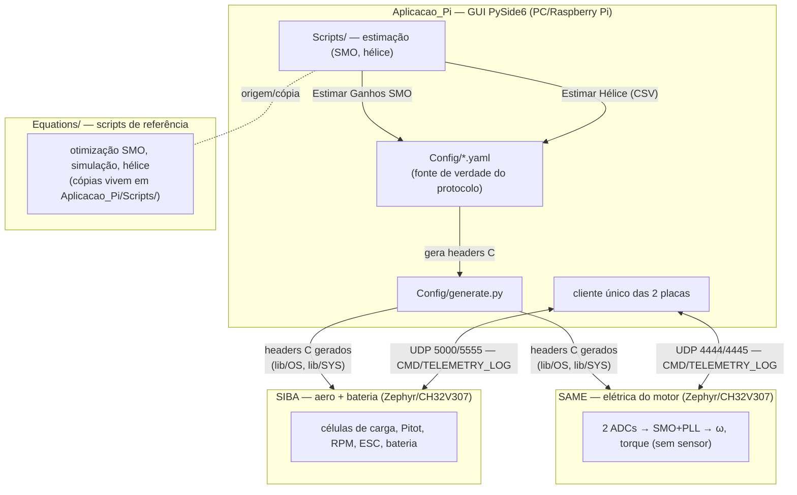
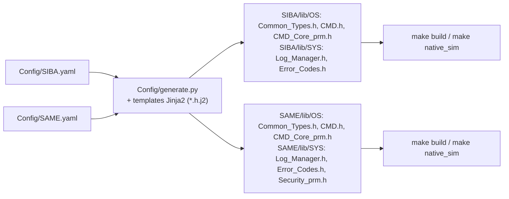
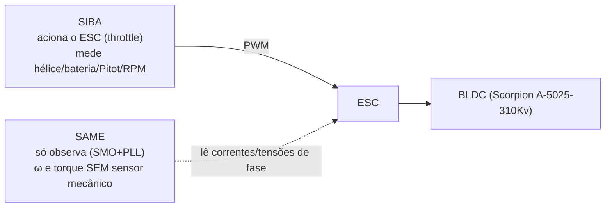
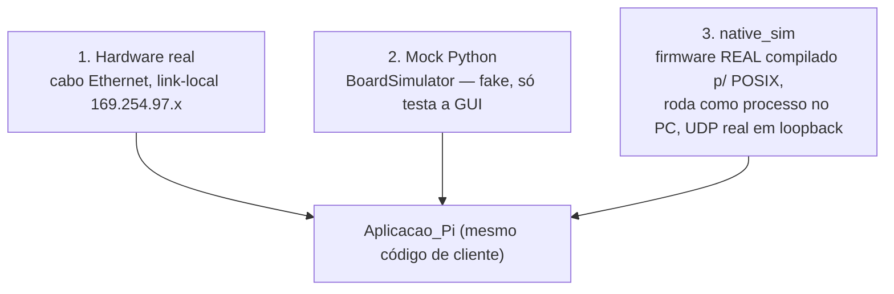
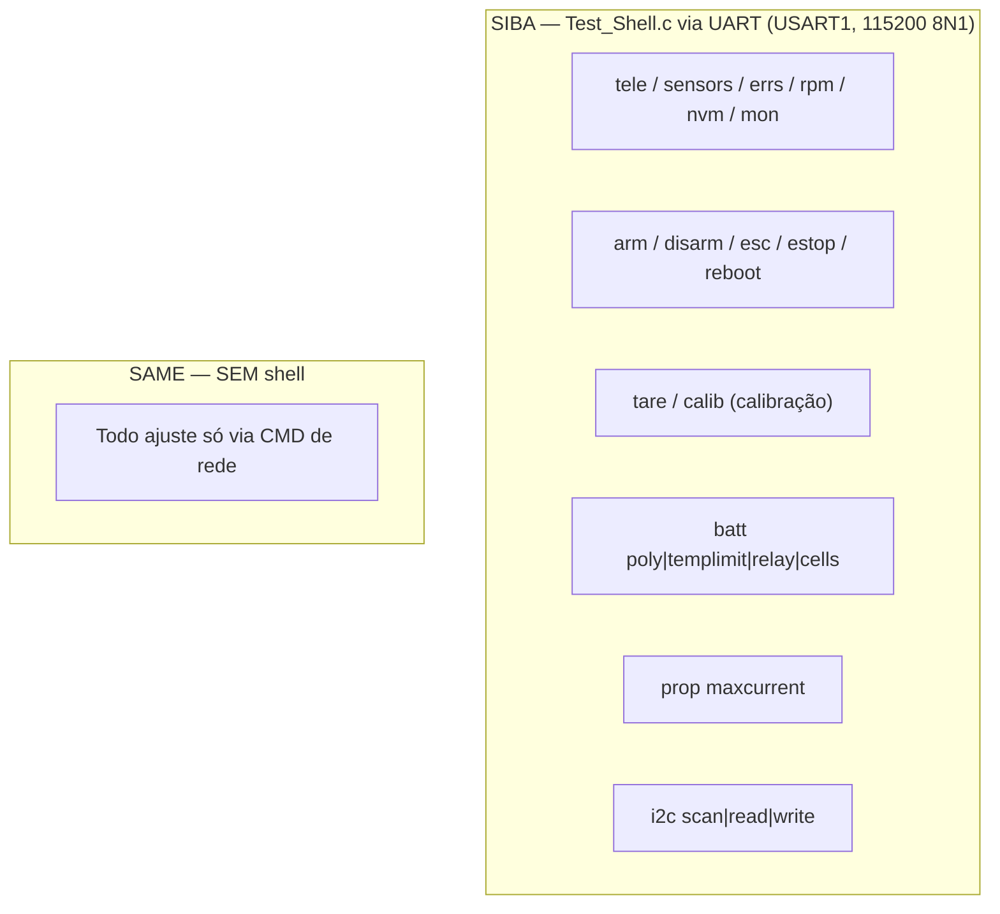

# Codigos — software da bancada

Firmwares das placas embarcadas e a aplicação de PC que as comanda. O
objetivo é caracterizar um conjunto motor **BLDC** + hélice de aeromodelo em
bancada, com telemetria elétrica e aerodinâmica.

> Volta para o [README principal](../README.md).

## Estrutura

| Pasta | O que é |
|-------|---------|
| **`Aplicacao_Pi/`** | **Aplicação PySide6 (GUI)** que roda no PC/Raspberry Pi — cliente único das duas placas. Ver [`Aplicacao_Pi/README.md`](Aplicacao_Pi/README.md). |
| **`SIBA/`** | Firmware do **nó aerodinâmico e da bateria** (CH32V307, Zephyr): células de carga, Pitot, RPM, relés da bateria — e é quem aciona o ESC. Ver [`SIBA/README.md`](SIBA/README.md). |
| **`SAME/`** | Firmware do **nó de aquisição elétrica do motor** — lê 2 ADCs (tensões/correntes de fase) e **estima ω e torque sem sensores** via SMO+PLL (só observa, não aciona o motor). Ver [`SAME/README.md`](SAME/README.md). |
| **`Equations/`** | Scripts de referência (otimização dos ganhos SMO, simulação, hélice) — os usados pela GUI ficam copiados em `Aplicacao_Pi/Scripts/`. |
| **`Teste/`** | Scripts de experimentos pontuais (recepção crua da SIBA, dashboard de teste, identificação de Ld/Lq). |
| **`Makefile`** | Atalhos para compilar/limpar as duas placas de uma vez (`make help`). |

Cada `README.md` acima é completo por si só — traz as equações,
os structs em C, a explicação de cada sensor/thread e o passo a passo de
uso daquela placa/programa. Além disso, cada pasta tem um `CLAUDE.md` com
anotações voltadas a quem for mexer no código (TODOs, decisões em aberto,
bugs históricos já corrigidos).

## Rodar

```bash
cd Aplicacao_Pi && python mainApp.py                # GUI
cd SIBA && make build                               # firmware, placa real
cd SIBA && make native_sim && make native_sim_run   # firmware no PC (só Linux)
make native_sim                                     # daqui: native_sim das duas placas
```

As duas placas podem rodar em `native_sim` ao mesmo tempo, cada uma em seu
loopback, sem bancada física (ver §5).

---

## 1. Mapa do repositório



## 2. `generate.py` — a única fonte de verdade do protocolo



> **Regra de ouro**: edite o `.yaml`, rode `python Config/generate.py`, e só
> depois compile o firmware. Os `.h` gerados nunca são editados à mão.

## 3. Protocolo de rede

As duas placas falam o mesmo **formato** de protocolo UDP, com conteúdo
(enums e campos) próprio de cada uma:

- **CMD** (PC → placa): 8 bytes packed, `<BBBfb>` = `func, instr, target, value, action`.
- **TELEMETRY_LOG** (placa → PC): struct packed little-endian, 10 Hz.

| | SIBA | SAME |
|---|---|---|
| IP padrão | `169.254.97.200` | `169.254.97.100` |
| PC recebe | `5555` | `4445` |
| Placa recebe | `5000` | `4444` |
| loopback `native_sim` | `127.0.0.200` | `127.0.0.100` |
| Fonte de verdade | `Config/SIBA.yaml` → `generate.py` | `Config/SAME.yaml` → `generate.py` |

## 4. Papel de cada placa no ensaio do motor



A **SIBA aciona** o ESC e mede o lado aerodinâmico; a **SAME só observa** o
lado elétrico e estima rotação e torque.

## 5. Três modos de execução



Ver [`Aplicacao_Pi/README.md`](Aplicacao_Pi/README.md), seção "As três
formas de conectar em uma placa", para o diagrama de estados de cada modo,
e a seção `TinyTerminal` para o shell que expõe esses modos como comandos
(`siba mock start`, `siba native start`, etc.).

## 6. Shells embarcados — o que dá pra fazer em cada micro sem a GUI

Uma placa pode expor uma interface de linha de comando **direto no
firmware**, independente do `CMD` binário de rede — útil para diagnóstico
de bancada sem depender do PC/link UDP.



Na SIBA os comandos ficam **no nível raiz** do shell (sem prefixo `siba`).

| | SIBA | SAME |
|---|---|---|
| Shell embarcado? | **Sim** — `Test_Shell.c`, Zephyr Shell subsystem | **Não** |
| Meio de acesso | UART (USART1); em `native_sim`, stdin do processo ou `siba native shell` no TinyTerminal | — (só `CMD` via UDP) |
| Cobre mais que o protocolo de rede? | **Sim** — I2C bruto, limite de corrente do motor, contagem de células, dump da NVM (sem CMD equivalente) | — |
| Detalhe completo | [`SIBA/README.md`](SIBA/README.md) | [`SAME/README.md`](SAME/README.md) |

> ⚠️ Não confundir com o **`TinyTerminal`** da `Aplicacao_Pi` — aquele é um
> shell que roda **no PC** e fala com as placas pela rede (mesmo `CMD`
> binário da GUI); o shell desta seção roda **dentro do firmware** e fala
> direto com as camadas internas (Sys/HAL), sem rede nenhuma. Ver a seção
> `TinyTerminal` em [`Aplicacao_Pi/README.md`](Aplicacao_Pi/README.md).

---

Licença: **MIT** (ver `../LICENSE`).
