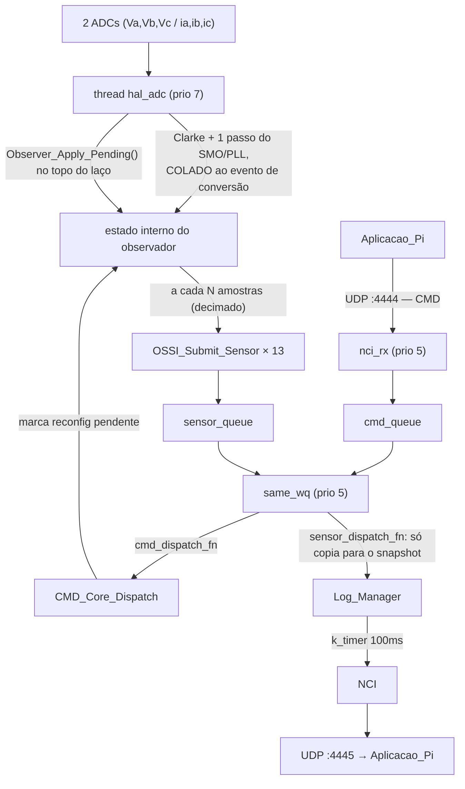
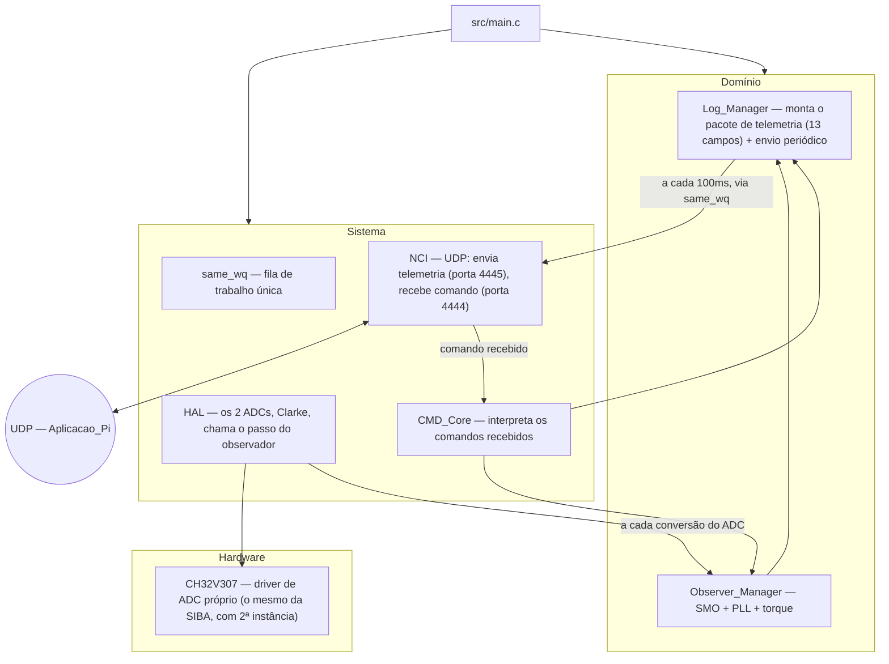
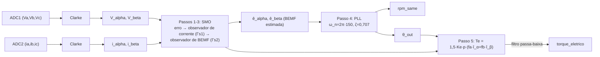
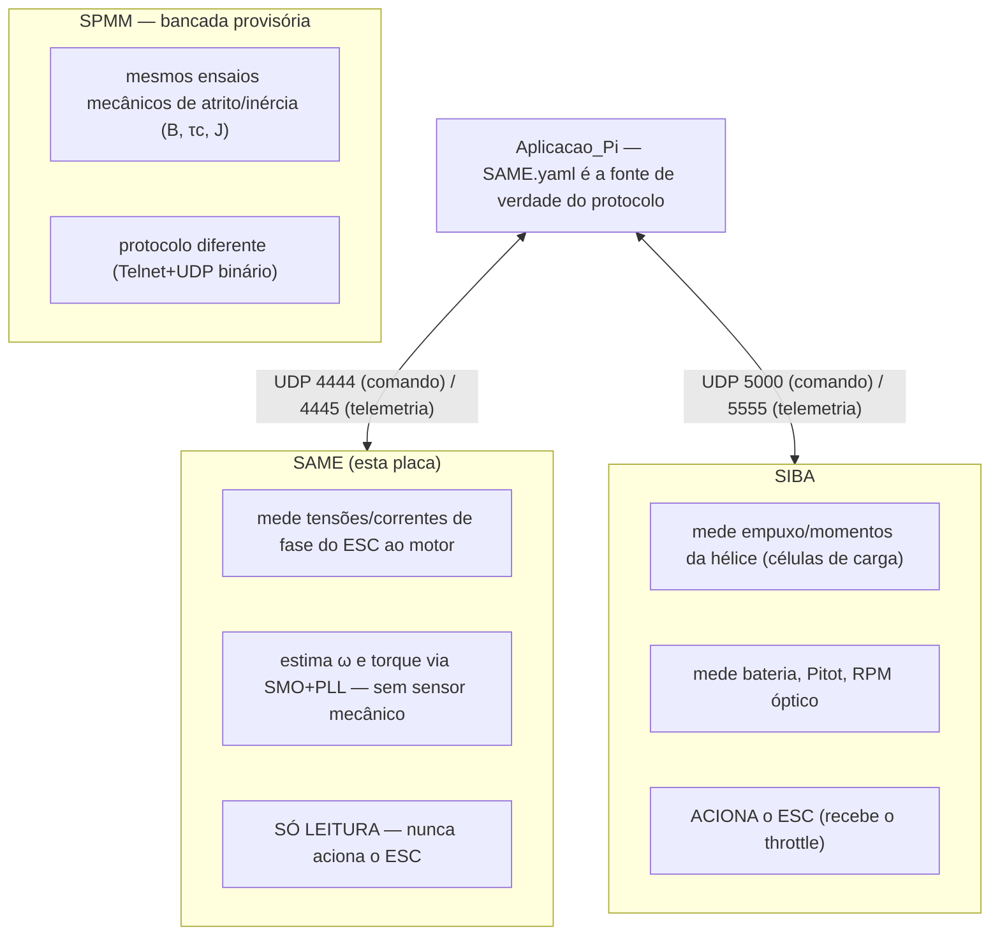

# SAME — Sistema de Aquisição do Motor Elétrico

## O que é essa placa e para que ela serve

A SAME é o nó de instrumentação **elétrica** do motor, na mesma bancada de
ensaios de motopropulsão da equipe Albatroz Aerodesign que abriga a placa
irmã [**SIBA**](../SIBA/) (aerodinâmica + bateria). Ela lê as tensões e
correntes das três fases entre o ESC e o motor BLDC sob ensaio (um
**Scorpion A-5025-310Kv**) e, a partir só dessas 6 grandezas elétricas,
**estima a velocidade angular do eixo e o torque eletromagnético sem usar
nenhum sensor mecânico** — nem encoder, nem sensor Hall de posição, nem
tacômetro.

Essa estimativa é feita por um **Observador por Modos Deslizantes (SMO)**
acoplado a um **PLL** (malha de captura de fase), reconstruindo a força
contraeletromotriz (BEMF) do motor a partir do modelo elétrico dele — as
equações completas estão na seção própria mais abaixo. A técnica existe
porque instalar um encoder ou resolver no eixo de um motor de aeromodelo
de teste é caro, ocupa espaço e adiciona massa/atrito que distorceria
justamente as medidas mecânicas que a bancada quer caracterizar; medir
somente grandezas elétricas, que já estão disponíveis no cabo entre o ESC
e o motor, evita esse problema.

**A SAME nunca aciona o motor.** Ela é estritamente um observador — quem
gera o sinal de PWM que controla o ESC é a SIBA. Isso é uma decisão de
separação de responsabilidades: a placa que aciona tem que reagir a
condições de segurança (sobrecorrente, superaquecimento da bateria) em
tempo real; a placa que só observa pode ter sua lógica de estimação
livre dessas preocupações.

Roda em um **CH32V307VTC6** (RISC-V, 144 MHz) sobre **Zephyr RTOS**,
comunicando com o PC (`../Aplicacao_Pi/`) por **UDP/Ethernet**. Diferente
da SIBA, a SAME **não tem um shell de comandos via UART** — todo ajuste de
parâmetro (ganhos do observador, calibração de sensor, parâmetros do
motor) é feito exclusivamente pelo protocolo de rede descrito abaixo.

Projeto de TCC — Equipe Albatroz Aerodesign, UDESC Joinville.

## Build

```bash
make build          # placa real (same_board / CH32V307), gera zephyr.bin
make flash          # grava via WCH-LinkE (OpenOCD)
make native_sim      # binário POSIX no PC (motor virtual sintético)
make native_sim_run  # roda o binário native_sim
make debug           # OpenOCD + GDB
```

### Rodar sem hardware (`native_sim`)

Igual à SIBA, o firmware compila para rodar como processo comum do Linux
(sem emulação de CPU — é a própria arquitetura POSIX do Zephyr). Como não
existe ADC de verdade nesse modo, a thread de aquisição substitui a
leitura física por um **motor virtual**: ela sintetiza três tensões e três
correntes de fase senoidais, na frequência elétrica correspondente a uma
rotação alvo fixa (`HAL_SIM_DEMO_RPM`), e alimenta essas 6 grandezas
sintéticas no **mesmo pipeline de processamento** (Clarke → observador →
PLL) que seria usado com dados reais. Isso permite validar se a
implementação do SMO/PLL converge para o valor de rotação esperado sem
precisar de motor, ESC ou bancada nenhuma — só o algoritmo rodando contra
um sinal conhecido.

A rede, mesmo nesse modo, é real: o processo abre sockets UDP de verdade
e troca pacotes com o PC. A SAME usa o endereço de loopback
**`127.0.0.100`** (o último número do IP link-local real,
`169.254.97.100`), diferente do que a SIBA usa (`127.0.0.200`), para que
as duas possam rodar ao mesmo tempo no mesmo PC sem os pacotes se
misturarem:

- Telemetria (placa→PC): UDP `127.0.0.100:4445`
- Comando (PC→placa): UDP `127.0.0.100:4444`

---

## Como a placa é organizada por dentro

### Só duas threads que bloqueiam de verdade

A SAME segue o mesmo princípio de desenho da SIBA — nenhuma thread mexe
diretamente em estado compartilhado com outra; tudo passa por uma fila de
trabalho única (`same_wq`) — mas leva isso a um extremo ainda maior,
porque ela tem uma única fonte de dado (os dois ADCs) em vez de várias
fontes independentes (a SIBA tem HX711 × 6, ADC e RPM como fontes
separadas). Por isso a SAME usa só **duas threads que bloqueiam
esperando algo externo**:

| Thread | Prioridade Zephyr | O que faz |
|---|---|---|
| `hal_adc` (thread de aquisição) | 7 | Bloqueia esperando os dois ADCs terminarem de converter; quando os dados chegam, faz a transformada de Clarke, roda **um passo completo do observador SMO+PLL** colado a esse mesmo evento, e — só de vez em quando, não a cada amostra — publica a telemetria |
| `nci_rx` | 5 | Bloqueia em `recvfrom()` esperando um pacote UDP de comando chegar na porta 4444 |
| `same_wq` | 5 | Não bloqueia em hardware — só processa o que for colocado nela (telemetria a publicar, comando a aplicar) |

No Zephyr, quanto **menor** o número de prioridade, maior a precedência de
execução quando duas threads estão prontas ao mesmo tempo — então
`same_wq` e `nci_rx` (prioridade 5) têm precedência sobre `hal_adc`
(prioridade 7) nesse critério numérico. Na prática isso importa pouco
porque a thread de aquisição passa a maior parte do tempo **bloqueada**
esperando o hardware do ADC (ela só está "pronta para rodar" no instante
em que uma conversão termina), então raramente há disputa real de CPU
entre as duas.



O motivo de rodar o passo do observador **dentro da própria thread de
aquisição**, e não delegá-lo para a `same_wq` como se fosse só mais um
dado de sensor, é que o SMO é um observador **discretizado no tempo** —
cada passo de atualização das suas variáveis internas (correntes e BEMF
estimadas) depende do passo anterior ter rodado exatamente a cada
intervalo de amostragem $T_s$. Se o passo do observador tivesse que
esperar sua vez numa fila de trabalho compartilhada com o despacho de
comandos e o envio de telemetria por UDP, o intervalo entre passos
deixaria de ser constante, e a discretização do modelo (que assume $T_s$
fixo) ficaria incorreta. Por isso o observador roda "colado" ao evento de
conversão do ADC, sem fila no meio.

### O que a `same_wq` processa

A `same_wq` é bem mais simples que a `siba_wq` da placa irmã, porque não
existe nenhum manager de domínio (bateria, hélice, segurança) na SAME — só
dois tipos de trabalho:

```c
/* Igual à SIBA: um k_msgq guarda os dados, um k_work avisa a same_wq para processar */
typedef struct { uint32_t sensor_id; float value; } sensor_item_t;
K_MSGQ_DEFINE(sensor_queue, sizeof(sensor_item_t), 32, 4);

typedef struct { uint8_t buf[sizeof(CMD)]; size_t len; } cmd_item_t;
K_MSGQ_DEFINE(cmd_queue, sizeof(cmd_item_t), 4, 4);
```

Quando a thread de aquisição decide publicar a telemetria (ver "decimação"
abaixo), ela chama `OSSI_Submit_Sensor` **13 vezes seguidas** — uma para
cada campo do pacote de telemetria (as 6 medidas brutas calibradas, as 4
componentes αβ de Clarke, e os 3 resultados do observador: rotação,
torque elétrico, torque na hélice). O item de cada uma dessas 13 chamadas
só é **copiado** para o snapshot de telemetria pela função de despacho
(`sensor_dispatch_fn`) quando ela roda na `same_wq` — diferente da SIBA,
aqui a função de despacho **não decide mais nada**, porque todo o cálculo
pesado (Clarke, SMO, PLL) já aconteceu antes, na própria thread de
aquisição; a `same_wq` só serve para tirar essa cópia de dentro do
caminho crítico de tempo real da aquisição, e para serializar essa cópia
com o envio por UDP (que roda também na `same_wq`, disparado por um timer
de 100 ms, exatamente como na SIBA).

Comandos recebidos (`OSSI_Submit_CMD`) seguem o mesmo padrão que a SIBA:
a thread `nci_rx` só empacota os bytes crus na `cmd_queue` e pede para a
`same_wq` processar; quando processado, o comando pode alterar um
parâmetro do observador — mas essa alteração **não é aplicada
imediatamente**, como explicado a seguir.

### Como um comando de ajuste chega a mudar o observador em execução

Isso merece destaque porque é uma decisão de desenho não óbvia: um `CMD`
que muda um ganho do SMO ou um parâmetro do motor (resistência,
indutância, pares de polos) chega pela rede, é processado pela `same_wq`,
mas a `same_wq` **não mexe diretamente** nas variáveis internas do
observador. Ela só marca um sinalizador de "reconfiguração pendente",
guardando o novo valor. É a **própria thread de aquisição**, no topo do
seu laço (antes de processar a próxima amostra), que verifica esse
sinalizador (`Observer_Apply_Pending()`) e, se houver algo pendente:

1. Recalcula as constantes de discretização do observador a partir dos
   novos parâmetros (essas constantes, como será visto na seção de
   equações, dependem de $R_s$, $L_s$ e $T_s$ — mudar qualquer um exige
   recalculá-las);
2. **Zera todo o estado interno** do observador (correntes estimadas,
   BEMF estimada, integrador do PLL, ângulo, filtros).

O motivo de zerar o estado em vez de só trocar as constantes e deixar o
observador continuar de onde estava: as variáveis de estado que o
observador vinha acumulando foram calculadas com as constantes **antigas**
— continuar usando esse estado acumulado junto com constantes novas
produziria um transitório artificial (um "solavanco" na estimativa) até o
observador reconvergir, o que poderia ser confundido com um evento real
do motor. Zerar e deixar reconvergir do zero é mais previsível para quem
está analisando os dados depois.

Essa aplicação sempre acontecer só no topo do laço da thread de aquisição
(nunca no meio de um passo, nunca por outra thread) garante que a troca de
parâmetro nunca acontece "pela metade" de um cálculo.

---

## Diagrama de blocos



### Ordem de inicialização

```
1. OSSI_Init()        — cria e arranca a same_wq
2. Observer_Init()    — carrega os valores padrão do SMO/PLL e zera o estado
3. Log_Manager_Init() — zera o pacote de telemetria, arranca o timer de envio (100ms)
4. CMD_Core_Init()    — carrega a tabela de calibração dos sensores de corrente/tensão
5. NCI_Init()         — abre o socket de saída e cria a thread nci_rx (escuta a porta 4444)
6. HAL_Init()         — configura os 2 ADCs e cria a única thread de hardware, hal_adc
```

---

## Protocolo de comunicação com o PC

A SAME usa exatamente o mesmo **formato** de pacote que a SIBA (`CMD` de 8
bytes / `TELEMETRY_LOG` empacotado), mas com um conteúdo de enums/campos
diferente — cada placa tem seu próprio arquivo `.yaml`
(`../Aplicacao_Pi/Config/SAME.yaml`) do qual os headers em C são gerados
pelo mesmo `generate.py`, e nenhum dos dois lados (firmware ou GUI) edita
esses arquivos gerados à mão.

| | Valor |
|---|---|
| Porta que o PC escuta (telemetria) | `4445` |
| Porta que a placa escuta (comando) | `4444` |
| IP padrão da placa | `169.254.97.100` (link-local, sem DHCP) |

### Struct `CMD` (PC → placa, 8 bytes)

```c
typedef struct __attribute__((packed)) {
    func_type      function;         // FUNC_START, FUNC_STOP, FUNC_RESET, FUNC_SENSOR
    instruct_type  instruction;      // INSTR_READ/WRITE/NONE/DEFAULT
    int8_t         target_id;        // qual sensor/parâmetro/ganho
    float          value;            // o novo valor
    int8_t         action_or_status; // qual ação de calibração/ajuste
} CMD;
```

A SAME tem só **4** valores de `func_type` (a SIBA tem 6 — não existe
`FUNC_ESC` nem `FUNC_BATTERY` aqui, porque a SAME não aciona nada e não
tem bateria própria para gerenciar):

| `func_type` | Efeito |
|---|---|
| `FUNC_START` | Se o alvo for o "padrão" (`TARGET_DEFAULT`), reinicia o observador do zero — útil para começar uma nova aquisição sem arrastar o estado da anterior |
| `FUNC_STOP` | Também reinicia o observador (a SAME não tem nada para "parar" de verdade, já que não aciona nada — o efeito prático de STOP e START, aqui, é o mesmo: zerar o estado) |
| `FUNC_RESET` | Reinicia o microcontrolador |
| `FUNC_SENSOR` | Ajusta calibração de sensor, parâmetro do motor, ganho do observador, ou o período de amostragem/telemetria — ver a seguir |

### `target_type` — todos os alvos possíveis

```c
typedef enum __attribute__((packed)) {
    TARGET_CURRENT_A, TARGET_CURRENT_B, TARGET_CURRENT_C,     // calibração das 3 correntes
    TARGET_VOLTAGE_A, TARGET_VOLTAGE_B, TARGET_VOLTAGE_C,     // calibração das 3 tensões de fase
    TARGET_POLES_PAIRS, TARGET_RESISTANCE, TARGET_INDUCTANCE,
    TARGET_KV_RATING,                                         // parâmetros físicos do motor
    TARGET_GAMMA1, TARGET_GAMMA2, TARGET_GAMMAT,              // ganhos do observador (ver equações)
    TARGET_BEMF_LPF_FREQUENCY, TARGET_TORQUE_LPF_FREQUENCY,   // frequência de corte dos filtros
    TARGET_TS_ADC, TARGET_TS_UDP,                             // período de amostragem / de telemetria
    TARGET_DEFAULT                                            // "nenhum alvo específico" (start/stop/reset)
} target_type;
```

`FUNC_SENSOR` é despachado de três formas diferentes, dependendo de qual
faixa o `target_id` cai:

1. **`TARGET_POLES_PAIRS` até `TARGET_TS_ADC`** (parâmetros do motor,
   ganhos do observador, frequências de filtro): o `action_or_status`
   diz se é para **gravar** o `value` recebido, ou **restaurar o valor
   padrão de fábrica** daquele parâmetro. Qualquer uma dessas duas ações
   marca a reconfiguração pendente descrita na seção anterior — o
   observador recalcula constantes e reinicia na próxima amostra.
2. **`TARGET_TS_UDP`**: reprograma o período do timer que envia
   telemetria (o padrão é 100 ms / 10 Hz) — pode ser aumentado para
   reduzir tráfego de rede, ou diminuído para uma taxa de amostragem mais
   fina, sem precisar recompilar.
3. **Os 6 primeiros alvos** (`TARGET_CURRENT_A/B/C`, `TARGET_VOLTAGE_A/B/
   C`): calibração afim comum, `y = \text{linear} \cdot x_{mV} +
   \text{offset}$, no mesmo padrão da SIBA — `action_or_status` escolhe
   entre gravar o ganho, gravar o offset, restaurar o padrão, ou só gravar
   um limite mínimo/máximo de validade.

O ADC1 lê **três** tensões de fase (`V_a`, `V_b`, `V_c`) e cada uma tem sua
**própria** calibração (`TARGET_VOLTAGE_A/B/C`) — mesmo esquema das 3
correntes. (Versão anterior deste protocolo só definia calibração para
duas tensões de linha e reusava uma delas para a terceira fase; substituído
por 3 alvos independentes.)

### Struct `TELEMETRY_LOG` (placa → PC, enviada por padrão a 10 Hz)

```c
typedef struct __attribute__((packed)) {
    uint32_t   timestamp;         // milissegundos desde o boot
    float      V_a, V_b, V_c;     // tensões de fase medidas, em Volts
    float      i_a, i_b, i_c;     // correntes de fase medidas, em Ampères
    float      V_alpha, V_beta;   // tensão no referencial estacionário αβ (após Clarke)
    float      i_alpha, i_beta;   // corrente no referencial estacionário αβ (após Clarke)
    float      rpm_same;          // rotação estimada pelo PLL
    float      torque_eletrico;   // torque eletromagnético estimado (Te)
    float      torque_helice;     // torque estimado na hélice (hoje, espelha o elétrico)
    log_status status;            // sempre LOG_VALID hoje — a SAME não faz checagem de faixa/segurança
} TELEMETRY_LOG;
```

Note que a SAME **não tem** um campo `error_code` como a SIBA — ela não
tem um `Security_Manager` próprio, porque não há nada de crítico para
proteger do lado dela (não aciona motor, não gerencia bateria). O campo
`status` sempre sai como `LOG_VALID`.

`torque_helice` hoje simplesmente repete o valor de `torque_eletrico` —
em regime permanente (rotação constante), o torque que a hélice exige do
eixo é igual ao torque eletromagnético que o motor produz, então a
distinção só passaria a importar quando o atrito mecânico do conjunto
(coeficiente viscoso $B$ e de Coulomb $\tau_c$, medidos na bancada
[SPMM](../SPMM/README.md)) forem subtraídos: $\tau_{h\acute{e}lice} =
T_e - (B\omega + \tau_c)$. Essa subtração ainda não está implementada.

---

## O observador — Modos Deslizantes (SMO) + PLL

### Por que estimar em vez de medir diretamente

O motor BLDC, entre as fases, se comporta eletricamente como um circuito
RL em série com uma fonte de tensão (a força contraeletromotriz, BEMF),
que é proporcional à velocidade de rotação e tem a fase alinhada com a
posição do rotor. Se fosse possível medir a BEMF diretamente, a posição e
a velocidade sairiam de uma conta trivial — o problema é que a BEMF
**não é diretamente acessível**: o que se mede nos terminais do motor é a
tensão aplicada pelo ESC, não a BEMF isolada. O Observador por Modos
Deslizantes existe para **reconstruir** a BEMF a partir apenas do que é
possível medir de verdade: as tensões aplicadas e as correntes
resultantes.

Um observador, no sentido de controle, é um modelo matemático que roda em
paralelo ao sistema físico, alimentado pelas mesmas entradas, e cujo
estado interno é continuamente corrigido para que sua saída (a corrente
estimada) convirja para a saída real medida (a corrente de verdade). A
correção — o termo "por modos deslizantes" — usa uma função de chaveamento
que empurra o erro para dentro de uma faixa estreita ao redor de zero de
forma robusta a incertezas do modelo (isso é o que faz esse tipo de
observador tolerar razoavelmente bem erros na estimativa da resistência e
indutância do motor).

### Referencial αβ e a transformada de Clarke

O motor tem três fases (a, b, c), mas como as três correntes sempre somam
zero (não há neutro), a informação das três pode ser representada em
apenas duas dimensões. A **transformada de Clarke** faz exatamente essa
redução, projetando as grandezas de fase num referencial bidimensional
fixo no estator, chamado αβ:

$$i_\alpha = i_a \qquad i_\beta = \frac{i_a + 2i_b}{\sqrt{3}}$$

(o mesmo vale para a tensão, $v_\alpha, v_\beta$). Trabalhar em αβ em vez
de com as três fases separadas simplifica as equações do observador — em
vez de três equações acopladas, sobram duas.

### Constantes de discretização

O observador roda em tempo discreto, com passo de amostragem fixo $T_s$
(o mesmo período em que os ADCs convertem). O motor, modelado como
circuito RL com resistência $R_s$ e indutância $L_s$ por fase, é
discretizado por Euler progressivo (a forma mais simples de aproximar uma
equação diferencial: $\frac{dx}{dt} \approx \frac{x_{k+1}-x_k}{T_s}$):

$$\Phi_i = 1 - \frac{R_s T_s}{L_s} \qquad \Gamma_v = \frac{T_s}{L_s} \qquad \Phi_e = 1 - \Gamma_t$$

$\Phi_i$ é o quanto a corrente estimada "decai" sozinha a cada passo (sem
nenhuma tensão aplicada); $\Gamma_v$ converte a tensão aplicada em
variação de corrente; $\Phi_e$ é o decaimento da BEMF estimada, e depende
de $\Gamma_t$, um dos três ganhos ajustáveis do observador.

### Os ganhos são Γ (Gamma), não K — e o motivo disso

O observador tem três ganhos ajustáveis, e o firmware os recebe **na forma
Γ**, não como constantes $K$ "cruas". A relação entre as duas formas é

$$\Gamma_{s1} = K_{s1} T_s \qquad \Gamma_{s2} = K_{s2} T_s \qquad \Gamma_t = K_t T_s$$

A razão de configurar em Γ em vez de em $K$: Γ é **invariante ao passo de
amostragem** — o mesmo valor de Γ produz o mesmo comportamento do
observador independente de qual $T_s$ o firmware realmente usa. Isso
importa porque os ganhos ótimos são calculados **offline**, numa
simulação em Python que roda com um $T_s$ de simulação que pode não ser
idêntico ao $T_s$ real de amostragem do ADC na placa. Se o protocolo
transportasse $K$ em vez de Γ, o valor teria que ser reconvertido toda vez
que o $T_s$ real mudasse; transportando Γ, o firmware simplesmente
recupera $K = \Gamma/T_s$ internamente, usando o seu próprio $T_s$, sem
que a ferramenta de ajuste offline precise saber qual será esse $T_s$ real
de antemão. Os sinais dos três ganhos são fixos por construção do
observador: $\Gamma_{s1} > 0$, $\Gamma_{s2} < 0$, $\Gamma_t > 0$.

### Passo a passo do observador (roda a cada amostra, na thread de aquisição)

O diagrama abaixo dá a visão de conjunto dos 5 passos detalhados a seguir
— vale olhar para ele antes de entrar nas equações, para situar onde cada
uma entra na cadeia:



**1. Erro de corrente e função de comutação.** A diferença entre a
corrente medida de verdade e a corrente que o observador está estimando
é o sinal de erro que direciona toda a correção:

$$e_\alpha = i_\alpha - \hat i_\alpha \qquad e_\beta = i_\beta - \hat i_\beta$$

Esse erro não é usado diretamente — ele passa por uma função de
comutação suavizada dentro de uma "camada de contorno" de largura $BL$
(um observador por modos deslizantes ideal usaria uma função de sinal
(`sign`) descontínua, mas isso causaria uma oscilação de alta frequência
indesejada — *chattering* — na implementação real; suavizar a comutação
dentro de uma faixa estreita reduz esse efeito às custas de um pouco de
precisão). O firmware permite escolher entre três formas de suavização:

$$s = \mathrm{clamp}\left(\frac{e}{BL}, -1, 1\right) \quad\text{(saturação)} \qquad
  s = \tanh\left(\frac{e}{BL}\right) \quad\text{(tangente hiperbólica)} \qquad
  s = \frac{e/BL}{1+|e/BL|} \quad\text{(sigmoide)}$$

**2. Observador de corrente** (ganho deslizante $\Gamma_{s1}$) — atualiza
a corrente estimada usando a tensão aplicada, a BEMF estimada até agora, e
o termo de correção $s$:

$$\hat i_\alpha \leftarrow \Phi_i \hat i_\alpha + \Gamma_v (u_\alpha - \hat e_\alpha) + \Gamma_{s1} s_\alpha$$
$$\hat i_\beta  \leftarrow \Phi_i \hat i_\beta  + \Gamma_v (u_\beta  - \hat e_\beta ) + \Gamma_{s1} s_\beta$$

**3. Observador da BEMF** (ganho $\Gamma_{s2}$, com o mesmo termo de
correção $s$ calculado no passo 1) — é aqui que a informação de posição
do rotor efetivamente se acumula:

$$\hat e_\alpha \leftarrow \Phi_e \hat e_\alpha + \Gamma_{s2} s_\alpha \qquad
  \hat e_\beta  \leftarrow \Phi_e \hat e_\beta  + \Gamma_{s2} s_\beta$$

**4. PLL — extrai ângulo e velocidade da BEMF estimada.** A BEMF estimada
$(\hat e_\alpha, \hat e_\beta)$ é, em regime, um par de sinais senoidais
defasados 90° entre si, cuja frequência é a frequência elétrica do motor
e cuja fase é a posição do rotor. Um PLL (o mesmo princípio usado para
sincronizar com a rede elétrica em inversores conectados à rede) é um
laço de realimentação que ajusta um ângulo interno $\hat\theta$ até que
ele fique em fase com o sinal de entrada — nesse ponto, a velocidade com
que $\hat\theta$ está variando é a própria frequência elétrica estimada:

$$\text{amp}_E = \sqrt{\hat e_\alpha^2 + \hat e_\beta^2}$$
$$\text{erro de fase} = \frac{g_\alpha \hat e_\beta - g_\beta \hat e_\alpha}{\text{amp}_E}$$
$$I_{pll} \leftarrow I_{pll} + (\text{erro de fase}) T_s$$
$$\omega_e = K_p (\text{erro de fase}) + K_i I_{pll}$$
$$\hat\theta \leftarrow (\hat\theta + \omega_e T_s) \bmod 2\pi$$
$$\omega_{est} = \omega_e / p$$

onde $g_\alpha = f(\hat\theta)$ e $g_\beta$ é a versão defasada de 120°
da mesma função $f$ (senoidal, por padrão — ou trapezoidal, dependendo do
motor), $p$ é o número de pares de polos (converte velocidade elétrica em
velocidade mecânica) e $K_p = 2\zeta\omega_n$, $K_i = \omega_n^2$ são os
ganhos de um PI clássico de segunda ordem, com $\omega_n = 2\pi \times
150$ rad/s e $\zeta = 0{,}707$ (amortecimento crítico) — parâmetros de
projeto do próprio laço de PLL, escolhidos para uma resposta rápida sem
oscilação excessiva. `rpm_same` é $\omega_{est}$ convertido de rad/s para
RPM.

**5. Torque estimado.** Com o ângulo $\hat\theta$ (ajustado por uma
compensação opcional de atraso de fase do condicionamento analógico:
$\theta_{out} = \hat\theta + \arctan(\omega_e/\omega_{p\acute{o}lo})$),
calcula-se o torque eletromagnético a partir da corrente estimada e da
constante de torque do motor $K_e$ (derivada do $K_v$ comercial: $K_e =
\frac{60}{2\pi K_v \cdot p}$):

$$T_e = 1{,}5 \cdot K_e \cdot p \cdot (f_a \hat i_\alpha + f_b \hat i_\beta)$$

e passa por um filtro passa-baixa de primeira ordem antes de virar o
campo `torque_eletrico` da telemetria, para suavizar o ripple de alta
frequência inerente à comutação:

$$\alpha_{tq} = \frac{2\pi f_c T_s}{1 + 2\pi f_c T_s} \qquad tq_{lpf} \leftarrow \alpha_{tq} T_e + (1-\alpha_{tq}) tq_{lpf}$$

### Onde essas equações são validadas antes de ir para o firmware

Antes de qualquer ganho ser testado na placa real, o mesmo conjunto de
equações acima é simulado inteiramente em Python
(`../Aplicacao_Pi/Scripts/test_coeff_auto.py`, acelerado com Numba) contra
uma planta simulada do motor — é o "modelo de referência" do que o
firmware deve reproduzir bit a bit. Os ganhos Γ ótimos, por sua vez, são
encontrados por um algoritmo de otimização (Evolução Diferencial,
`../Aplicacao_Pi/Scripts/autotune_cost.py`) que testa muitas combinações
de Γ contra essa mesma simulação e escolhe a que minimiza uma função de
custo baseada no erro entre o torque/velocidade estimados e os valores
verdadeiros da simulação. Esse processo roda de dentro da GUI
(`Aplicacao_Pi`, menu Estimativas → Estimar Ganhos SMO) — não no
firmware da SAME, que só **recebe** os três valores de Γ prontos por
comando de rede.

---

## Parâmetros elétricos do motor (R e L) — como são medidos

Os parâmetros $R_s$ (resistência de fase) e $L_s$ (indutância de fase),
usados nas constantes de discretização acima, são medidos numa bancada à
parte, **com o rotor travado** (para eliminar a BEMF da equação, já que
com o eixo parado não há tensão induzida):

- **Resistência**: injeta-se uma corrente contínua conhecida entre dois
  terminais do motor e mede-se a tensão resultante. Como o motor está
  ligado em estrela, a medida entre dois terminais atravessa **duas**
  fases em série, então:
  $$R_s = \frac{V_{DC}}{2 I_{DC}}$$
- **Indutância** (método da ressonância): um capacitor de valor
  $C$ conhecido é colocado em paralelo com o enrolamento, formando um
  tanque ressonante LC. Varre-se a frequência de excitação até encontrar
  a frequência de ressonância $f_r$ (onde a impedância é máxima):
  $$L_{linha} = \frac{1}{C (2\pi f_r)^2} \qquad L_s = \frac{L_{linha}}{2}$$

(o motor sob ensaio é do tipo SPM — ímãs colados na superfície do rotor —
o que faz com que a indutância no eixo direto e no eixo de quadratura
sejam aproximadamente iguais, $L_d \approx L_q \approx L_s$, simplificando
o modelo para uma única indutância de fase.)

---

## Relação com a SIBA e com a SPMM



A SAME reaproveita da SIBA o driver de ADC customizado (necessário porque
o driver de ADC genérico do Zephyr, neste chip, conflita com o registrador
de Ethernet — ver a explicação completa em `../SIBA/Readme.md`) e o
esquema de `native_sim`. A SPMM é uma bancada **provisória** — ela existiu
para caracterizar o atrito viscoso ($B$), o atrito de Coulomb ($\tau_c$) e
o momento de inércia ($J$) do conjunto mecânico antes de SIBA e SAME
estarem prontas para uso em bancada; esses três parâmetros mecânicos são
os que, um dia, entrarão na conta de `torque_helice` mencionada acima.

## Decisões em aberto / a confirmar em bancada

- **Mapa de pinos real**: hoje o firmware assume ADC1 em PA0/PA1/PA2
  (tensões `V_a/V_b/V_c`) e ADC2 em PA3/PA4/PA5 (correntes `i_a/i_b/i_c`)
  — precisa ser confirmado contra o esquemático definitivo dos shunts de
  corrente e divisores de tensão de fase.
- **DMA do ADC2**: o driver customizado (`adc_ch32v307.c`) trata o ADC2
  igual ao ADC1 (com seu próprio canal de DMA), mas em chips clássicos da
  família STM32F1 (que compartilha a mesma origem de silício), o ADC2 não
  tem canal de DMA próprio — precisa validar em bancada se o CH32V307
  realmente permite isso; se não permitir, a leitura do ADC2 precisaria
  ser feita em modo simultâneo através de um registro combinado do ADC1.
- **$T_s$ real de amostragem**: o valor efetivo depende da taxa real de
  conversão alcançada pela malha de aquisição (o projeto mira algo em
  torno de 333 kSps por canal) — ajustável via `TARGET_TS_ADC` sem
  recompilar.
- **Forma da BEMF** ($f$ nas equações do PLL): senoidal por padrão, mas
  trocável para trapezoidal, dependendo de qual se ajusta melhor ao motor
  real sob ensaio.

---

Licença: **MIT** (ver `../../LICENSE`).
