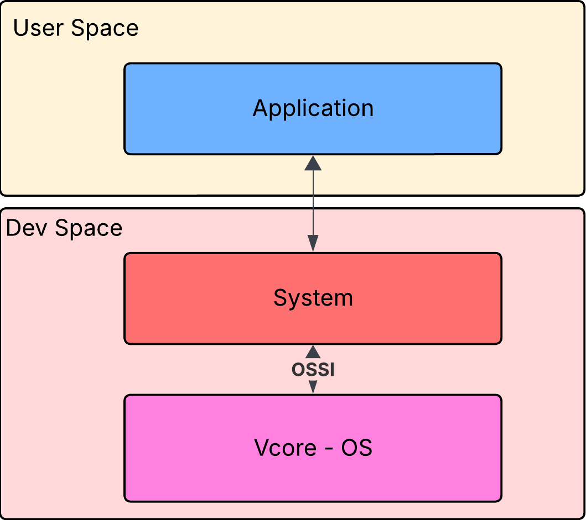
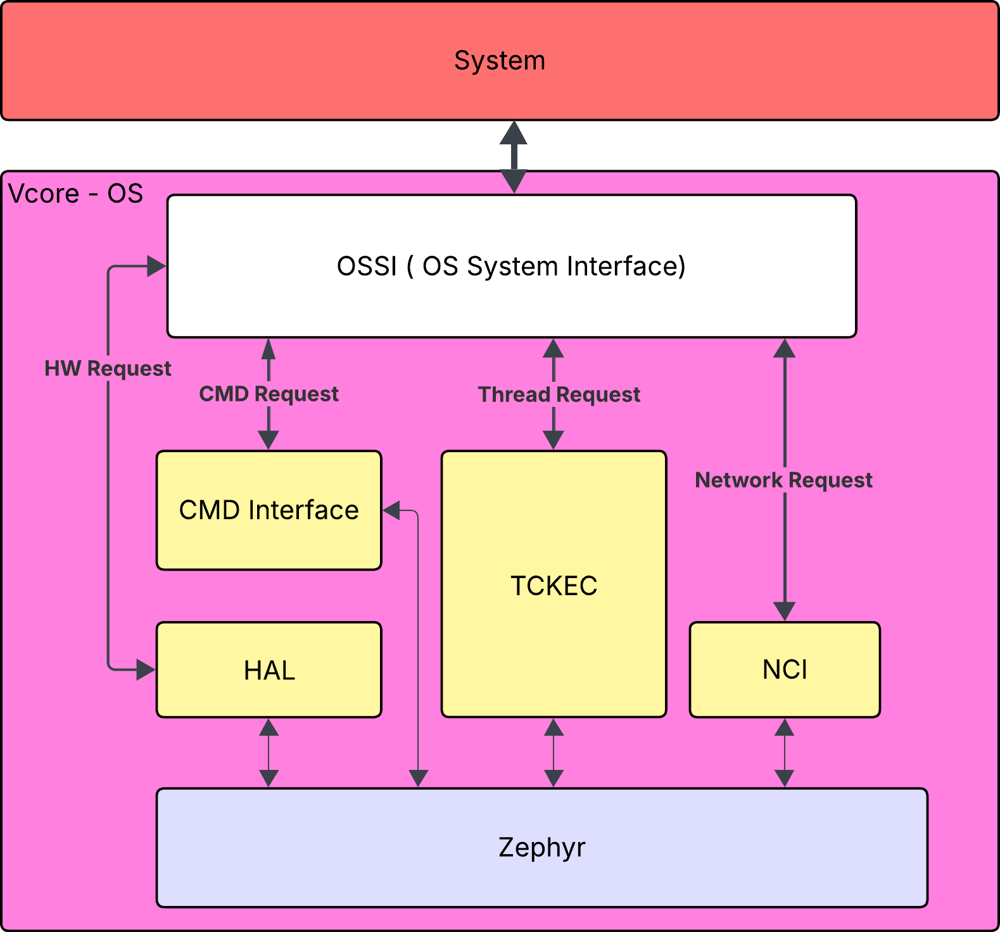
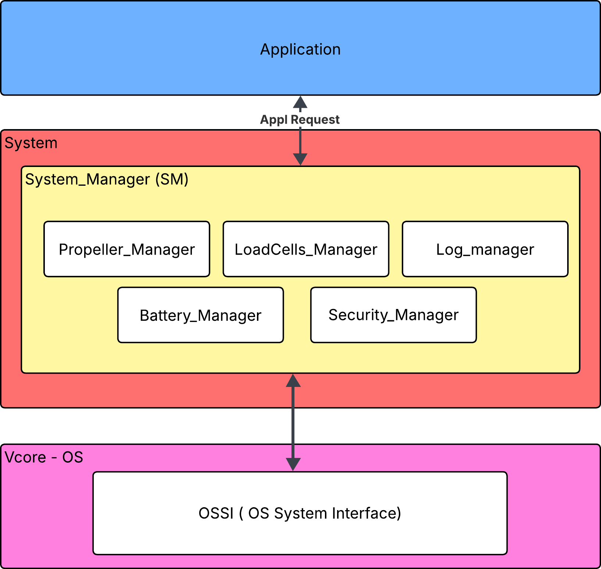

# SIBA BOARD - Sistema Integrado da Bancada Aerodinâmica
A placa SIBA tem o principal proposito de medir parâmetros relacionados a hélice e a interface da bateria, para entender mais sobre a placa do BLDC olhe a documentação da SAME (Sistema de Aquisição do Motor Elétrico)

## Requisitos do Sistema
Para compilar e interagir o código da SIBA, é necessário as seguinte ferramentas e HW

- Hardware: CH32V307VTC6 + PC
- Toolchain: Zephyr SDK, Make, Cmake, Ninja, Python e outras ferramentas que podem ser baixadas no [Zephyr Docs](https://docs.zephyrproject.org/latest/develop/getting_started/index.html)

### Comandos principais: 

```
make clean
make build
make flash
make menuconfig
```

## Arquitetura do Software
O arquitetura SIBA é quebrado em 3 camadas, em Vcore - OS, System e Application. O Vcore é o sistema operacional da placa, é onde lida-se com arquitetura física da placa e da comunicação, o Vcore usa do Zephyr para abstrair mais ainda o HW e facilitar o desenvolvimento dos threads. O System é a ultima camada no Dev Space, a ideia do System é gerenciar parte da arquitetura geral, ou seja bateria, hélice, celula de carga, comunicação e a segurança do sistema. Já a Application é a camada geral. OSSI (Operating System Standard Interface) é utilizado como barramento central de comunicação inter-threads, garantindo segurança de memória via passagem por valor.


### Vcore - OS



CMD - Interface de comando: Atua como o interpretador central. Recebe pacotes binários brutos, valida comandos e roteia a instrução para o subsistema responsável através do OSSI.

TCKEC - Thread Create Kill Executive Control: Gerenciador do ciclo de vida de threads. Executa a criação e destruição dinâmica, diferenciando processos para fins de gerenciamento de energia.

HAL - Hardware Abstraction Layer: Interface direta com os periféricos, isolando as camadas superiores das particularidades dos registradores do hardware.

NCI - Network Core Interface: Interface da pilha de rede UDP e sockets. Implementa bloqueio inteligente com timeouts no OSSI, garantindo latência mínima e baixo consumo de CPU.

OSSI - OS System Interface: o OSSI não é uma thread, é o barramento de comunicação ([IPC](https://en.wikipedia.org/wiki/Inter-process_communication)). É a esteira rolante da fábrica. Nenhuma thread do Vcore ou do System fala diretamente com outra. Se o NCI quer falar com o CMD, ele coloca o dado no OSSI. Isso garante que o sistema nunca trave por causa de concorrência de memória (race conditions)

### System Manager



Propeller Manager: Controle de parâmetros da hélice e processamento de dados da célula de carga.

Battery Manager: Monitoramento de tensão, corrente e integridade das células de energia.

Security Manager: Monitoramento de limites operacionais e execução de rotinas de emergência.

Log Manager: Agregador de telemetria. Agrupa comandos recebidos e logs de sensores em formato de lote (`{cmds | logs})` para otimizar o uso da rede no envio ao PC.

### Application
Ponto de entrada do sistema (main.c). É responsável por inicializar o Vcore, solicitar a criação das threads base ao TCKEC e gerenciar a máquina de estados global do sistema SIBA.