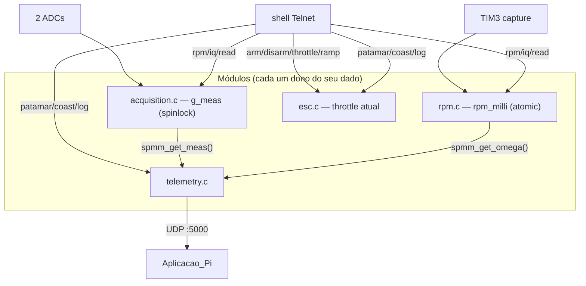
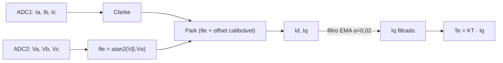
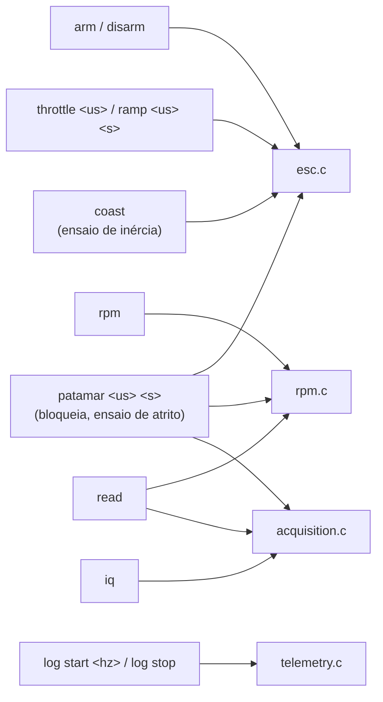
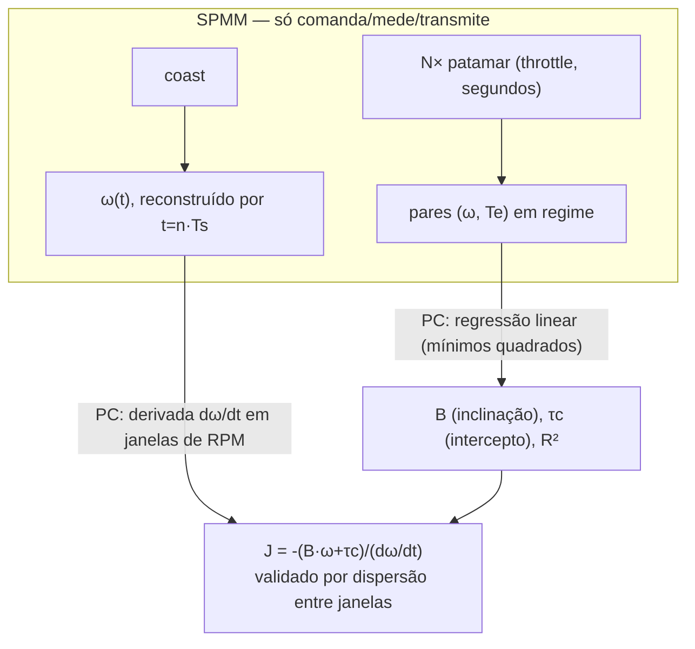

# SPMM — Sistema Provisório de Medição Mecânica

> [README principal](../../README.md) · [Visão geral do software](../README.md) · [Aplicação de supervisão](../Aplicacao_Pi/README.md)

| | |
|---|---|
| **MCU** | CH32V307VCT6 (RISC-V, 144 MHz) · Zephyr RTOS |
| **Rede** | Telnet `169.254.97.150:23` (comandos) + UDP `:5000` (log binário, 100 Hz por padrão) |
| **Mede** | Tensões e correntes das 3 fases e RPM (sensor independente da comutação) |
| **Aciona** | ESC comercial próprio (PWM 50 Hz) |
| **Ensaios** | Atrito viscoso B e de Coulomb τc (patamares) · inércia J (coast-down) |

**Sumário:** [Build](#build) · [Arquitetura](#como-a-placa-é-organizada-por-dentro) · [Shell](#comandos-do-shell-telnet) · [Log UDP](#protocolo-do-log-de-telemetria-udp-binário) · [Ensaios](#os-ensaios--o-que-cada-um-mede-e-por-quê) · [Parâmetros](#parâmetros-do-motor-sob-ensaio)

## O que é essa placa e por que ela existe

O SPMM é uma bancada de caracterização **provisória** — não é uma das duas
placas definitivas do projeto (essas são a [SIBA](../SIBA/) e a
[SAME](../SAME/)) — construída para medir três propriedades **mecânicas**
do conjunto motor+hélice+eixo antes de a bancada definitiva estar pronta e
validada em hardware real:

- **Atrito viscoso** ($B$): a parcela da perda mecânica que cresce
  proporcionalmente à velocidade de rotação (atrito de rolamentos
  lubrificados, arrasto aerodinâmico do próprio eixo/hélice em vazio).
- **Atrito de Coulomb** ($\tau_c$): a parcela constante, independente da
  velocidade (atrito seco/estático nos rolamentos e vedações).
- **Momento de inércia** ($J$): a resistência do conjunto rotativo
  (rotor do motor + eixo + hélice) a mudanças de velocidade angular.

Esses três parâmetros são necessários para o modelo mecânico completo do
motor — por exemplo, é o que permitiria isolar, do torque eletromagnético
medido pela SAME, a parcela que efetivamente sobra para acelerar/mover a
hélice (`torque_helice = T_e - (B\omega + \tau_c)`, ver
`../SAME/README.md`), e para prever a resposta dinâmica do conjunto em
manobras.

O motivo de existir uma placa separada e provisória para isso, em vez de
esperar a SIBA/SAME estarem prontas: essas duas placas definitivas
dependiam de hardware específico (PCB própria, sensores calibrados) que
ainda estava em desenvolvimento; o SPMM foi montado com um microcontrolador
avulso e um ESC comercial genérico, priorizando **rapidez de montagem**
sobre acabamento, só para não bloquear a caracterização mecânica enquanto
o resto do projeto avançava. Por isso o firmware aqui é propositalmente
mais simples que o das outras duas placas: não há barramento de mensagens
interno, não há gerenciador de segurança dedicado, e a interação é feita
por texto simples via Telnet em vez de um protocolo binário compacto.

O SPMM **não gera o sinal trifásico do motor** — quem faz isso é um ESC
comercial de aeromodelismo, igual ao que a SIBA também comanda. O SPMM só:
**comanda o throttle** desse ESC (um sinal de PWM de servo, igual ao da
SIBA), **mede as tensões e correntes das 3 fases** entre o ESC e o motor, e
**lê a rotação** por um sensor óptico/Hall independente. Roda num
**CH32V307VCT6** dedicado, sobre **Zephyr RTOS**.

Projeto de TCC — Equipe Albatroz Aerodesign, UDESC Joinville.

## Princípio de projeto: o firmware só comanda, mede e transmite

Toda a matemática de pós-processamento — a regressão linear que extrai
$B$ e $\tau_c$, a derivada numérica $d\omega/dt$ usada para extrair $J$ —
roda **depois, no PC, em Python**, nunca dentro do firmware. A decisão de
manter o firmware "burro" (sem mínimos quadrados, sem diferenciação
numérica embarcada) existe porque esse tipo de conta é mais fácil de
depurar, revisar e até refazer com métodos diferentes quando está rodando
em Python com todas as bibliotecas de análise numérica disponíveis, do que
dentro de um microcontrolador com ponto flutuante limitado — e porque o
firmware sendo simples reduz a chance de um bug de cálculo silencioso
acontecer justamente onde ele seria mais difícil de perceber (dentro da
placa, sem visibilidade fácil).

## Build

```bash
make build           # placa real (CH32V307), gera zephyr.bin
make flash           # grava via WCH-LinkE (OpenOCD)
make native_sim       # compila para rodar como processo POSIX no PC
make native_sim_run   # roda o binário native_sim
make debug            # OpenOCD + GDB
```

No modo `native_sim`, cada um dos três módulos de hardware (`esc.c`,
`rpm.c`, `acquisition.c`) tem um bloco `#ifdef CONFIG_ARCH_POSIX` que troca
a leitura/escrita de hardware real por um valor sintético — o throttle
fica só guardado em uma variável, o RPM sintético persegue esse throttle
como se fosse um motor de verdade respondendo (com atraso de primeira
ordem), e a aquisição sintetiza as 6 fases elétricas a partir desse RPM
sintético, passando pelo **mesmo código** de processamento (Clarke/Park)
que seria usado com dados reais do ADC. A rede continua sendo real (os
mesmos sockets UDP/TCP do Linux), então dá para testar o shell Telnet e o
streaming de dados sem hardware nenhum.

---

## Como a placa é organizada por dentro

Diferente da SIBA e da SAME, aqui **não existe uma fila de trabalho
central** (não há um `siba_wq`/`same_wq` equivalente) — o SPMM foi
deliberadamente mantido mais simples, porque tem só 3 fontes de dado
independentes (aquisição elétrica, rotação, e o próprio ESC) e o volume de
troca de estado entre elas é pequeno o bastante para não justificar a
complexidade extra de um barramento único. Em vez disso, cada módulo
guarda seu próprio último valor numa variável protegida por um mecanismo
de exclusão simples (`spinlock` ou `atomic`, dependendo do tamanho do
dado), e quem precisa desse valor — o shell, a telemetria — simplesmente
lê essa variável quando quiser, por meio de uma função "getter" exposta
pelo módulo dono do dado.



### As três (na real, quatro) threads e como se comunicam

| Thread | Prioridade Zephyr | Período | O que faz | Onde publica o resultado |
|---|---|---|---|---|
| `acq` (aquisição) | 4 (a mais alta) | acorda a cada 1 ms (~1 kHz) | Lê os dois ADCs (correntes e tensões das 3 fases), calcula Clarke+Park | Escreve numa struct `g_meas` protegida por `k_spinlock` |
| `rpm` | 6 | acorda a cada 100 ms | Lê quantos pulsos o contador de hardware acumulou na última janela, converte para RPM | Escreve num inteiro `atomic_t` (não precisa de spinlock — é uma palavra só) |
| `telemetry` | 7 (a mais baixa) | variável (o período do log ativo), ou dorme indefinidamente se o log estiver parado | Monta pacotes com as leituras mais recentes de `acq`/`rpm` e manda por UDP | — (só consome, não publica nada) |
| shell (Telnet) | baixa, controlada pelo próprio subsistema de Shell do Zephyr | bloqueada esperando o usuário digitar algo | Interpreta os comandos de texto (ver tabela abaixo) | chama funções dos outros três módulos diretamente |

Em Zephyr, **número menor de prioridade significa mais precedência de
execução** quando duas threads estão prontas ao mesmo tempo. A ordem aqui
(aquisição=4 mais prioritária, depois rpm=6, depois telemetria=7, e o
shell na prioridade mais baixa de todas) é deliberada: a aquisição precisa
rodar num intervalo de tempo **constante** (1 ms) para que o cálculo de
corrente/torque não fique com ruído de amostragem irregular — se a
telemetria ou o shell pudessem atrasar a aquisição, o intervalo de tempo
entre amostras variaria de forma imprevisível, distorcendo qualquer
cálculo que dependa desse intervalo ser conhecido e constante.

Por que essas três threads **não competem de verdade** pela CPU na
prática: `acq` roda um cálculo curto (Clarke+Park são só multiplicações e
somas) e volta a dormir 1 ms; `rpm` só acorda a cada 100 amostras de
`acq` para fazer uma conta ainda mais simples; e o shell fica a maior
parte do tempo **bloqueado esperando entrada de texto** — o custo dele
enquanto ocioso é essencialmente zero (memória de stack reservada, não
CPU). A única thread que de fato pode competir de perto com a aquisição é
a telemetria, quando está streamando em alta taxa (até 1 kHz num
coast-down) — e é exatamente por isso que ela tem a prioridade mais baixa
das três.

### Medição elétrica completa — as 3 fases medidas de verdade, não reconstruídas

Um jeito comum e mais barato de medir corrente trifásica é medir só duas
fases e calcular a terceira pela lei de Kirchhoff das correntes (como não
há neutro, $i_a + i_b + i_c = 0 \Rightarrow i_c = -(i_a+i_b)$). O SPMM
**não faz isso** — ele mede as **três correntes** (um ADC de 3 canais) e
as **três tensões** de fase (outro ADC de 3 canais) diretamente. A
vantagem de medir tudo é poder usar a soma $i_a+i_b+i_c$ como um
diagnóstico de desbalanceamento/erro de sensor (se a soma não for
aproximadamente zero, alguma das três medidas está com problema), em vez
de simplesmente assumir que está tudo certo.

O ângulo elétrico do rotor ($\theta_e$), necessário para separar a
corrente nos eixos direto/quadratura (transformada de Park), **não vem do
sensor de rotação** — o sensor de pulsos (7 por volta) é grosseiro demais
para dar um ângulo contínuo e preciso. Em vez disso, o firmware deriva
$\theta_e$ do próprio **vetor de tensão** aplicado pelo ESC:

$$V_\alpha = \frac{2V_a - V_b - V_c}{3} \qquad V_\beta = \frac{2}{\sqrt3}\left(\frac{V_b-V_c}{2}\right)$$
$$\theta_e = \mathrm{atan2}(V_\beta, V_\alpha) + \theta_{offset}$$

A ideia é que o ESC já está aplicando uma tensão numa direção elétrica
conhecida a cada instante da comutação — medir essa direção diretamente
evita ter que estimar o ângulo com um observador, ao custo de não
corrigir eventuais atrasos de fase entre a tensão aplicada e o fluxo
magnético real do rotor ($\theta_{offset}$ existe justamente para
compensar esse deslocamento fixo, calibrável em bancada). Com $\theta_e$
em mãos, a transformada de Park separa a corrente nos eixos $d$/$q$:

$$I_d = I_\alpha \cos\theta_e + I_\beta \sin\theta_e \qquad I_q = -I_\alpha \sin\theta_e + I_\beta \cos\theta_e$$

$I_q$ (a componente em quadratura) é proporcional ao torque produzido; por
causa da comutação de 6 degraus do ESC (6-step), o $I_q$ instantâneo tem
uma ondulação (ripple) na frequência de comutação, então o firmware
mantém uma média móvel exponencial filtrada (constante $\alpha=0{,}02$,
ou seja, cada amostra nova pesa 2% sobre o valor anterior — um filtro
bem lento, adequado porque o que interessa é o torque médio em regime, não
a variação instantânea):

$$I_{q,filtrado} \leftarrow I_{q,filtrado} + 0{,}02 \, (I_q - I_{q,filtrado}) \qquad T_e = K_T \cdot I_{q,filtrado}$$

onde $K_T = 9{,}5493/K_v$ é a constante de torque, derivada do $K_v$
comercial do motor (a mesma relação usada na SAME).



### Rotação — por que precisa de um sensor mecânico independente

A rotação é lida por um sensor óptico ou Hall, contando pulsos por uma
janela de tempo fixa (100 ms) com o recurso de captura de hardware do
microcontrolador (input capture — o hardware marca o instante de cada
pulso sem intervenção da CPU). Isso é necessário porque, no ensaio de
inércia (coast-down), o throttle é cortado — sem excitação elétrica no
motor, não há mais BEMF nem comutação para se extrair ângulo/velocidade
das grandezas elétricas, então só um sensor mecânico independente
continua informando a rotação durante a desaceleração livre, que é
justamente a parte mais importante desse ensaio.

---

## Comandos do shell (Telnet)

A interação com a placa é feita por um shell de texto simples, acessível
por **Telnet (TCP, porta 23)** — diferente da SIBA (que usa UART) e da
SAME (que não tem shell nenhum), a escolha aqui foi por rede porque a
bancada provisória não tinha um cabo serial já disponível/confiável e
Telnet é trivial de implementar sobre o subsistema de rede que o Zephyr já
oferece. Os comandos ficam **no nível raiz** (`arm`, `throttle`, etc.), sem
prefixo — diferente do `siba <comando>` agrupado da placa SIBA.



| Comando | Argumentos | O que faz | Por que existe |
|---|---|---|---|
| `arm` | — | Aplica o pulso mínimo (1000 µs) por 2 segundos — a sequência de segurança padrão de um ESC de RC | Sem isso, o ESC ignoraria qualquer comando de throttle por segurança (evita que o motor dispare ao ligar) |
| `disarm` | — | Volta o pulso para 1000 µs e desarma | Desligamento seguro |
| `throttle <us>` | pulso em microssegundos, 1000-2000 | Define o throttle diretamente | Recusa se o ESC não estiver armado |
| `ramp <us> <s>` | pulso alvo, duração em segundos | Interpola suavemente do throttle atual até o alvo, em passos de 50 ms | Evita um degrau brusco de corrente/torque que uma mudança instantânea de throttle causaria |
| `rpm` | — | Imprime a rotação atual (RPM e rad/s) | Consulta rápida sem precisar do dump completo |
| `iq` | — | Imprime só o $I_q$ filtrado atual | idem |
| `read` | — | Imprime tudo: RPM, $\omega$, $T_e$, $I_q$, $I_d$, $\theta_e$, e as 6 grandezas de fase (`ia,ib,ic,va,vb,vc`) | Formato "chave=valor", pensado para ser parseado facilmente por um script |
| `patamar <us> <s>` | throttle, tempo de espera | Aplica o throttle, **bloqueia** pelo tempo indicado esperando o motor estabilizar, e então imprime o ponto de regime $(\omega, T_e)$ | Esse é o comando que gera cada ponto do ensaio de atrito — ver seção de equações abaixo |
| `coast` | — | Corta o throttle para o mínimo (1000 µs) | Dispara a desaceleração livre do ensaio de inércia |
| `log start <hz>` | taxa em Hz | (Re)configura a taxa do streaming de telemetria por UDP | Por padrão a telemetria já sai a 100 Hz desde o boot; um ensaio de inércia tipicamente sobe essa taxa para capturar o decaimento com mais resolução temporal |
| `log stop` | — | Pausa o streaming | — |

O comando `patamar` **bloqueia o shell** pelo tempo de espera pedido — isso
é intencional: o script/GUI que orquestra o ensaio espera a resposta do
comando antes de mandar o próximo, então o bloqueio simplesmente sincroniza
os dois lados sem precisar de um mecanismo de espera separado. Esse
bloqueio não afeta a thread de aquisição, que roda com prioridade mais
alta e de forma completamente independente do shell.

## Protocolo do log de telemetria (UDP, binário)

O streaming de dados sai continuamente por UDP (porta 5000, a 100 Hz por
padrão, desde o boot) como um pacote binário compacto — texto seria mais
fácil de ler "a olho nu", mas custaria muito mais bytes por amostra, o que
importa quando se quer capturar um coast-down inteiro numa taxa alta (até
1000 Hz) sem saturar a rede:

```c
#pragma pack(push, 1)
typedef struct {
    uint32_t n;         // índice sequencial da amostra
    float    omega;     // velocidade mecânica, rad/s
    float    te;         // torque estimado, N·m (= KT * iq filtrado)
    float    iq;         // corrente de eixo q filtrada, A
    float    id;         // corrente de eixo d, A
    float    theta_e;    // ângulo elétrico estimado, rad
    float    ia, ib, ic;    // correntes de fase instantâneas, A
    float    va, vb, vc;    // tensões de fase instantâneas, V
} spmm_sample_t;   // 48 bytes por amostra

typedef struct {
    uint16_t      count;    // quantas amostras vêm neste pacote
    uint16_t      ts_us;    // período de amostragem, em microssegundos
    spmm_sample_t s[];      // até 20 amostras por pacote (964 bytes, abaixo do MTU Ethernet)
} spmm_pkt_hdr_t;
#pragma pack(pop)
```

### Por que o tempo é reconstruído por um contador, não pelo relógio da rede

Este é o ponto mais importante do protocolo, e o motivo de existir o
campo `n`: seria mais simples, à primeira vista, o PC simplesmente anotar
o horário de chegada de cada pacote UDP e usar isso como o eixo do tempo.
Isso **não funciona** para calcular a derivada $d\omega/dt$ do ensaio de
inércia, por dois motivos: (1) pacotes UDP não chegam em intervalos
perfeitamente regulares — o sistema operacional do PC, a pilha de rede, e
o próprio Wi-Fi/Ethernet introduzem uma variação (jitter) de alguns
milissegundos que corromperia diretamente a precisão de uma derivada
numérica, que é muito sensível a erros no denominador ($\Delta t$); e (2)
pacotes UDP podem se perder ou chegar fora de ordem, e não haveria como
detectar isso só olhando o relógio do PC. A solução: cada amostra carrega
um **contador sequencial `n`**, incrementado pelo próprio firmware a cada
amostra gerada, e o PC reconstrói o instante de cada amostra como

$$t_n = n \cdot T_s$$

onde $T_s$ vem do campo `ts_us` do próprio pacote (o período real que foi
configurado com `log start <hz>`). Como $T_s$ é derivado do cristal do
microcontrolador — muito mais estável que qualquer relógio de rede — o
$\Delta t$ usado na derivada fica preciso independente de qualquer jitter
de rede. E como perda/reordenação de pacotes agora aparece como um salto
no valor de `n` (por exemplo, `n` pulando de 100 para 105, faltando 4
amostras), isso vira **detectável** e pode ser tratado (marcando o buraco)
em vez de silenciosamente distorcer a conta.

---

## Os ensaios — o que cada um mede e por quê

Os dois ensaios abaixo são feitos comandando a placa pelo shell (Telnet),
seja digitando os comandos manualmente, seja por um cliente automatizado
(a GUI `Aplicacao_Pi`, ver `SPMMEnsaioDialog` em
`../Aplicacao_Pi/README.md`, que orquestra exatamente a mesma sequência de
comandos descrita abaixo).



### Atrito viscoso ($B$) e atrito de Coulomb ($\tau_c$)

Procedimento: com o motor girando **em regime permanente** (velocidade
constante, sem aceleração) em vários níveis de throttle diferentes,
mede-se o par $(\omega, T_e)$ em cada nível:

```
arm
patamar 1200 3      # throttle 1200us, espera 3s estabilizar, imprime (ω, Te)
patamar 1300 3
patamar 1400 3
...                 # cobrir uma faixa de rotação razoável
```

A física por trás: em regime permanente, a aceleração angular é zero
($d\omega/dt = 0$), então, pela segunda lei de Newton para rotação, todo o
torque eletromagnético produzido pelo motor é consumido **inteiramente**
pelas perdas mecânicas — não sobra torque líquido para acelerar nada. O
modelo de atrito adotado (o mais simples que captura tanto uma perda que
cresce com a velocidade quanto uma perda que não depende dela) é linear
em $\omega$ com um termo constante:

$$T_e = B\,\omega + \tau_c$$

Com vários pares $(\omega_k, T_{e,k})$ medidos em diferentes níveis de
throttle, ajusta-se uma **reta** por mínimos quadrados sobre esses pontos
— a inclinação da reta é $B$ e o intercepto (onde a reta cruzaria
$\omega=0$) é $\tau_c$. Essa regressão roda no PC
(`Aplicacao_Pi/Communication_Data/spmm_analysis.py::fit_atrito`, resolvida
em forma fechada por álgebra direta, sem depender de bibliotecas de
álgebra linear como LAPACK — isso evita que dados degenerados vindos de
uma bancada desconectada, por exemplo com $\omega$ praticamente constante
em todos os pontos, causem um erro de biblioteca em vez de simplesmente
devolver um resultado marcado como inválido). A qualidade do ajuste é
reportada pelo coeficiente de determinação $R^2$ — próximo de 1 indica que
os pontos realmente caem sobre uma reta, validando a hipótese do modelo
linear de atrito; um $R^2$ baixo sugere que existe alguma perda mecânica
não capturada por esse modelo simples (por exemplo, atrito que varia com
o quadrado da velocidade, típico de arrasto aerodinâmico).

### Momento de inércia ($J$) — desaceleração livre (coast-down)

Procedimento: leva-se o motor a uma rotação alta e, de repente, corta-se
totalmente o throttle, deixando o conjunto desacelerar livremente por
atrito, enquanto se registra $\omega(t)$ durante toda a desaceleração:

```
arm
throttle 1800       # sobe a rotação
log start 1000      # aumenta a taxa de log para capturar bem o decaimento
coast                # corta o throttle; o log em andamento streama ω(t) do decaimento
```

Sem excitação elétrica ($T_e = 0$), a única coisa desacelerando o conjunto
é o próprio atrito medido no ensaio anterior — a segunda lei de Newton
para rotação dá:

$$J\,\frac{d\omega}{dt} = -(B\,\omega + \tau_c)$$

Isolando $J$ para cada ponto da curva de decaimento (usando o $B$ e
$\tau_c$ já conhecidos do ensaio de atrito):

$$J = \frac{-(B\,\omega + \tau_c)}{d\omega/dt}$$

(o sinal funciona porque $d\omega/dt$ é negativo durante a desaceleração,
e o numerador também é negativo, resultando em $J>0$, como tem que ser
fisicamente). Como a derivada numérica é sensível a ruído, calcula-se $J$
não num único ponto, mas em **várias janelas de RPM diferentes** ao longo
da mesma curva de decaimento — se o valor de $J$ calculado permanecer
aproximadamente constante entre janelas, isso valida a medição; se $J$
variar sistematicamente com a rotação, é sinal de que o modelo de atrito
($B$, $\tau_c$) usado está incompleto ou incorreto para aquela faixa de
velocidade.

**Alternativa por constante de tempo (verificação cruzada, opcional)**:
se o atrito de Coulomb for desprezível ($\tau_c \approx 0$), a equação
acima se resolve numa exponencial pura, $\omega(t) = \omega_0
e^{-t/T}$, e $J = B \cdot T$, onde $T$ é a constante de tempo ajustada
diretamente sobre a curva medida — um jeito independente de checar o
resultado do método da derivada quando o atrito seco é pequeno.

## Parâmetros do motor sob ensaio

Motor: **Scorpion A-5025-310Kv**, enrolamento em Delta (6T/7T), 14 polos
($p=7$ pares de polos). Parâmetros elétricos já caracterizados por outro
método (ensaio de rotor bloqueado, ver `../SAME/README.md`), usados aqui só
como referência — não entram diretamente nas contas mecânicas acima:
$R_Y \approx 8{,}69\text{ m}\Omega$ (o valor de datasheet é $8{,}65\text{
m}\Omega$, uma diferença de 0,46%) e $L_Y \approx 6{,}95\text{ µH}$.

---

Licença: **MIT** (ver `../../LICENSE`).
