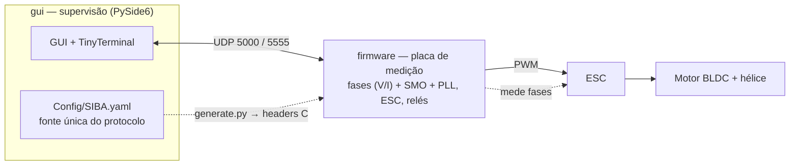

<div align="center">

# Bancada de Medição para Sistemas Propulsivos Elétricos com BLDC

**Trabalho de Conclusão de Curso · Engenharia Elétrica · UDESC Joinville (2026)**
Desenvolvido em parceria com a equipe **Albatroz Aerodesign**


-283272)


</div>

---

## Sumário

- [Sobre o projeto](#sobre-o-projeto)
- [Arquitetura](#arquitetura)
- [Estrutura do repositório](#estrutura-do-repositório)
- [Primeiros passos](#primeiros-passos)
- [Fundamentação](#fundamentação)
- [Hardware caracterizado](#hardware-caracterizado)
- [Status](#status)
- [Ferramentas](#ferramentas)
- [Declaração de uso de IA](#declaração-de-uso-de-ia)
- [Autor](#autor)

---

## Sobre o projeto

Este repositório reúne o TCC completo: um **sistema de aquisição para ensaios
de conjuntos motopropulsores com motor BLDC**, do firmware ao texto final. Uma
placa de medição adquire as tensões e correntes de fase do motor, aciona o
controlador e os relés de potência e envia a telemetria por Ethernet a uma
aplicação de supervisão no PC.

O ponto central é estimar **velocidade angular e torque no eixo sem sensores
mecânicos**. Para isso, a placa executa um **Observador por Modos Deslizantes
(SMO)** associado a um **PLL**, reconstruindo a força contraeletromotriz (BEMF)
a partir das correntes e tensões de fase.

### Objetivos

1. Projetar e implementar o sistema de medição do motor BLDC (sensores de
   corrente por fase, condicionamento de sinal e aquisição sincronizada).
2. Modelar o motor no referencial αβ e projetar o observador (SMO + PLL) para
   estimar BEMF, velocidade e torque.
3. Integrar medição, acionamento e segurança na placa de medição.
4. Integrar a placa e a aplicação de supervisão em uma rede Ethernet (UDP).
5. Desenvolver a aplicação de supervisão em Python (monitoramento, calibração,
   registro em CSV, alarmes e estimação de parâmetros).

---

## Arquitetura

O sistema tem **uma placa de medição**, baseada no microcontrolador
**CH32V307VCT6** (RISC-V, 144 MHz, FPU e Ethernet MAC+PHY integrados) com
**Zephyr RTOS**, e uma aplicação de supervisão no PC. A placa absorveu as
funções da antiga SAME, que queimou; no código ela ainda se chama `SIBA`.



**Firmware.** Nenhuma thread mexe diretamente no estado de outra: valores
medidos e comandos de rede entram numa **fila de trabalho única** (OSSI) que
serializa a lógica (segurança, telemetria, comandos). A aquisição das fases
tem fila própria, que roda Clarke + SMO + PLL a cada quadro do ADC. Os módulos
principais são `NCI` (rede), `HAL` (periféricos), `OSSI` (fila), `CMD_Core`
(comandos) e os *managers* de domínio.

**Protocolo gerado.** `gui/Config/SIBA.yaml` é a **fonte única da verdade** do
protocolo. O `generate.py` gera, via Jinja2, os headers C do firmware, e a GUI
lê o mesmo YAML em tempo de execução. **Os headers gerados nunca são editados
à mão.**

**Três modos de execução.** Hardware real, simulador Python (só para testar a
interface) ou `native_sim`, que roda o firmware de verdade como processo Linux,
com UDP real em loopback.

> O detalhamento de cada parte está nos READMEs das pastas, indicados na
> tabela abaixo.

---

## Estrutura do repositório

```text
.
├── firmware/                 Firmware Zephyr da placa de medição
├── gui/                      Aplicação de supervisão (PySide6) + protocolo + scripts
│   ├── Config/               YAML do protocolo, templates Jinja2 e generate.py
│   ├── Scripts/              Simulação do SMO, autotuning, coeficientes da hélice
│   └── Ensaios/              Scripts e registros dos ensaios de bancada
├── docs/
│   ├── TCC_documento/        Texto do TCC em LaTeX (abnTeX2, modelo UDESC)
│   └── TCC_apresentacao/     Slides da defesa em Beamer (tema UDESC)
├── legado/                   Código antigo fora do build (Equations, Teste)
├── Simulacoes/               LTspice e FEMM (sensor de corrente)
├── Esquematicos/             Esquemáticos
└── Figuras/                  Figuras de arquitetura usadas fora do LaTeX
```

| Pasta | Documentação |
|---|---|
| `firmware/` | [Firmware da placa de medição](firmware/README.md) |
| `gui/` | [Aplicação de supervisão](gui/README.md) · [Geração do protocolo](gui/Config/README.md) |
| `docs/TCC_documento/` | [Como compilar o texto](docs/TCC_documento/README.md) |
| `docs/TCC_apresentacao/` | [Como compilar os slides](docs/TCC_apresentacao/README.md) |

---

## Primeiros passos

Os atalhos ficam no `Makefile` da raiz (`make help`):

```bash
make gui                     # aplicação de supervisão
make protocolo               # regenera os headers C a partir de gui/Config/SIBA.yaml
make firmware                # compila para a placa real (requer Zephyr SDK e west)
make flash                   # grava na placa
make native_sim              # compila o firmware para rodar no PC (Linux)
make documento               # texto do TCC
make apresentacao            # slides
```

---

## Fundamentação

### Modelo do motor

Tensão de fase do BLDC em estrela, para k ∈ {a, b, c}:

```text
v_k = R·i_k + L·(di_k/dt) + e_k
```

No referencial estacionário αβ (transformada de Clarke):

```text
⎡v_α⎤     ⎡i_α⎤         d ⎡i_α⎤   ⎡e_α⎤
⎢   ⎥ = R ⎢   ⎥ + L_s · ──⎢   ⎥ + ⎢   ⎥
⎣v_β⎦     ⎣i_β⎦        dt ⎣i_β⎦   ⎣e_β⎦
```

### Observador por Modos Deslizantes

Discretizado por Euler progressivo, com coeficientes invariantes ao passo de
amostragem T_s:

```text
Φ_i = 1 − R_s·T_s / L_s      Γ_v = T_s / L_s      Γ_s1 = K_s1·T_s      Γ_s2 = K_s2·T_s

î[k+1] = Φ_i·î[k] + Γ_v·(v[k] − ê[k]) + Γ_s1·Sat(i[k] − î[k])
ê[k+1] = ê[k] + Γ_s2·Sat(i[k] − î[k])
```

Posição e velocidade são extraídas por um PLL a partir da BEMF estimada. O
torque eletromagnético é

```text
T̂_e = (3p / 4ω_e) · (ê_α·i_α + ê_β·i_β)
```

### Autotuning

Os ganhos (K_s1, K_s2, K_t) são ajustados offline por **Evolução
Diferencial**, otimizando diretamente os ganhos discretizados Γ (que vão
para o firmware sem depender de T_s). A função-custo combina **torque e RPM**
com perda de **Huber**, priorizando o torque (w_T = 1,0; w_ω = 0,5).

### Carga da hélice

No ensaio estático (V∞ ≈ 0):

```text
Q = C_Q·ρ·n²·D⁵   ⇒   Q = k_Q·ω_m²,   com   k_Q = C_Q·ρ·D⁵ / (4π²)
```

---

## Hardware caracterizado

| Item | Especificação |
|---|---|
| Motor | Scorpion A-5025-310Kv |
| Bateria | LiPo 6S 3300 mAh 40C |
| Hélices | APC 15×6E e APC 17×10E |
| MCU | WCH CH32V307VCT6, RISC-V 144 MHz, ADC 12 bits, Ethernet integrada |

**Parâmetros elétricos medidos**

| Parâmetro | Linha | Fase (estrela) | Método |
|---|---|---|---|
| Resistência | R_LL = 17,37 mΩ | R_Y = 8,69 mΩ | 4 fios (Kelvin) |
| Indutância | L_LL = 13,90 µH | L_Y = 6,95 µH | Ressonância LC |

---

## Status

| Componente | Estado |
|---|---|
| Firmware da placa de medição | Fases (V/I) + SMO + PLL embarcado, ESC, relés e segurança; compila para a placa e para `native_sim` |
| Aplicação de supervisão | Funcional nos modos hardware, simulador e `native_sim` |
| Simulação do SMO + autotuning | Validada |
| Identificação dos parâmetros elétricos | Concluída (indutância também ajustada aos registros: L_Y ≈ 11,3 µH) |
| Ensaios com hélices APC 15x6E e 17x10E | Concluídos |

---

## Ferramentas

| Área | Ferramentas |
|---|---|
| Hardware | KiCad, LTspice, FEMM |
| Firmware | Zephyr RTOS, Zephyr SDK, OpenOCD (WCH-LinkE) |
| Software | Python, PySide6, pyqtgraph, NumPy, SciPy, Numba, Jinja2 |
| Texto | LaTeX (abnTeX2), TikZ, Beamer |

---

## Declaração de uso de IA

Ferramentas de IA generativa (ChatGPT, Claude, Gemini, DeepSeek, Claude Code)
foram usadas como apoio à revisão textual, à conferência de cálculos e ao
desenvolvimento e depuração de scripts. Todo o conteúdo foi revisado e validado
pelo autor, que assume responsabilidade integral pela precisão e originalidade.

---

## Autor

**Vitor Dall'Olivo Gonçalves** · Engenharia Elétrica, UDESC Joinville

Orientadora: Ana Teruko Yokomizo Watanabe · Coorientador: Aureo Guilherme Dobrikopf

Distribuído sob a licença [MIT](LICENSE).
