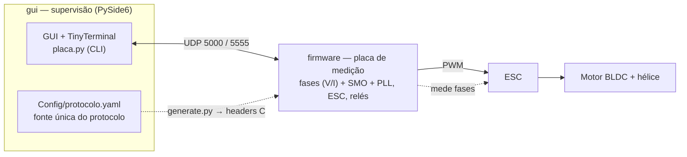

<div align="center">

# DESENVOLVIMENTO DE SISTEMA DE AQUISIÇÃO COM ESTIMAÇÃO POR MODO DESLIZANTE PARA BANCADA DE PROPULSÃO COM MOTOR BLDC

**Trabalho de Conclusão de Curso · Engenharia Elétrica · UDESC Joinville (2026)**


-283272)


</div>

---

## Sumário

- [Sobre o projeto](#sobre-o-projeto)
- [Arquitetura](#arquitetura)
- [Estrutura do repositório](#estrutura-do-repositório)
- [Primeiros passos](#primeiros-passos)
- [Hardware caracterizado](#hardware-caracterizado)
- [Status](#status)
- [Ferramentas](#ferramentas)
- [Declaração de uso de IA](#declaração-de-uso-de-ia)

---

## Sobre o projeto

Este repositório reúne o TCC completo, do firmware ao texto: um **sistema de
aquisição para ensaios de conjuntos motopropulsores com motor BLDC**. Uma placa
de medição lê as tensões e correntes de fase do motor, aciona o ESC e os relés
de potência e envia a telemetria por Ethernet a uma aplicação no PC.

A velocidade e o torque no eixo são **estimados sem sensores mecânicos**, por
um **Observador por Modos Deslizantes (SMO)** com **PLL** executado na própria
placa.

---

## Arquitetura

Uma **placa de medição** (CH32V307, RISC-V 144 MHz, Zephyr RTOS) e uma
**aplicação de supervisão** no PC, ligadas por UDP. Os comandos da placa também
funcionam de qualquer shell, pelo `gui/placa.py`.



- **Firmware:** medições e comandos passam por uma fila de trabalho única; a
  aquisição das fases tem fila própria, que roda o observador a cada quadro do
  ADC.
- **Protocolo:** definido só no `gui/Config/protocolo.yaml`. Os headers C do
  firmware são gerados a partir dele, e a GUI lê o mesmo arquivo.
- **Sem a placa:** o firmware também roda como processo Linux (`native_sim`),
  com UDP real em loopback.

Os detalhes estão nos READMEs de cada pasta.

---

## Estrutura do repositório

```text
.
├── firmware/                 Firmware Zephyr da placa de medição
├── gui/                      Aplicação de supervisão, CLI, protocolo e scripts
│   ├── Config/               protocolo.yaml, templates Jinja2 e generate.py
│   ├── Scripts/              Simulação do SMO, autotuning, coeficientes da hélice
│   └── Ensaios/              Scripts e registros dos ensaios
├── docs/
│   ├── TCC_documento/        Texto do TCC em LaTeX (abnTeX2, modelo UDESC)
│   └── TCC_apresentacao/     Slides da defesa em Beamer
├── legado/                   Código antigo fora do build
├── Simulacoes/               LTspice e FEMM (sensor de corrente)
├── Esquematicos/             Esquemáticos
└── Figuras/                  Figuras usadas fora do LaTeX
```

| Pasta | Documentação |
|---|---|
| `firmware/` | [Firmware da placa de medição](firmware/README.md) |
| `gui/` | [Aplicação de supervisão](gui/README.md) · [Geração do protocolo](gui/Config/README.md) |
| `docs/TCC_documento/` | [Como compilar o texto](docs/TCC_documento/README.md) |
| `docs/TCC_apresentacao/` | [Como compilar os slides](docs/TCC_apresentacao/README.md) |

---

## Primeiros passos

Atalhos do `Makefile` da raiz (`make help`):

```bash
make gui            # aplicação de supervisão
make protocolo      # regenera os headers C a partir do protocolo.yaml
make firmware       # compila para a placa (requer Zephyr SDK e west)
make flash          # grava na placa
make native_sim     # compila o firmware para rodar no PC (Linux)
make documento      # texto do TCC
make apresentacao   # slides
```

Comandos da placa pela linha de comando:

```bash
cd gui
.venv/bin/python placa.py tele                    # telemetria
.venv/bin/python placa.py set i_a linear 0.0809   # calibração
```

---

## Hardware caracterizado

| Item | Especificação |
|---|---|
| Motor | Scorpion A-5025-310Kv |
| Bateria | LiPo 6S 3300 mAh 40C |
| Hélices | APC 15×6E e APC 17×10E |
| MCU | WCH CH32V307VCT6, RISC-V 144 MHz, ADC 12 bits, Ethernet integrada |

**Parâmetros elétricos medidos (por fase, estrela)**

| Parâmetro | Valor | Método |
|---|---|---|
| Resistência | R_Y = 8,69 mΩ | 4 fios (Kelvin), R_Y = R_LL/2 |
| Indutância | L_Y ≈ 11,3 µH | Registros de osciloscópio (análise harmônica do circuito de fase) |

---

## Status

| Componente | Estado |
|---|---|
| Firmware | Fases (V/I), SMO + PLL, ESC, relés e segurança; compila para a placa e para `native_sim` |
| Aplicação de supervisão e CLI | Funcionais com a placa, com o simulador e com o `native_sim` |
| Simulação do SMO e autotuning | Validados |
| Parâmetros elétricos do motor | Medidos |
| Ensaios com as hélices APC 15x6E e 17x10E | Concluídos |

---

## Ferramentas

| Área | Ferramentas |
|---|---|
| Hardware | KiCad, LTspice, FEMM |
| Firmware | Zephyr RTOS, Zephyr SDK, OpenOCD (WCH-LinkE) |
| Software | Python, PySide6, pyqtgraph, NumPy, SciPy, Numba, Jinja2 |
| Texto | LaTeX (abnTeX2), TikZ, Beamer |

---

## Declaração de uso de IA

Ferramentas de IA generativa (ChatGPT, Claude, Gemini, DeepSeek, Claude Code)
foram usadas como apoio à revisão textual, à conferência de cálculos e ao
desenvolvimento e depuração de scripts. Todo o conteúdo foi revisado e validado
pelo autor, que assume responsabilidade integral pela precisão e originalidade.

Distribuído sob a licença [MIT](LICENSE).
