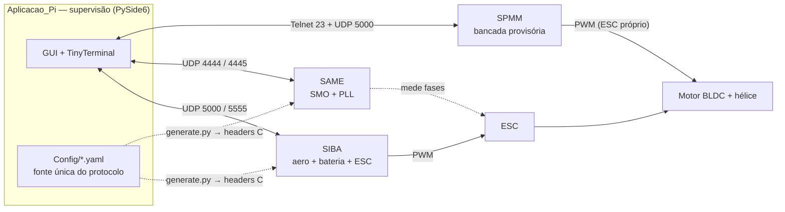

<div align="center">

# Bancada de Medição para Sistemas Propulsivos Elétricos com BLDC

**Trabalho de Conclusão de Curso · Engenharia Elétrica · UDESC Joinville (2026)**
Desenvolvido em parceria com a equipe **Albatroz Aerodesign**


-283272)


</div>

---

## Sumário

- [Sobre o projeto](#sobre-o-projeto)
- [Arquitetura](#arquitetura)
- [Estrutura do repositório](#estrutura-do-repositório)
- [Primeiros passos](#primeiros-passos)
- [Fundamentação](#fundamentação)
- [Hardware caracterizado](#hardware-caracterizado)
- [Status](#status)
- [Ferramentas](#ferramentas)
- [Declaração de uso de IA](#declaração-de-uso-de-ia)
- [Autor](#autor)

---

## Sobre o projeto

Este repositório reúne o TCC completo: uma **bancada de ensaios para conjuntos
motopropulsores com motor BLDC**, do firmware ao texto final. A bancada faz a
aquisição sincronizada das grandezas elétricas do motor, das forças
aerodinâmicas da hélice e da velocidade do escoamento, e serve como ferramenta
de caracterização para o projeto de aeronaves da equipe.

O ponto central é estimar **velocidade angular e torque no eixo sem sensores
mecânicos**. Para isso, a placa SAME executa um **Observador por Modos
Deslizantes (SMO)** associado a um **PLL**, reconstruindo a força
contraeletromotriz (BEMF) a partir das correntes e tensões de fase.

### Objetivos

1. Projetar e fabricar o hardware de medição elétrica do motor BLDC (sensores
   de corrente por fase, condicionamento de sinal e aquisição sincronizada de
   tensão).
2. Modelar o motor no referencial αβ e projetar o observador (SMO + PLL) para
   estimar BEMF, velocidade e torque.
3. Integrar os sensores aerodinâmicos da bancada (células de carga e tubo de
   Pitot) para medir tração, momentos e velocidade do escoamento.
4. Implementar a comunicação UDP/TCP entre os nós e a estação de supervisão.
5. Desenvolver o software de supervisão em Python (monitoramento em tempo real,
   calibração, registro em CSV, alarmes e estimação de parâmetros).

---

## Arquitetura

A bancada é formada por **dois nós de aquisição definitivos** e uma **bancada
provisória**, todos baseados no microcontrolador **CH32V307VCT6** (RISC-V,
144 MHz, FPU e Ethernet MAC+PHY integrados) e rodando **Zephyr RTOS**. Um único
programa de PC comanda os três.

| Placa | Nome | Papel |
|:---:|---|---|
| **SIBA** | Sistema Integrado da Bancada Aerodinâmica | Células de carga (6× HX711), Pitot, RPM, bateria e relés. **É a placa que aciona o ESC.** |
| **SAME** | Sistema de Aquisição do Motor Elétrico | Lê tensões e correntes das 3 fases e roda o SMO + PLL embarcado. **Só observa, nunca aciona.** |
| **SPMM** | Sistema Provisório de Medição Mecânica | Bancada provisória com ESC próprio, usada para medir atrito (B, τc) e inércia (J). |



**Firmware.** SIBA e SAME seguem a mesma arquitetura: nenhuma thread mexe
diretamente no estado de outra. Leituras de sensor e comandos de rede entram
numa **fila de trabalho única** (`siba_wq` / `same_wq`) que serializa toda a
lógica (calibração, segurança, telemetria). Só continuam como threads próprias
as tarefas que bloqueiam em hardware ou socket (aquisição e recepção de rede).
Os módulos principais são `NCI` (rede), `HAL` (periféricos), `OSSI` (fila),
`CMD_Core` (comandos) e os *managers* de domínio.

**Protocolo gerado.** Os arquivos `SIBA.yaml` e `SAME.yaml` em
`Codigos/Aplicacao_Pi/Config/` são a **fonte única da verdade** do protocolo.
O script `generate.py` gera, via Jinja2, os headers C do firmware
(`Common_Types.h`, `CMD.h`, `Log_Manager.h`, `Error_Codes.h`,
`CMD_Core_prm.h`, `Security_prm.h`), e a GUI lê os mesmos YAMLs em tempo de
execução. **Os headers gerados nunca são editados à mão.**

**Três modos de execução.** Cada placa pode ser usada com o hardware real, com
um simulador Python (só para testar a interface) ou em `native_sim`, que roda o
firmware de verdade como processo Linux, com UDP real em loopback.

> O detalhamento de cada parte está nos READMEs das pastas, indicados na
> tabela abaixo.

---

## Estrutura do repositório

```text
.
├── Codigos/                  Software da bancada
│   ├── Aplicacao_Pi/         Supervisão em Python/PySide6 + geração do protocolo
│   │   └── Config/           YAMLs do protocolo, templates Jinja2 e generate.py
│   ├── SIBA/                 Firmware Zephyr do nó aerodinâmico e da bateria
│   ├── SAME/                 Firmware Zephyr do nó elétrico (SMO + PLL) + testes do observador
│   ├── SPMM/                 Firmware Zephyr da bancada provisória (B, τc, J)
│   ├── Equations/            Scripts de referência: simulação do SMO, autotuning, hélice
│   └── Teste/                Scripts de experimentos pontuais
├── Simulacoes/               LTspice (front-end AMC1301, SS49E) e FEMM (toroide do sensor de corrente)
├── Textual/                  Texto do TCC em LaTeX (abnTeX2, modelo UDESC)
├── apresentacao/             Slides da defesa em Beamer (tema UDESC) + roteiro
└── Figuras/                  Figuras de arquitetura usadas fora do LaTeX
```

| Pasta | Documentação |
|---|---|
| `Codigos/` | [Visão geral do software](Codigos/README.md) |
| `Codigos/Aplicacao_Pi/` | [Aplicação de supervisão](Codigos/Aplicacao_Pi/README.md) · [Geração do protocolo](Codigos/Aplicacao_Pi/Config/README.md) |
| `Codigos/SIBA/` | [Firmware SIBA](Codigos/SIBA/README.md) |
| `Codigos/SAME/` | [Firmware SAME](Codigos/SAME/README.md) |
| `Codigos/SPMM/` | [Firmware SPMM](Codigos/SPMM/README.md) |
| `Textual/` | [Como compilar o texto](Textual/README.md) |
| `apresentacao/` | [Como compilar os slides](apresentacao/README.md) |

---

## Primeiros passos

**Aplicação de supervisão**

```bash
cd Codigos/Aplicacao_Pi
python mainApp.py            # instala dependências faltantes do pyproject.toml ao abrir
```

**Firmware** (requer Zephyr SDK e `west`; ver o README de cada placa)

```bash
cd Codigos
make help                    # lista os alvos
make siba                    # compila a SIBA para a placa real
make native_sim              # compila SIBA, SAME e SPMM para rodar no PC (Linux)
```

**Protocolo** (sempre que `SIBA.yaml` ou `SAME.yaml` mudar)

```bash
cd Codigos/Aplicacao_Pi/Config
python generate.py
```

**Texto e slides**

```bash
cd Textual && make           # gera abntex2-model_UDESC_2024.pdf
cd apresentacao && make      # gera apresentacao.pdf
```

---

## Fundamentação

### Modelo do motor

Tensão de fase do BLDC em estrela, para k ∈ {a, b, c}:

```text
v_k = R·i_k + L·(di_k/dt) + e_k
```

No referencial estacionário αβ (transformada de Clarke):

```text
⎡v_α⎤     ⎡i_α⎤         d ⎡i_α⎤   ⎡e_α⎤
⎢   ⎥ = R ⎢   ⎥ + L_s · ──⎢   ⎥ + ⎢   ⎥
⎣v_β⎦     ⎣i_β⎦        dt ⎣i_β⎦   ⎣e_β⎦
```

### Observador por Modos Deslizantes

Discretizado por Euler progressivo, com coeficientes invariantes ao passo de
amostragem T_s:

```text
Φ_i = 1 − R_s·T_s / L_s      Γ_v = T_s / L_s      Γ_s1 = K_s1·T_s      Γ_s2 = K_s2·T_s

î[k+1] = Φ_i·î[k] + Γ_v·(v[k] − ê[k]) + Γ_s1·Sat(i[k] − î[k])
ê[k+1] = ê[k] + Γ_s2·Sat(i[k] − î[k])
```

Posição e velocidade são extraídas por um PLL a partir da BEMF estimada. O
torque eletromagnético é

```text
T̂_e = (3p / 4ω_e) · (ê_α·i_α + ê_β·i_β)
```

### Autotuning

Os ganhos (K_s1, K_s2, K_t) são ajustados offline por **Evolução
Diferencial**, otimizando diretamente os ganhos discretizados Γ (que vão
para o firmware sem depender de T_s). A função-custo combina **torque e RPM**
com perda de **Huber**, priorizando o torque (w_T = 1,0; w_ω = 0,5).

### Carga da hélice

No ensaio estático (V∞ ≈ 0):

```text
Q = C_Q·ρ·n²·D⁵   ⇒   Q = k_Q·ω_m²,   com   k_Q = C_Q·ρ·D⁵ / (4π²)
```

---

## Hardware caracterizado

| Item | Especificação |
|---|---|
| Motor | Scorpion A-5025-310Kv |
| Bateria | LiPo 6S 3300 mAh 40C |
| Hélices | APC 15×6E e APC 17×10E |
| MCU | WCH CH32V307VCT6, RISC-V 144 MHz, ADC 12 bits, Ethernet integrada |

**Parâmetros elétricos medidos**

| Parâmetro | Linha | Fase (estrela) | Método |
|---|---|---|---|
| Resistência | R_LL = 17,37 mΩ | R_Y = 8,69 mΩ | 4 fios (Kelvin) |
| Indutância | L_LL = 13,90 µH | L_Y = 6,95 µH | Ressonância LC |

---

## Status

| Componente | Estado |
|---|---|
| Firmware SIBA | Compila para a placa e para `native_sim`; UDP validado em `native_sim`. ADC desligado nesta versão da placa (circuitos analógicos não montados) |
| Firmware SAME | SMO + PLL embarcado, diagnóstico por `error_code`, calibração persistente em EEPROM; compila para a placa e para `native_sim` |
| Bancada provisória SPMM | Implementada; usada para caracterizar B, τc e J |
| Aplicação de supervisão | Funcional; cliente único das três placas, nos modos hardware, simulador e `native_sim` |
| Simulação do SMO + autotuning | Validada (prova de conceito) |
| Identificação dos parâmetros elétricos | Concluída |
| Validação experimental integrada (SIBA + SAME) | Em andamento |

---

## Ferramentas

| Área | Ferramentas |
|---|---|
| Hardware | KiCad, LTspice, FEMM |
| Firmware | Zephyr RTOS, Zephyr SDK, OpenOCD (WCH-LinkE) |
| Software | Python, PySide6, pyqtgraph, NumPy, SciPy, Numba, Jinja2 |
| Texto | LaTeX (abnTeX2), TikZ, Beamer |

---

## Declaração de uso de IA

Ferramentas de IA generativa (ChatGPT, Claude, Gemini, DeepSeek, Claude Code)
foram usadas como apoio à revisão textual, à conferência de cálculos e ao
desenvolvimento e depuração de scripts. Todo o conteúdo foi revisado e validado
pelo autor, que assume responsabilidade integral pela precisão e originalidade.

---

## Autor

**Vitor Dall'Olivo Gonçalves** · Engenharia Elétrica, UDESC Joinville

Orientadora: Ana Teruko Yokomizo Watanabe · Coorientador: Aureo Guilherme Dobrikopf

Distribuído sob a licença [MIT](LICENSE).
