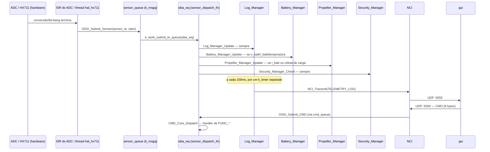
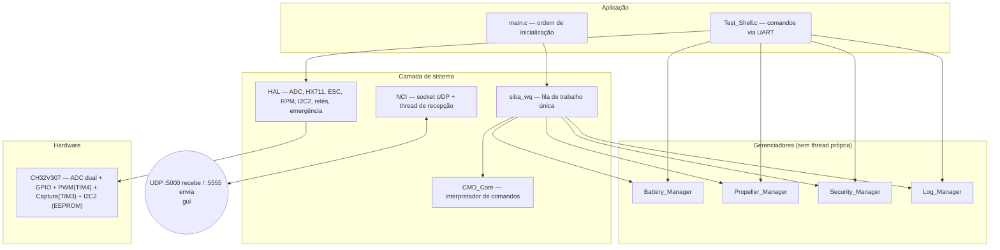
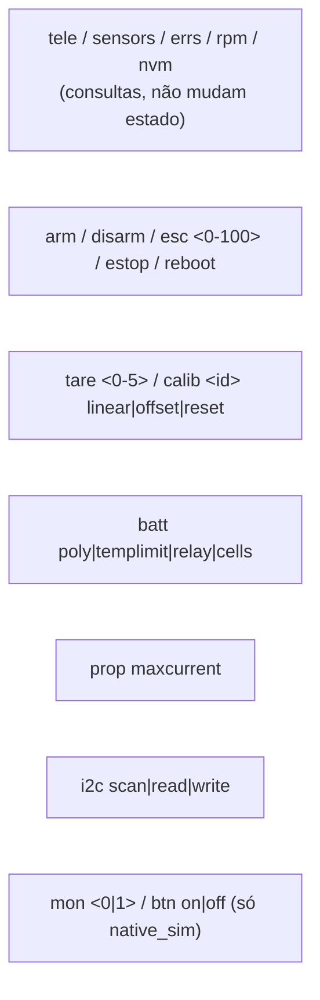
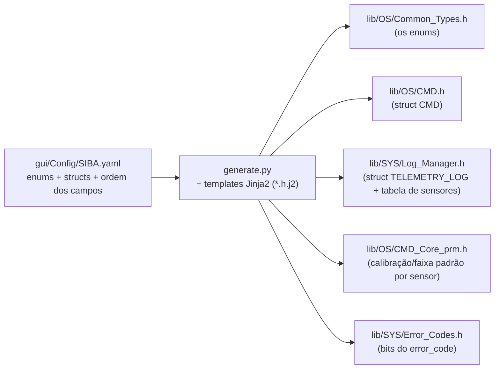

# SIBA — Sistema Integrado da Bancada Aerodinâmica

> [README principal](../../README.md) · [Visão geral do software](../README.md) · [Aplicação de supervisão](../gui/README.md)

| | |
|---|---|
| **MCU** | CH32V307VCT6 (RISC-V, 144 MHz) · Zephyr RTOS v4.4.0 |
| **Rede** | UDP · placa `169.254.97.200:5000` (comando) → PC `:5555` (telemetria, 10 Hz) |
| **Mede** | 6 células de carga (HX711), RPM, Pitot, bateria (tensão, corrente, temperatura), temperatura do motor |
| **Aciona** | ESC do motor (PWM 50 Hz) e relés de pré-carga/potência da bateria |
| **Shell** | Só no `native_sim` (desligado na placa para economizar memória) |

**Sumário:** [Build](#requisitos-e-build) · [Arquitetura](#como-a-placa-é-organizada-por-dentro-arquitetura-de-software) · [Protocolo](#protocolo-de-comunicação-com-o-pc) · [Sensores](#os-sensores-um-a-um) · [Segurança](#segurança--o-código-de-erro-agregado) · [Shell](#shell-de-diagnóstico-via-uart) · [Pinagem](#pinagem-referência-de-hardware) · [generate.py](#como-o-protocolo-é-gerado-generatepy)

## O que é essa placa e para que ela serve

A SIBA é uma placa eletrônica customizada, projetada para a bancada de
ensaios de motopropulsão da equipe Albatroz Aerodesign. Ela tem duas
responsabilidades dentro da bancada:

1. **Medir a aerodinâmica e a estrutura do conjunto motor+hélice**: força e
   momento em até 6 eixos (6 células de carga HX711 — tipicamente empuxo e
   torques/momentos da hélice), velocidade do ar incidente (tubo de Pitot)
   e rotação do eixo (sensor óptico/Hall + contador de pulsos).
2. **Gerenciar e proteger a bateria LiPo** que alimenta o motor: mede
   tensão, corrente e temperatura, estima a carga restante (SOC), comanda
   os relés de pré-carga e de potência, lê o botão de emergência e **é ela
   quem aciona o ESC do motor** (gera o sinal PWM de servo que controla o
   acelerador).

O motor propriamente dito (correntes e tensões de fase, estimativa de
torque eletromagnético sem sensores) é medido por uma placa irmã, a
**SAME** (`../SAME/`) — a SIBA não lê nada do lado elétrico do motor, só
aciona o ESC e cuida da bateria/aerodinâmica.

A placa roda em um microcontrolador **CH32V307VCT6** (núcleo RISC-V,
144 MHz, com Ethernet MAC integrada) sobre o **Zephyr RTOS v4.4.0**, e
conversa com um programa de PC (`../gui/`) por **UDP/Ethernet**.
O **shell de comandos** de diagnóstico só existe no build `native_sim`; na
placa ele fica desligado para economizar memória (detalhado mais abaixo).

Projeto de TCC — Equipe Albatroz Aerodesign, UDESC Joinville.

## Requisitos e build

- Hardware: CH32V307VCT6 + PC com Zephyr SDK instalado
- Toolchain: Zephyr SDK, Make, CMake, Ninja, Python — ver o
  [guia oficial do Zephyr](https://docs.zephyrproject.org/latest/develop/getting_started/index.html)

```bash
make build      # west build -b siba_board — compila para a placa real
make flash      # grava o binário via WCH-LinkE (OpenOCD)
make clean      # limpa a build (pristine)
make menuconfig # interface de texto do Kconfig, para mexer nas opções do Zephyr
```

### Rodar sem a placa física (`native_sim`)

Como nem sempre a placa/gravador (W-Link) estão disponíveis, o firmware
também pode ser compilado para rodar **como um processo comum do Linux**,
usando a board `native_sim` do próprio Zephyr. Isso não é uma emulação de
CPU (não tem QEMU nem simulação de instrução RISC-V) — o Zephyr, nesse
modo, compila para a arquitetura POSIX do próprio PC e roda como um
programa normal, mas com o **mesmo código de aplicação** (filas, lógica dos
managers, parser de comandos). Serve para caçar bugs de lógica (por
exemplo, um erro de cálculo no polinômio de SOC, ou uma condição de corrida
entre threads) sem precisar gravar a placa a cada teste. O que esse modo
**não** consegue testar é qualquer coisa que dependa do hardware físico de
verdade: timing de periférico, DMA, pinagem, o transceiver Ethernet real.

```bash
make native_sim       # west build -b native_sim -d build_native_sim
make native_sim_run   # builda (se preciso) e roda build_native_sim/zephyr/zephyr.exe
```

Quando o binário sobe, aparece um prompt (`uart:~$`) — é o mesmo shell de
diagnóstico que existe na placa real (seção "Shell de diagnóstico" abaixo),
funcionando sobre o stdin/stdout do processo em vez da UART física. Só em
`native_sim` existe também o comando `btn on|off`, que simula o botão de
emergência. Ctrl+C encerra o processo.

Importante: mesmo nesse modo, a **rede é real** — o binário abre sockets
UDP de verdade no Linux e troca pacotes com o PC nas mesmas portas que a
placa física usaria (5000 para receber comando, 5555 para mandar
telemetria). Isso é possível porque o Zephyr, quando compilado para
`native_sim`, tem uma opção chamada "Offloaded Sockets" (NSOS) que
redireciona as chamadas de rede do firmware direto para os sockets BSD do
Linux, sem simular a pilha de rede do Zephyr inteira. Só o endereço muda:
em vez do IP link-local `169.254.97.200` que a placa física usa, o processo
escuta em loopback, `127.0.0.200` (o último número do IP real vira o
último número do `127.0.0.x`) — o motivo de usar `.200` e não `127.0.0.1`
é simplesmente para que a SIBA e a SAME possam rodar **ao mesmo tempo** no
mesmo PC sem os pacotes de uma se misturarem com os da outra (a SAME usa
`127.0.0.100`).

Como cada periférico físico (ADC, PWM do ESC, contador de RPM, HX711, I2C)
não existe de verdade nesse modo, o próprio arquivo `HAL.c` tem blocos
`#ifdef CONFIG_ARCH_POSIX` que trocam a leitura do registrador físico por
um gerador de valor sintético plausível (por exemplo, o RPM sintético
persegue o valor de throttle do ESC como se fosse um motor de verdade
respondendo, com ruído). Isso significa que o `HAL.c` é **o mesmo arquivo**
compilado para os dois alvos — não existe um "HAL_mock.c" separado — só
o miolo de cada função muda dependendo se está compilando para a placa
real ou para `native_sim`. A vantagem de fazer assim (em vez de duplicar o
arquivo) é que qualquer correção de lógica feita numa função vale para os
dois alvos automaticamente, sem precisar lembrar de replicar a mudança.

---

## Como a placa é organizada por dentro (arquitetura de software)

### O problema que a arquitetura resolve

Um firmware como esse tem várias fontes de eventos acontecendo ao mesmo
tempo e de forma imprevisível: uma célula de carga termina de converter,
o ADC termina uma média, chega um pacote UDP do PC, um timer de 100 ms
dispara para mandar a telemetria. Se cada uma dessas fontes rodasse numa
thread própria e todas mexessem diretamente nas mesmas variáveis (por
exemplo, o snapshot de telemetria, ou o estado da calibração de uma
célula), seria fácil ter uma condição de corrida: duas threads lendo e
escrevendo a mesma variável ao mesmo tempo, produzindo um valor
inconsistente ou corrompido. A alternativa mais simples de evitar isso —
colocar um mutex (trava) em cada variável compartilhada — cria outro
problema: é fácil esquecer de travar em algum lugar, e también corre-se o
risco de deadlock se duas travas forem pegas em ordens diferentes por
threads diferentes.

A solução adotada aqui foi diferente: em vez de várias threads que
competem pelo mesmo dado, existe **uma única fila de trabalho**
(`siba_wq`, um `k_work_q` do Zephyr) que processa, uma de cada vez e
sempre na mesma thread, tudo que precisa mexer no estado compartilhado
(configuração de sensor, snapshot de telemetria, código de erro
agregado). As únicas threads que continuam existindo separadamente são
as que **precisam mesmo bloquear esperando hardware** — fazer bit-bang do
protocolo do HX711 e esperar um pacote de rede (`recvfrom`) — porque essas
operações não podem virar um item de fila (elas bloqueiam por tempo
indeterminado). O ADC e o RPM nem precisam de thread: são tratados por
interrupção. Quando uma dessas fontes termina de ler um valor, ela não mexe direto nas variáveis compartilhadas: ela só
empacota o valor e o empurra para a fila de trabalho, que processa depois,
na sua própria vez.

### Threads do sistema e como elas se comunicam entre si

Existem só **2 threads que bloqueiam em hardware/rede**, mais **1 fila de
trabalho**, mais **3 mecanismos que não são threads** (interrupções e
timers):

| Nome | Prioridade Zephyr | O que faz | Como entrega o resultado |
|---|---|---|---|
| `hal_hx711` | 6 | Fica fazendo bit-bang (gerando os pulsos de clock manualmente por software) nos pinos de cada uma das 6 células de carga, uma де cada vez, e lendo o bit de dado que a célula devolve | Chama `OSSI_Submit_Sensor(sensor_id, valor)` para cada célula, na sua vez |
| `nci_rx` | 5 | Fica bloqueada em `recvfrom()`, esperando um pacote UDP chegar na porta 5000 | Chama `OSSI_Submit_CMD(buf, tamanho)` com os bytes crus recebidos |
| `siba_wq` | 5 | **Não bloqueia em hardware nenhum** — só espera algum item ser colocado nela. É aqui que toda a lógica de negócio roda | (ver abaixo) |
| ADC (ISR + `k_work`) | — | O DMA do ADC dual (ADC1 mestre + ADC2 escravo, simultâneos) dispara uma interrupção a cada quadro; a ISR acumula 1500 quadros e então agenda a publicação da média | Um `k_work` chama `OSSI_Submit_Sensor` para cada canal |
| RPM (ISR TIM3 + `k_timer`) | — | A captura do TIM3 conta pulsos; um timer de 100 ms converte a contagem em RPM | `OSSI_Submit_Sensor(SENSOR_ID_RPM, ...)` |
| Log TX (`k_timer`) | — | Dispara a cada 100 ms | Agenda `log_tx_work` na `siba_wq` |

(Prioridade no Zephyr funciona ao contrário do que parece intuitivo:
**número menor é mais prioritário**. Então `siba_wq` e `nci_rx`, com
prioridade numérica 5, têm prioridade **maior** que `hal_hx711` (6).
Isso é proposital: assim que um dado de sensor fica pronto,
a prioridade alta de quem processa esse dado (`siba_wq`) garante que a
lógica de segurança — que pode precisar desarmar o ESC — roda assim que
possível, sem ficar esperando atrás de uma thread de leitura de hardware
que já cumpriu seu papel ao entregar o valor.)

Não existem mais threads além dessas — nem uma thread por manager
(bateria, hélice, segurança, log), nem um "gerenciador de threads"
dinâmico. Isso já foi diferente no passado deste projeto (existia um
esquema com um pool de até 10 threads geridas dinamicamente e 4 filas de
mensagem separadas — uma para comando, uma para "sistema", uma para
threads, uma para rede), mas isso foi simplificado para o esquema de fila
única descrito aqui, principalmente porque a versão antiga gastava mais de
30 KB de RAM só com stacks de threads que na prática quase nunca rodavam
ao mesmo tempo, e o comportamento concorrente entre várias threads
mexendo no mesmo estado era mais difícil de raciocinar do que uma fila
única processada em ordem.

#### O mecanismo exato: `k_msgq` + `k_work`

Zephyr oferece duas primitivas diferentes que esse firmware combina:

- **`k_msgq`** é uma fila de **dados** de tamanho fixo — um array circular
  onde você "põe" (`k_msgq_put`) uma cópia de uma struct pequena, e depois
  alguém "tira" (`k_msgq_get`) essa cópia em outro lugar. Não executa
  código nenhum sozinha — é só um buffer thread-safe.
- **`k_work`** é uma **função a ser rodada mais tarde, numa fila de
  trabalho específica** (`k_work_submit_to_queue`). Ela não carrega dado
  nenhum por si — é só um "avise-me para rodar esta função na thread da
  `siba_wq`, na próxima vez que ela estiver livre".

O firmware usa os dois em conjunto, criando duas filas de dados pequenas
dentro de `OSSI.c`:

```c
/* Item de sensor: 4 bytes de ID + 4 bytes de valor float = 8 bytes.
 * 40 posições cabem uma rajada de 6 células + 4 canais ADC + 1 RPM
 * mesmo se a siba_wq estiver ocupada por ~10ms processando outra coisa. */
typedef struct { uint32_t sensor_id; float value; } sensor_item_t;
K_MSGQ_DEFINE(sensor_queue, sizeof(sensor_item_t), 40, 4);

/* Item de comando: os 8 bytes do CMD + o tamanho recebido. 4 posições
 * bastam porque comandos chegam devagar (<1Hz, controle manual do usuário). */
typedef struct { uint8_t buf[sizeof(CMD)]; size_t len; } cmd_item_t;
K_MSGQ_DEFINE(cmd_queue, sizeof(cmd_item_t), 4, 4);
```

Quando o ADC termina uma média, o trabalho de publicação chama
`OSSI_Submit_Sensor(SENSOR_ID_V_BATT, 12.4f)`, que faz exatamente duas
coisas: põe o item na `sensor_queue` (`k_msgq_put`), e manda a `siba_wq`
rodar a função de despacho assim que puder
(`k_work_submit_to_queue(&siba_wq, &sensor_dispatch_work)`). A função de
despacho, `sensor_dispatch_fn`, quando finalmente roda na `siba_wq`, **não
processa só o item que a acordou** — ela drena a fila inteira num laço
(`while (k_msgq_get(...) == 0)`), processando todos os itens que estiverem
esperando. Isso importa porque o ADC e a `hal_hx711` submetem vários
itens em sequência rápida (uma média de ADC gera uma chamada para cada
canal) — sem esse laço de drenagem, a `siba_wq` precisaria
ser acordada 4 vezes separadas para o mesmo evento de conversão.

Para cada item de sensor drenado, a função de despacho decide, por um
`switch`/`if` simples no `sensor_id`, quem precisa saber daquele valor:

```c
static void sensor_dispatch_fn(struct k_work *w)
{
    sensor_item_t item;
    while (k_msgq_get(&sensor_queue, &item, K_NO_WAIT) == 0) {
        uint32_t id  = item.sensor_id;
        float    val = item.value;

        Log_Manager_Update(id, val);   /* SEMPRE — grava no snapshot de telemetria */

#if HAL_ENABLE_ADC                     /* alarmes de bateria dependem do ADC */
        if (id == SENSOR_ID_V_BATT || id == SENSOR_ID_I_BATT ||
            id == SENSOR_ID_TEMPERATURE_BATTERY) {
            Battery_Manager_Update(id, val);   /* recalcula SOC, checa alarmes de bateria */
        }
#endif
        if (id == SENSOR_ID_I_BATT || id <= SENSOR_ID_LOAD_CELL_5) {
            Propeller_Manager_Update(id, val); /* protege o motor contra sobrecorrente */
        }

        Security_Manager_Check(id, val);       /* SEMPRE — checa se o valor está fora da faixa segura */
    }
}
```

O ponto importante desse desenho: como **tudo isso roda sempre na mesma
thread (`siba_wq`)**, nunca existe o risco de `Battery_Manager_Update` e
`Security_Manager_Check` rodarem ao mesmo tempo em núcleos/instantes
diferentes disputando a mesma variável — o processamento é sequencial por
construção, então managers como `Battery_Manager`/`Security_Manager` nem
precisam de mutex interno para se proteger um do outro (só
`Log_Manager`/`Propeller_Manager` têm um mutex próprio, e é porque eles
também são lidos de **fora** da `siba_wq` — pelo shell de diagnóstico, que
roda na sua própria thread).

O mesmo padrão se repete para comandos de rede (`cmd_queue` +
`cmd_dispatch_fn`, que chama `CMD_Core_Dispatch` para cada `CMD` recebido)
e para o envio periódico de telemetria: um `k_timer` do Zephyr dispara a
cada 100 ms (10 Hz) e, em vez de tentar montar/enviar o pacote diretamente
de dentro do callback do timer (que roda em contexto de interrupção,
onde não se pode fazer chamadas bloqueantes), ele só empurra mais um
`k_work` (`log_tx_work`) para a `siba_wq`, que quando processado chama
`Log_Manager_Transmit()` e manda o pacote pela rede.

O diagrama abaixo resume os dois caminhos descritos acima — sensor
entrando e virando telemetria, comando entrando e virando ação — deixando
explícito que os dois convergem na mesma fila e nunca rodam ao mesmo
tempo:



### Diagrama de blocos



A decisão de desenho aqui é que o shell de UART fala **direto** com os
gerenciadores (linha `shell --> Batt & Prop & ...`) em vez de passar pela
fila de comandos de rede. A razão é de separação de responsabilidade: o
`CMD`/`CMD_Core` existe só para o protocolo de rede com o PC (ele tem um
formato de bytes fixo, definido pelo `.yaml`); o shell é uma ferramenta de
bancada que já está rodando dentro do firmware, então não faz sentido
serializar um comando em bytes, colocar na fila, e desserializar de volta
— seria trabalho extra sem benefício. Se o shell precisasse competir pelo
mesmo caminho que os comandos de rede usam, mudanças no protocolo de rede
também afetariam comandos que não têm nada a ver com rede.

### Ordem de inicialização

O `main()` roda uma vez, na ordem abaixo, e depois **retorna** — não fica
num laço infinito. Isso é seguro porque todas as threads relevantes (as
duas bloqueantes de HAL, a de rede, e a fila de trabalho) já foram criadas
e continuam vivas sob o escalonador do Zephyr independente do `main()` ter
retornado.

```text
1. OSSI_Init()              — cria e arranca a siba_wq (precisa vir primeiro:
                               tudo que vem depois pode gerar trabalho para ela)
2. Security_Manager_Init()
3. Battery_Manager_Init()   — aqui o GPIO do relé de potência é configurado
4. Propeller_Manager_Init() — zera o mutex e o estado de calibração das células
5. Log_Manager_Init()       — zera o snapshot de telemetria, arranca o timer de 100ms
6. CMD_Core_Init()          — carrega a tabela de calibração/faixa de cada sensor
7. NCI_Init()               — abre o socket de saída (TX) e cria a thread nci_rx
8. HAL_Init()               — inicializa ADC/HX711/ESC/RPM/I2C2/relés de verdade
                               (relés abertos), cria a thread hal_hx711 e liga
                               as interrupções do ADC e do RPM
9. NVM_Init()               — restaura a calibração gravada na EEPROM (I2C2, 0x50);
                               se falhar, seguem os defaults de CMD_Core_prm.h
```

O status da rede não é ligado à mão: o `NCI` registra um callback que
acompanha o link do PHY (e acende o LED de PE15) sozinho.

A ordem importa: por exemplo, `HAL_Init()` só é chamado depois que todos
os managers já existem, porque assim que o ADC começa a converter ele já
pode gerar leituras que vão parar na fila de sensores — se o
`Battery_Manager` ainda não tivesse sido inicializado, a primeira leitura
de tensão poderia cair numa struct com lixo de memória.

---

## Protocolo de comunicação com o PC

A SIBA troca dois tipos de pacote com o programa de PC, sempre por UDP:

- O PC manda um **`CMD`** (comando) de 8 bytes para a porta 5000 da placa.
- A placa manda um **`TELEMETRY_LOG`** (telemetria) para a porta 5555 do
  PC, 10 vezes por segundo (a cada 100 ms), continuamente — não existe
  comando de "ligar"/"desligar" a telemetria; ela está sempre ativa desde
  o boot.

Esses dois formatos **não são escritos à mão no C** — eles são gerados
automaticamente a partir de um arquivo `.yaml` (`../gui/Config/
SIBA.yaml`) por um script Python (`generate.py`), explicado na seção
própria mais abaixo. A razão de gerar em vez de escrever à mão nos dois
lados (firmware em C e GUI em Python) é evitar que os dois lados
divirjam silenciosamente — se alguém adicionasse um campo na struct do
lado do Python sem lembrar de replicar no C, o parsing do pacote binário
ia decodificar os bytes errados sem dar erro nenhum (é só uma sequência de
bytes, não tem nome de campo dentro do pacote).

### Struct `CMD` (PC → placa, 8 bytes)

```c
typedef struct __attribute__((packed)) {
    func_type      function;         // O QUE fazer: FUNC_START, FUNC_STOP,
                                      // FUNC_RESET, FUNC_SENSOR, FUNC_ESC,
                                      // FUNC_BATTERY
    instruct_type  instruction;      // COMO fazer: INSTR_READ, INSTR_WRITE,
                                      // INSTR_NONE, INSTR_DEFAULT
    int8_t         target_id;        // EM QUEM: índice do sensor/alvo
    float          value;            // O dado em si (throttle em %, ganho de
                                      // calibração, offset, coeficiente...)
    int8_t         action_or_status; // Ação específica dentro da função
                                      // (qual coeficiente calibrar, qual ação
                                      // de bateria) OU status de resposta
} CMD;
```

`__attribute__((packed))` diz ao compilador para **não inserir bytes de
preenchimento** entre os campos da struct (o compilador, por padrão,
alinha cada campo em endereços múltiplos do seu tamanho, o que deixaria a
struct maior que a soma dos campos). Sem isso, o tamanho da struct em C
poderia não bater com os 8 bytes que o Python empacota com
`struct.pack("<BBBfb", ...)`, e o firmware rejeitaria todo pacote por
"tamanho incompatível".

Cada campo do `CMD` tem 1 byte, exceto `value`, que é um `float` de 4
bytes — por isso o total é `1+1+1+4+1 = 8` bytes.

### `func_type` — o que cada valor faz

| Valor | Nome | O que a placa faz quando recebe |
|---|---|---|
| 0 | `FUNC_START` | Com `target_id = TARGET_DEFAULT` e `INSTR_WRITE`, comanda a **cadeia de potência** conforme `action_or_status` (`status_type`): `STATUS_OK` arma a bancada (pré-carga → potência → ESC), `STATUS_ERROR` desliga a bancada, `STATUS_EMERGENCY_OVERRIDE`/`RESTORE` sobrescreve/restaura o botão de emergência. Em qualquer outro caso é só informativo (as células e a telemetria já rodam desde o boot) |
| 1 | `FUNC_STOP` | Se `target_id` for o alvo "padrão" (`TARGET_DEFAULT`), dispara uma **parada de emergência**: desarma o ESC imediatamente, independente de qualquer outra condição. |
| 2 | `FUNC_RESET` | Reinicia o microcontrolador (`sys_reboot`, um reset "frio", como se tivesse desligado e ligado de novo). |
| 3 | `FUNC_SENSOR` | Ajusta a calibração (ganho/offset/limites) de um sensor — célula de carga ou canal de ADC. Ver tabela detalhada abaixo. |
| 4 | `FUNC_ESC` | `value` é o throttle pedido, de 0.0 a 100.0(%). Esse pedido **não vai direto para o hardware do PWM** — ele passa pelo `Propeller_Manager`, que arma o ESC se ainda não estiver armado, e **recusa ou reduz** o pedido se a corrente do motor já estiver acima do limite de segurança (ver seção "Proteção contra sobrecorrente" abaixo). |
| 5 | `FUNC_BATTERY` | Ajusta parâmetros de bateria: coeficientes do polinômio de SOC, limite de temperatura, ou liga/desliga o relé de potência. `action_or_status` diz qual desses. |

Note que `FUNC_ESC` **ignora completamente o campo `target_id`** — não
existe (ainda) um "alvo" separado para o motor dentro do `target_type`;
qualquer `CMD` com `function=FUNC_ESC` e `instruction=INSTR_WRITE` é
tratado como um pedido de throttle, não importa o que esteja em
`target_id`.

### `FUNC_SENSOR` — calibrando um sensor

O `target_id` identifica qual sensor está sendo calibrado (mesma
numeração usada na telemetria, ver tabela de sensores mais abaixo:
0 a 5 são as 6 células de carga; 6, 7, 9, 10 e 12 são os canais de ADC —
tensão, corrente e temperatura da bateria, velocidade do ar e temperatura
do motor). O campo `action_or_status`, para essa função, é
interpretado como um `default_action`:

| `default_action` | Célula de carga (target 0-5) | Sensor de ADC (target 6,7,9,10,12) |
|---|---|---|
| `..._LINEAR_COEF` | `value` é o **peso conhecido** que está sobre a célula agora — a placa resolve sozinha a escala necessária para que a leitura passe a valer esse peso (ver a fórmula de calibração do HX711 abaixo) | `value` é o ganho linear direto |
| `..._OFFSET_COEF` | Tara a célula: o offset vira a leitura bruta atual (o valor de `value` é ignorado) | `value` é o offset (deslocamento) direto |
| `..._RESET_DEFAULT` | Restaura a escala e o offset de fábrica, e tara de novo | Restaura ganho=1.0 e offset=0.0 |
| `..._MAX_VALID` / `..._MIN_VALID` | Só grava o limite superior/inferior aceitável para esse sensor (usado depois pelo `Security_Manager` para saber quando soar alarme) | idem |

Repare que, para as **células de carga**, "ganho" e "peso" não são a
mesma coisa que para um sensor de ADC comum — isso é intencional e é
explicado na seção sobre o HX711 mais abaixo.

### `FUNC_BATTERY` — `battery_action`

| Ação | O que faz |
|---|---|
| `BAT_ACTION_P0_OVERWRITE` até `P4_OVERWRITE` | Sobrescreve um dos 5 coeficientes do polinômio de estimativa de carga (SOC) — ver a fórmula na seção de bateria |
| `BAT_ACTION_TEMP_LIMIT_OVERWRITE` | Muda a temperatura acima da qual a placa considera a bateria superaquecendo |
| `BAT_ACTION_RELAY` | Liga (`value > 0.5`) ou desliga o relé de potência |

### Struct `TELEMETRY_LOG` (placa → PC, enviado a 10 Hz)

```c
typedef struct __attribute__((packed)) {
    uint32_t   timestamp;             // milissegundos desde o boot da placa
    float      load_cell_0;           // leitura calibrada da célula 0 (N ou kgf,
    float      load_cell_1;           // depende de com que peso foi calibrada)
    float      load_cell_2;
    float      load_cell_3;
    float      load_cell_4;
    float      load_cell_5;
    float      v_batt;                // tensão da bateria, em Volts
    float      i_batt;                // corrente da bateria, em Ampères
    float      soc;                   // carga estimada da bateria, 0 a 100%
    float      temperature_battery;   // temperatura da bateria, em °C
    float      air_speed;             // velocidade do ar (tubo de Pitot), m/s
    float      rpm;                   // rotação do eixo do motor
    float      temperature_motor;     // temperatura do motor (termistor no estator), °C
    log_status status;                // LOG_VALID / LOG_INVALID / LOG_OVERFLOW /
                                       // LOG_CRITICAL_ALARM / LOG_DENIED_ACTION
    uint32_t   error_code;            // mapa de bits com todos os alarmes ativos
                                       // (ver seção "Segurança" abaixo)
} TELEMETRY_LOG;
```

O campo `error_code` é o que permite ao programa de PC (e ao próprio shell
da placa, com o comando `errs`) mostrar, em uma única leitura,
**todas** as condições de alarme que estão ativas no momento — sem
precisar de vários campos booleanos separados. A ideia por trás disso é
explicada na seção de Segurança.

---

## Os sensores, um a um

### Células de carga (HX711 × 6)

O HX711 é um conversor analógico-digital de 24 bits dedicado a strain
gauges (extensômetros/células de carga), com amplificação embutida. Ele
não usa um protocolo padrão como I2C ou SPI — o firmware precisa gerar os
pulsos de clock manualmente, por software, num pino de saída (chamado
`PD_SCK` no datasheet do chip), e ler o bit de dado que o HX711 devolve em
outro pino (`DOUT`), 24 vezes seguidas para montar o valor completo. Esse
processo é chamado de "bit-banging". Depois dos 24 bits de dado, um
número extra de pulsos de clock (1, 2 ou 3) seleciona o ganho do
amplificador interno e qual dos dois canais de entrada será lido na
próxima conversão — este firmware usa sempre 1 pulso extra, que
corresponde ao canal A com ganho 128×, o ajuste recomendado para
extensômetros de ponte completa.

O valor bruto que sai do HX711 é um inteiro de 24 bits com sinal — não
tem unidade física nenhuma até ser calibrado. A calibração usada aqui é o
modelo canônico do próprio fabricante do sensor:

$$\text{leitura} = \frac{\text{raw} - \text{tare}}{\text{scale}}$$

Onde `raw` é o valor bruto de 24 bits lido agora, `tare` é o valor bruto
guardado no momento em que a célula foi tarada (zerada) e `scale` é um
fator de conversão contagens-por-unidade. É por isso que calibrar uma
célula de carga tem **dois passos conceitualmente diferentes**, e não um
único "ganho + offset" como um sensor comum:

1. **Tarar** (`offset`): com a célula sem carga nenhuma, grava-se
   `tare = raw_atual`. Depois disso, uma leitura sem carga dá exatamente
   zero. Não existe "valor" para essa operação — o comando ignora o campo
   `value` do `CMD` e simplesmente lê o raw atual.
2. **Calibrar a escala** (`linear`): com um **peso conhecido** sobre a
   célula (por exemplo, 1 kg), o usuário informa esse peso, e a placa
   resolve `scale = (raw_agora - tare) / peso_conhecido` — ou seja, é a
   placa que calcula a escala, a partir do peso que o usuário forneceu, e
   não o contrário. Essa é a razão de o campo `value` do `CMD FUNC_SENSOR`
   com `..._LINEAR_COEF` numa célula de carga representar **o peso
   colocado em cima dela**, não um "ganho" abstrato — mandar um ganho já
   calculado seria inverter a conta (contagens por unidade vs. unidade por
   contagem) e já foi origem de um bug real neste projeto.

Cada célula de carga é lida por um par de pinos dedicado — a placa tem 6
pares (12 pinos no total) numa mesma porta do microcontrolador, e a thread
`hal_hx711` visita as 6 células em sequência, uma conversão (~10 Hz por
célula, o limite do próprio chip HX711) de cada vez.

**Diagnóstico automático de célula desconectada**: se o pino `DOUT` de uma
célula não estiver ligado a chip nenhum (fio solto, célula removida), o
pino fica "flutuando" (DOUT não tem pull configurado) e tende a ser
lido em nível alto — os 24 bits todos em `1`. Interpretado como
inteiro com sinal de 24 bits, `0xFFFFFF` vira exatamente `-1`. O firmware
usa esse fato como diagnóstico: se `raw == -1`, ele assume que aquela
célula está fisicamente desconectada e sinaliza isso no código de erro
agregado (bit `PROP_LOAD_CELL_NOT_CONNECTED`), sem precisar de um pino de
detecção de presença dedicado.

### Sensores de bateria, Pitot e temperatura (ADC dual, 5 canais)

> ⚠️ **ADC desligado nesta versão da placa** (`HAL_DISABLE_ADC` em
> `lib/OS/HAL_prm.h`): os circuitos analógicos não foram montados. Esses
> campos saem zerados na telemetria e os alarmes de bateria ficam
> desligados. O texto abaixo vale quando o ADC for religado.

O CH32V307 tem dois ADCs e cada um só alcança um conjunto fixo de pinos (é
um mux analógico interno). O firmware usa os dois em **modo dual
simultâneo**: o ADC1 é mestre, com DMA, e o ADC2 converte junto como
escravo. Cada palavra do DMA traz as duas leituras.

| ADC / canal | Pino | Grandeza | `SENSOR_ID` |
|---|---|---|---|
| ADC1 CH0 | PA0 | Velocidade do ar (`air_speed`, Pitot) | 10 |
| ADC1 CH1 | PA1 | Temperatura da bateria (`temperature_battery`) | 9 |
| ADC1 CH3 | PA3 | Temperatura do motor (`temperature_motor`) | 12 |
| ADC2 CH13 | PC3 | Tensão da bateria (`v_batt`) | 6 |
| ADC2 CH14 | PC4 | Corrente da bateria (`i_batt`) | 7 |
| ADC2 CH12 | PC2 | Reserva (não publicado) | — |

Em vez de embutir a fórmula física exata de cada sensor, o firmware usa
um modelo genérico com ponto de zero, escolhido por sensor no `SIBA.yaml`
(`sensor_defaults`):

$$y = \text{linear} \cdot (x_{mV} - \text{zero}) + \text{offset} \qquad \text{(lei afim, padrão)}$$

$$y = \text{linear} \cdot \sqrt{x_{mV} - \text{zero}} + \text{offset} \qquad \text{(lei raiz, usada no Pitot)}$$

onde $x_{mV}$ é a tensão lida no pino, em milivolts, e $y$ é o valor físico
final (Volts, Ampères, m/s ou °C, dependendo do canal). A lei raiz existe
porque, por Bernoulli, a velocidade do ar cresce com a raiz da pressão
diferencial, e nenhuma reta descreve o Pitot. O motivo de manter só
esses parâmetros ajustáveis, em vez de uma fórmula física completa, é
que as fórmulas físicas exatas dependem de componentes específicos do circuito de condicionamento de sinal (razão
exata do divisor resistivo, sensibilidade do sensor de corrente,
coeficientes do termistor, ganho do amplificador do Pitot) que ainda
estavam sendo definidos/ajustados no esquemático durante o
desenvolvimento — em vez de gravar uma fórmula física no firmware que
precisaria ser recompilada toda vez que um componente do circuito
analógico mudasse, o firmware expõe só `linear`/`offset` ajustáveis em
tempo real (via `CMD` de rede ou shell), e o usuário calibra na bancada
com os valores medidos de verdade, contra um instrumento de referência.

O ADC lê cada canal com resolução de 12 bits (0 a 4095) sobre uma
referência de 3300 mV, em DMA circular. A interrupção acumula 1500 quadros
e publica a média (cerca de 16 Hz), o que reduz bastante o ruído sem
ocupar a CPU com cópias.

### Por que existe um driver de ADC customizado

O Zephyr já vem com um driver de ADC genérico que funcionaria, em teoria,
para vários microcontroladores da mesma família (série CH32V00x/CH32V20x/
CH32V30x da WCH). O problema é que, ativar esse driver genérico
(`CONFIG_ADC=y`) neste chip específico (CH32V307VCT6) acaba selecionando,
por engano, o driver escrito para o **CH32V003** — um chip bem mais
simples da mesma fabricante — que usa os **mesmos endereços de registrador
de memória (MMIO)** que, no CH32V307, pertencem ao controlador Ethernet.
Ou seja: ativar o ADC genérico corrompe a configuração da Ethernet e
derruba toda a comunicação com o PC. Por isso este projeto mantém um
driver próprio (`drivers/adc/adc_ch32v307.c`), escrito especificamente
para os registradores certos do CH32V307, com suporte a múltiplas
instâncias e com o modo dual simultâneo (ADC1 mestre, ADC2 escravo).

### Rotação do eixo (RPM)

A rotação é medida por um sensor de rotação (óptico ou baseado em efeito
Hall) que gera um pulso elétrico a cada vez que um ímã/marca passa — o
motor tem 14 polos, o que produz um número fixo de pulsos por volta
completa do eixo, exclusivamente definido pela construção física do
motor. A placa usa um recurso de hardware do próprio microcontrolador
chamado **input capture** (parte do periférico de timer TIM3): o
hardware, sozinho, registra o instante exato de cada borda de subida do
sinal, sem intervenção da CPU a cada pulso — a CPU só precisa, de tempos em
tempos, olhar quantos pulsos foram contados numa janela de tempo fixa (100
ms, neste firmware) e converter para RPM:

$$\text{RPM} = \frac{\text{pulsos contados}}{14} \times \frac{60000}{100}$$

O `14` no denominador é o número de polos do motor (a contagem de pulsos
por volta), e o `60000/100` converte de "voltas por janela de 100 ms" para
"voltas por minuto". Essa medida é feita de forma totalmente independente
do acionamento do motor (ela não depende de nenhum sinal do ESC) —
isso é importante porque, em ensaios de desaceleração livre (coast-down),
a excitação elétrica do motor é cortada de propósito, e um método de medir rotação que dependesse
da comutação elétrica do motor pararia de funcionar justamente na parte
mais importante do ensaio.

### ESC (acionamento do motor)

A SIBA gera um sinal de **PWM de servo** — o mesmo tipo de sinal usado em
servomotores de rádio-controle — para o ESC do motor: um pulso que se
repete a 50 Hz (a cada 20 ms), cuja **largura** (não a frequência) informa
o throttle desejado: 1000 microssegundos de pulso significa "parado/
armar", e 2000 microssegundos significa "aceleração máxima". Antes de
aceitar qualquer pulso diferente do mínimo, o ESC precisa ser "armado" —
uma sequência de segurança padrão em ESCs de RC que existe justamente para
evitar que o motor dispare sozinho ao ligar a placa (se o primeiro sinal
que o ESC visse já fosse um throttle alto, ele entenderia isso como um
comando válido assim que ligasse).

Medido no pino com analisador lógico: período de 20 ms, com pulso de 1000 µs
em 0 % e 2000 µs em 100 %, linear entre os dois.

### Proteção contra sobrecorrente do motor

Todo pedido de throttle — venha de um `CMD FUNC_ESC` pela rede ou do
comando `esc` do shell — passa pelo `Propeller_Manager` antes de
chegar no hardware do PWM. A cada nova leitura de corrente da bateria
(`i_batt`), o `Propeller_Manager` decide o que fazer:

- Se a corrente **já está acima do limite** (90 A por padrão, ajustável)
  e o pedido do usuário for **aumentar** o throttle, o pedido fica retido
  no valor atualmente aplicado — ele não é obedecido enquanto a corrente
  não cair.
- Independente de pedido novo, a cada leitura de corrente o
  `Propeller_Manager` reavalia: se `i_batt` estiver acima do limite, ele
  **reduz** o throttle aplicado em passos de 2 pontos percentuais; se a
  corrente já tiver voltado a ficar abaixo do limite e o throttle
  aplicado ainda for menor que o último pedido do usuário, ele **aumenta**
  de volta em passos de 2%, até alcançar o que foi pedido (sem nunca
  ultrapassar o limite de novo).

O efeito prático dessa lógica é que a corrente do motor nunca fica acima
do limite configurado por mais do que um único ciclo de leitura do ADC —
e a transição de volta ao throttle pedido é suave (em rampa de 2% por
leitura), não um degrau brusco, o que evita choques mecânicos/elétricos
repentinos no motor e no ESC.

---

## Segurança — o código de erro agregado

Em vez de expor um booleano separado para cada possível condição de
alarme (o que exigiria adicionar um campo novo na struct de telemetria —
e regerar o protocolo — toda vez que um alarme novo fosse criado), este
firmware usa um único campo `error_code` de 32 bits, onde **cada bit
representa uma condição de erro independente**. Isso permite, por
exemplo, que a bateria esteja com SOC baixo **e** o motor esteja em
sobrecorrente ao mesmo tempo, e o PC veja as duas coisas na mesma
leitura, sem ambiguidade.

| Bit | Nome | Quando liga |
|---|---|---|
| 0 | `BATT_LOW_SOC` | Carga estimada da bateria abaixo do limite de alerta (20% por padrão) |
| 1 | `BATT_POLY_MISCONFIGURED` | O polinômio de SOC está devolvendo um valor absurdo para uma tensão de célula plausível — sinal de que os coeficientes foram sobrescritos com valores errados |
| 2 | `BATT_LOW_VOLTAGE` | Tensão por célula abaixo de 3.5V — perto do limite seguro de descarga de uma célula LiPo |
| 3 | `BATT_RELAY_MISMATCH` | Está passando corrente pela bateria mesmo com o relé de potência comandado como desligado — indício de falha no próprio relé (contatos colados) |
| 4 | `BATT_OVER_TEMPERATURE` | Temperatura da bateria acima do limite configurado — **dispara parada de emergência automaticamente** |
| 8 | `PROP_LOAD_CELL_NOT_CONFIGURED` | Existe pelo menos uma célula de carga sem calibração explícita feita pelo usuário |
| 9 | `PROP_LOAD_CELL_NOT_CONNECTED` | Existe pelo menos uma célula devolvendo o padrão de "desconectada" (ver seção do HX711) |
| 10 | `PROP_OVERCURRENT` | Corrente do motor acima do limite configurado |
| 16 | `SEC_VOLTAGE_OUT_OF_RANGE` | Tensão da bateria fora da faixa operacional segura — **dispara parada de emergência** |
| 17 | `SEC_CURRENT_EXCESSIVE` | Corrente da bateria acima do limite de segurança geral — **dispara parada de emergência** |
| 18 | `SEC_RPM_EXCESSIVE` | Rotação acima do limite de segurança — **dispara parada de emergência** |
| 19 | `SEC_EMERGENCY_ACTIVE` | Uma parada de emergência está em vigor agora (o ESC foi desarmado) |
| 24 | `OS_GPIO_INIT_FAILED` | Algum periférico de GPIO não conseguiu ser inicializado no boot |
| 25 | `MCU_POWER_READY` | Informativo: o micro está pronto e os relés estão abertos (ligado no boot pelo `Security_Manager`) |

A tabela é gerada a partir da seção `error_bits` do `SIBA.yaml` (vira
`lib/SYS/Error_Codes.h` no firmware e as mensagens do Painel de Erros na
GUI).

Os bits marcados como "dispara parada de emergência" são verificados pelo
`Security_Manager` a **cada leitura nova** do sensor correspondente —
diferente da checagem feita pelos managers de domínio (bateria/hélice),
que servem para alertar cedo, a checagem de segurança usa limites mais
"duros" e reage imediatamente desarmando o ESC assim que o valor sai da
faixa, sem esperar confirmação do usuário.

Um detalhe de implementação relevante: os bits não são simplesmente
"setados a cada leitura ruim" — a função que liga/desliga um bit
(`Security_Manager_Error_Detect`/`_Erase`) só **registra no log de
depuração** quando o bit efetivamente **muda de estado** (de desligado
para ligado, ou vice-versa). Sem isso, uma condição de erro persistente
geraria uma linha de log a cada leitura (10 Hz ou mais), inundando o
console de depuração; com essa checagem de borda, cada condição gera
exatamente uma linha quando começa e uma quando termina.

### Botão de emergência e cadeia de potência

O botão de emergência fica no caminho de 12 V que alimenta as bobinas dos
relés: o corte é **físico**, sem depender do micro. O pino PD1 só **lê** o
estado do botão (por um divisor 12 V → 3 V; 0 V = apertado), sem pull
interno: o resistor inferior do divisor já define o 0 V. O `Security_Manager` checa esse pino a cada
despacho de sensor, dispara a parada e a libera quando o sinal volta.

Armar a bancada (`arm` no shell ou `FUNC_START`+`STATUS_OK` pela rede)
percorre a cadeia na ordem: fecha a **pré-carga**, espera os capacitores do
ESC carregarem (5 s por padrão, `CONFIG_SIBA_RELAY_PRECHARGE_MS`), fecha a **potência** e só então arma o **ESC**.
Desarmar faz o caminho inverso. O armamento é recusado com o botão
apertado, a menos que a emergência tenha sido sobrescrita pela rede
(`siba force on` no TinyTerminal), o que vale até a placa reiniciar.

### Estimativa de carga da bateria (SOC)

A carga restante da bateria é estimada por um polinômio de 4º grau
ajustado sobre a tensão **por célula** (não a tensão total do pack — packs
de tamanhos diferentes têm tensões totais diferentes para a mesma carga
percentual):

$$SOC(V_c) = p_0 + p_1 V_c + p_2 V_c^2 + p_3 V_c^3 + p_4 V_c^4$$

onde $V_c = V_{bat}/N_{c\acute{e}lulas}$. Os 5 coeficientes ($p_0$ a $p_4$)
são ajustáveis por comando (`FUNC_BATTERY` ou `siba batt poly`) e valem,
por padrão, $p_0=-307{,}0$, $p_1=281{,}7$, $p_2=-95{,}6$, $p_3=14{,}3$,
$p_4=-0{,}8$ — coeficientes calibrados para a curva de descarga típica de
uma célula LiPo entre 3.0V e 4.2V.

O número de células do pack ($N_{c\acute{e}lulas}$) pode ser fixado
manualmente pelo usuário (`siba batt cells <n>`) ou, se não for fixado,
**auto-detectado** a partir da tensão total do pack: o firmware tem uma
tabela de faixas de tensão plausíveis para packs de 1S a 8S (por exemplo,
um pack de 6S está tipicamente entre 21.0V, descarregado, e 25.2V,
carregado), e escolhe a contagem cuja faixa contém a tensão medida agora.
Essa auto-detecção tem uma limitação conhecida: as faixas de contagens
adjacentes **se sobrepõem ligeiramente** perto das transições (por
exemplo, 6S vai até 25.2V e 7S já começa em 24.5V) — uma tensão de pack
bem plausível (25.2V, um 6S "cheio") cai dentro das duas faixas ao mesmo
tempo, e uma leitura com um pouco de ruído pode fazer a contagem detectada
"piscar" entre 6S e 7S a cada amostra, distorcendo a divisão
$V_{bat}/N_{c\acute{e}lulas}$ e, por consequência, o SOC calculado. A
correção recomendada em bancada, hoje, é simplesmente **fixar** o número de
células manualmente em vez de depender da auto-detecção quando o pack
estiver perto de uma dessas transições.

---

## Shell de diagnóstico via UART

> **Desligado na placa** para economizar cerca de 48 kB de ROM
> (`CONFIG_SHELL=n` no `prj.conf`). Continua no `native_sim`, por meio de
> `boards/native_sim.conf`. Para tê-lo na placa, religar `CONFIG_SHELL`,
> `CONFIG_SHELL_BACKEND_SERIAL` e `CONFIG_SIBA_TEST_SHELL`.

Além do protocolo de rede, a placa aceita comandos de texto digitados
direto num terminal serial ligado à UART (`USART1`, 115200 bps, 8 bits de
dado, sem paridade, 1 stop bit — "115200 8N1"). Esse shell é fornecido
pelo próprio subsistema de Shell do Zephyr (`CONFIG_SHELL`) — o firmware
só precisa registrar os comandos (feito em `Test_Shell.c`); o Zephyr cuida
de imprimir o prompt, guardar histórico de comandos, e oferecer
autocompletar (aperte TAB depois de digitar `siba` para ver a lista).

Esse shell existe para permitir validar sensores, o ESC, a bateria e o
relé **sem depender do link UDP com o PC estar funcionando** — é a
ferramenta usada em bancada quando se quer isolar se um problema está no
firmware/hardware ou na comunicação de rede. Por desenho, os comandos do
shell falam **direto** com os gerenciadores de domínio ou com o HAL — eles
nunca passam pela fila de comandos de rede (`CMD_Core`), então funcionam
mesmo que a rede esteja completamente desligada.

Os comandos ficam **no nível raiz** do shell (sem prefixo `siba`):



| Comando | Argumentos | O que faz |
|---|---|---|
| `tele` | — | Foto completa da telemetria atual: timestamp, status, código de erro, as 6 células, bateria, temperaturas, velocidade do ar, RPM e estado do ESC |
| `sensors` | — | Para cada sensor, o valor **bruto** (contagem do ADC/HX711) e o **convertido** lado a lado — separa problema de hardware (bruto sem sentido) de problema de calibração (bruto ok, convertido errado) |
| `errs` | — | Decodifica o código de erro bit a bit (a mesma tabela da seção Segurança) |
| `rpm` | — | Só o RPM atual |
| `esc <0-100>` | percentual de throttle | Pede um throttle pelo `Propeller_Manager` (respeita o limite de corrente) |
| `arm` | — | Arma a bancada inteira: pré-carga → potência → ESC (bloqueia durante a pré-carga). Recusado com o botão de emergência apertado. O ESC é armado direto no HAL, então o limite de corrente só atua sobre os pedidos de throttle |
| `disarm` | — | Desarma a bancada: ESC → potência → pré-carga |
| `estop` | — | Dispara a mesma parada de emergência que o `CMD FUNC_STOP` |
| `reboot` | — | Reinicia o microcontrolador (reset frio) |
| `tare <0-5>` | índice da célula | Tara a célula indicada (offset = leitura bruta atual) |
| `calib <id> linear <valor>` | — | Célula de carga: calibra a escala usando `valor` como o **peso conhecido** aplicado agora. Canal de ADC: define o ganho linear |
| `calib <id> offset <valor>` | — | Célula: tara (o `valor` é ignorado). ADC: define o offset |
| `calib <id> reset` | — | Restaura a calibração de fábrica daquele sensor |
| `nvm` | — | Mostra a calibração gravada na EEPROM (13 sensores) e o contador de gravações |
| `mon <0\|1>` | — | Liga/desliga uma impressão periódica na UART |
| `batt poly <0-4> <valor>` | índice, valor | Sobrescreve um dos 5 coeficientes do polinômio de SOC |
| `batt templimit <valor>` | °C | Muda o limite de temperatura do alarme de superaquecimento |
| `batt relay on` / `off` | — | Liga/desliga o relé de potência (com a sequência de pré-carga) |
| `batt cells <n>` | nº de células (0 = auto) | Fixa a contagem de células do pack, contornando a auto-detecção |
| `prop maxcurrent <amps>` | Ampères | Muda o limite de corrente da proteção do motor (padrão 90 A) |
| `i2c scan` | — | Varre o barramento I2C2 (PB10/PB11) listando quem responde |
| `i2c read <addr> <len>` | endereço, nº de bytes | Lê `len` bytes do endereço indicado |
| `i2c write <addr> <b0> [b1...]` | endereço, bytes | Escreve os bytes no endereço indicado |
| `btn on` / `off` | — | **Só em `native_sim`:** simula o botão de emergência apertado/solto |

Alguns ajustes **só existem pelo shell**, sem equivalente no protocolo de
rede (`CMD`): fixar o número de células (`batt cells`), mudar o limite de
corrente do motor (`prop maxcurrent`), ler a NVM e acessar o I2C. São
ajustes de bancada e diagnóstico, não parâmetros que a GUI precise mudar
durante um ensaio.

---

## Pinagem (referência de hardware)

MCU: **CH32V307VCT6** (RISC-V, 144 MHz). A tabela abaixo reflete o
esquemático real da placa, já aplicado ao arquivo de descrição de hardware
do Zephyr (`.dts`) e ao código C (`HAL.c`/`HAL.h`).

| Pino | Periférico | Função | Tipo / lógica |
|------|------------|--------|---------------|
| PA0 | ADC1 canal 0 | Velocidade do ar — tubo de Pitot (`air_speed`) | analógico |
| PA1 | ADC1 canal 1 | Termistor da bateria (`temperature_battery`) | analógico |
| PA3 | ADC1 canal 3 | Termistor do motor (`temperature_motor`) | analógico |
| PC2 | ADC2 canal 12 | Reserva | analógico |
| PC3 | ADC2 canal 13 | Tensão da bateria (`v_batt`) | analógico |
| PC4 | ADC2 canal 14 | Corrente da bateria (`i_batt`) | analógico |
| PD1 | GPIO entrada | Leitura do botão de emergência via divisor 12 V→3 V (0 V = desliga, 3 V = liga); o corte dos relés é físico | ativa alta, sem pull interno (o divisor define o 0 V) |
| PB12 | GPIO saída | Relé de potência | 0 V = liga, alta impedância = desliga |
| PB13 | GPIO saída | Relé de pré-carga | 0 V = liga, alta impedância = desliga |
| PE0–PE5 | GPIO saída | Clock (`PD_SCK`) do HX711 das células 1–6 | saída |
| PE6–PE11 | GPIO entrada | Dado (`DOUT`) do HX711 das células 1–6 | entrada, sem pull |
| PB0 | TIM3 canal 3, captura | Contador de pulsos de RPM | entrada, sem pull |
| PB6 | TIM4 canal 1, PWM | Sinal do ESC (50 Hz, 1000–2000 µs) | saída PWM |
| PE15 | GPIO saída | LED de "rede online" (acompanha o link do PHY) | ativa alta |
| PB4 | GPIO saída | LED verde de status | ativa alta |
| PA15 | GPIO saída | LED vermelho de status | ativa alta |
| PB10 / PB11 | I2C2 SCL / SDA | EEPROM FT24C32A (0x50) | open-drain, pull-up externo |
| PA9 / PA10 | USART1 TX / RX | Console de log (115200 8N1) | push-pull / entrada com pull-up |
| PC6–PC9 | Ethernet (PHY interno) | RX+ / RX− / TX+ / TX− | pinos fixos |
| PA2, PA5, PA6, PA7 | SPI1 (desligado) | Reserva para flash W25Q | — |

> **ADC desativado nesta versão da placa.** Por tempo de montagem, os
> circuitos analógicos (Pitot, termistores, tensão e corrente da bateria)
> não foram montados. O firmware desliga o uso do ADC em
> `lib/OS/HAL_prm.h` (`HAL_DISABLE_ADC`); esses campos saem zerados na
> telemetria e ficam desligados a checagem de faixa de tensão/corrente da
> bateria (`Security_Manager`) e os alarmes do `Battery_Manager`. Os nós continuam no `.dts` — religar é comentar uma
> linha.

Os módulos de relé são acionados em nível baixo (0 V no pino = relé
fechado), declarado no `.dts` como `GPIO_ACTIVE_LOW`. Para abrir, o pino fica
em alta impedância, pois 3,3 V em push-pull não desligam o módulo de 5 V; no
boot os dois ficam assim (relés abertos).

---

## Como o protocolo é gerado (`generate.py`)

O `CMD`/`TELEMETRY_LOG` mostrados acima **não são escritos à mão** — eles
nascem de um arquivo `SIBA.yaml` (em `../gui/Config/`), que
declara os enums (`func_type`, `target_type`, etc.) e as structs
(`CMD`, `TELEMETRY_LOG`) junto com a **ordem exata dos campos** — essa
ordem dita o layout de memória, porque o pacote na rede é só uma sequência
de bytes, sem nome de campo dentro dele. Um script Python
(`generate.py`), usando o motor de templates Jinja2, lê esse `.yaml` e
escreve os arquivos `.h` finais em C:



```bash
cd ../gui/Config
python generate.py
# gera:
#   ../../SIBA/lib/OS/Common_Types.h   (os enums)
#   ../../SIBA/lib/OS/CMD.h            (a struct CMD)
#   ../../SIBA/lib/SYS/Log_Manager.h   (a struct TELEMETRY_LOG + tabela de sensores)
#   ../../SIBA/lib/OS/CMD_Core_prm.h   (calibração/faixa padrão de cada sensor)
#   ../../SIBA/lib/SYS/Error_Codes.h   (os bits do error_code)
```

**Sempre que o `SIBA.yaml` for editado, é preciso rodar `generate.py` antes
de recompilar o firmware** — os arquivos gerados nunca devem ser editados
à mão (uma edição manual seria sobrescrita na próxima geração, e mais
importante, ficaria dessincronizada do lado Python, que lê o mesmo
`.yaml`).

Um detalhe sutil do gerador: ele marca **só os enums que aparecem como
campo do `CMD`** (`func_type` e `instruct_type`) com
`__attribute__((packed))`, e não os enums de telemetria
(`log_status`). O motivo é que o tamanho de um `enum` em C não é definido
pelo padrão da linguagem — o compilador GCC usado para compilar o
firmware de verdade (que roda com a flag `-fshort-enums`) usa 1 byte por
enum, mas o mesmo código compilado no PC, para o modo `native_sim`, sem
essa flag, usaria 4 bytes por padrão. Se o `CMD` inteiro não fosse
compactado byte a byte dessa forma, o `sizeof(CMD)` sairia diferente entre
a placa real e o `native_sim`, e o parser rejeitaria pacotes vindos de um
lado quando compilado para o outro. Isso já foi um bug de verdade neste
projeto, detectado justamente ao testar contra o `native_sim`.

---

Licença: **MIT** (ver `../../LICENSE`).
