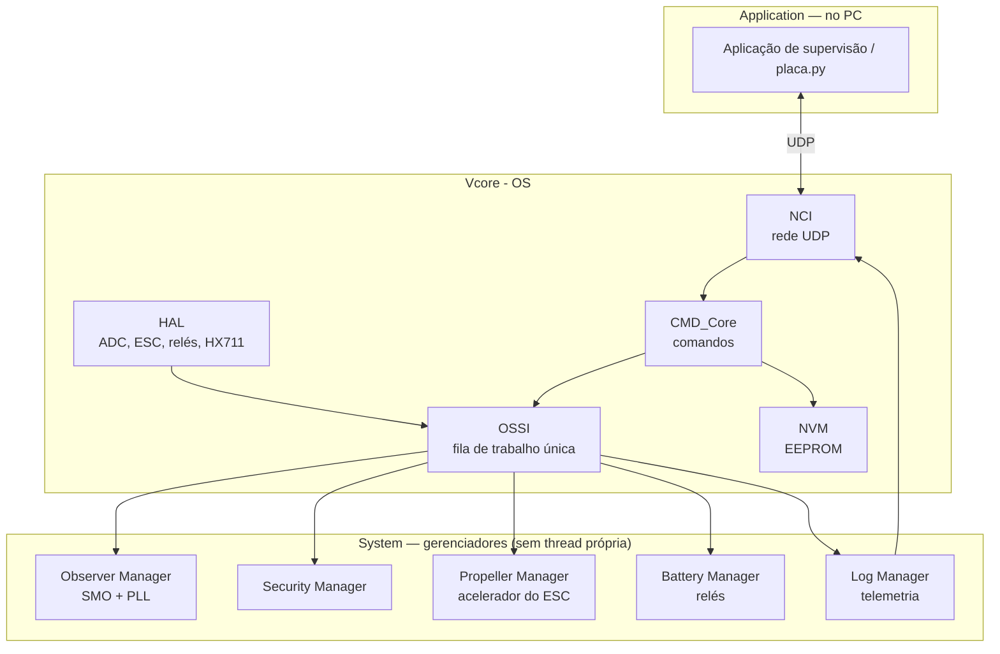
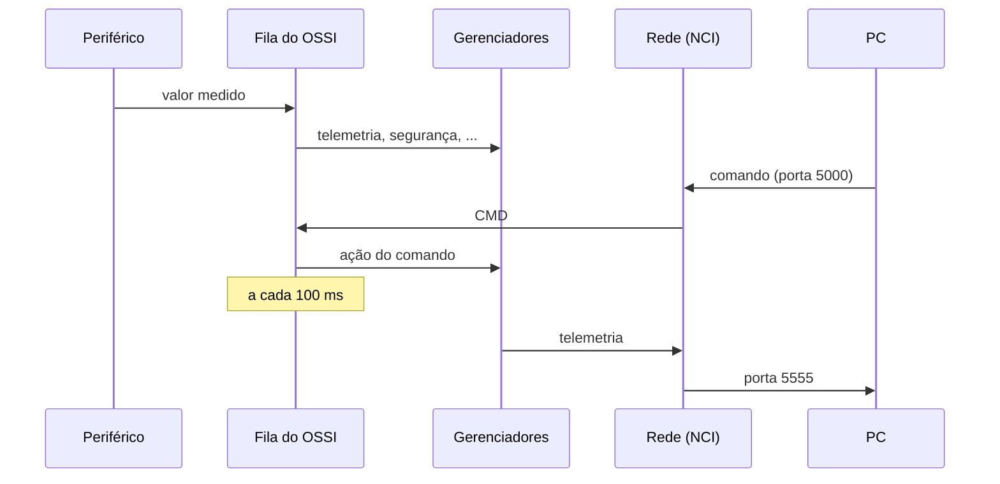
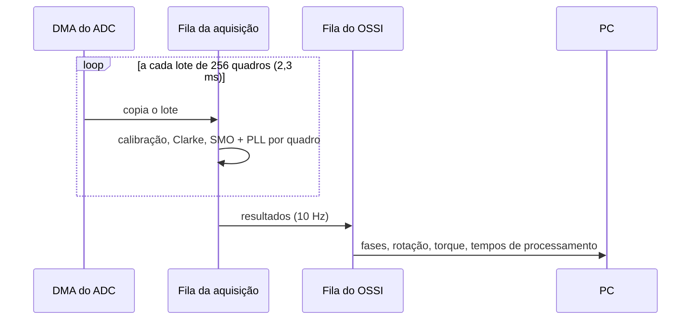

# Firmware da placa de medição

> [README principal](../README.md) · [Aplicação de supervisão](../gui/README.md) · [Geração do protocolo](../gui/Config/README.md)

A placa de medição é o nó central do sistema de aquisição. Ela:

- **mede** as tensões e correntes das três fases do motor;
- **estima** rotação e torque com o observador por modos deslizantes (SMO) e
  um PLL;
- **aciona** o ESC e os relés de potência;
- **concentra a segurança** (emergência, sobrecorrente, observador);
- **conversa com o PC** por Ethernet (UDP).

| | |
|---|---|
| **Microcontrolador** | CH32V307VCT6 (RISC-V 144 MHz, FPU, Ethernet MAC+PHY) |
| **Sistema operacional** | Zephyr RTOS 4.4 |
| **Rede** | Placa em `169.254.97.200`: recebe comandos na porta 5000 e envia telemetria (10 Hz) para a 5555 |

> Por dentro, o código ainda usa o nome antigo da placa (`SIBA`): `siba_wq`,
> `siba_board`, `CONFIG_SIBA_*`, `rpm_same`. São só nomes.

---

## Como compilar

Requer o Zephyr SDK e o `west`
([guia oficial](https://docs.zephyrproject.org/latest/develop/getting_started/index.html)).

```bash
make build        # compila para a placa
make flash        # grava pelo WCH-LinkE (se falhar, repetir)
make native_sim   # compila para rodar no PC (Linux)
make native_sim_run
```

O **`native_sim`** é o mesmo firmware rodando como programa do Linux, com
rede de verdade em `127.0.0.200`. Serve para testar comandos e telemetria sem
a placa. Só a parte de hardware é sintética: as fases do motor saem em zero e
não há EEPROM. A GUI (`native start`) e o `gui/placa.py --native` sobem esse
processo sozinhos.

---

## Organização em camadas

A aplicação, que em sistemas embarcados costuma ficar no próprio
microcontrolador, foi para o **computador**: rotinas de ensaio, calibração,
estimação, gráficos e registro em CSV ficam na aplicação de supervisão. A
placa guarda só o que precisa responder em tempo real (aquisição, observador,
acionamento e segurança) e recebe comandos simples pela rede. Assim sobra RAM
para a aquisição, e mudar um ensaio não exige regravar a placa.



**Vcore - OS** (`lib/OS`) encapsula o Zephyr e os periféricos:

| Módulo | Papel |
|---|---|
| OSSI | Fila de trabalho única: recebe o que o HAL e o CMD_Core publicam e chama os gerenciadores |
| NCI | Socket UDP: recebe comandos e envia a telemetria |
| HAL | Periféricos: ADC por DMA, PWM do ESC, relés, botão de emergência, HX711, I2C |
| CMD_Core | Interpreta o pacote de comando e o encaminha |
| NVM | Guarda calibrações e parâmetros do observador na EEPROM, que sobrevivem ao desligar |

**System** (`lib/SYS`) tem os gerenciadores de domínio, chamados pela fila do
OSSI, um de cada vez.

---

## Fila de trabalho única

Para que dois eventos nunca alterem as mesmas variáveis ao mesmo tempo, todo
o processamento passa por **uma única fila**. Uma amostra pronta, um comando
recebido ou a hora de enviar a telemetria apenas colocam um item na fila, e os
gerenciadores rodam em sequência, na mesma tarefa. Não há disputa de estado
nem necessidade de travas.



O shell de diagnóstico é a única exceção: como roda dentro da placa e não
depende da rede, fala direto com os gerenciadores.

---

## Medição das fases e observador

Os dois conversores do microcontrolador trabalham **juntos (modo dual)**:
cada corrente é convertida no mesmo instante que a tensão da mesma fase.

| Conversor | Pinos | Grandeza |
|---|---|---|
| ADC1 | PA0, PA1, PA3 | correntes `i_a`, `i_b`, `i_c` |
| ADC2 | PC2, PC3, PC4 | tensões `V_a`, `V_b`, `V_c` |

O observador **não passa pela fila do OSSI**. Ele precisa de amostras
igualmente espaçadas (passo de 9 µs), e cada lote tem de ser processado antes
do próximo chegar. Por isso tem uma fila própria, de prioridade maior:



- Um comando que muda um parâmetro do observador só marca a mudança como
  pendente. Entre um lote e o seguinte, a fila da aquisição recalcula as
  constantes e **zera o estado** do observador, para não misturar regime
  antigo com constantes novas.
- Ao ligar, com o motor parado, a placa mede o **zero dos sensores de
  corrente** e recusa o resultado se a média ou o ruído estiverem fora do
  esperado.

---

## Comandos e telemetria

O formato dos pacotes é definido em `gui/Config/protocolo.yaml`; os headers C
são gerados dele (`make protocolo`). O comando tem 8 bytes:

| Comando | Função |
|---|---|
| Partida (`FUNC_START`) | Arma o conjunto (pré-carga → potência → ESC) ou o desliga |
| Parada (`FUNC_STOP`) | Parada de emergência: desarma o ESC |
| Reinício (`FUNC_RESET`) | Reinicia a placa |
| Sensor (`FUNC_SENSOR`) | Calibração dos canais e parâmetros do motor e do observador |
| Acelerador (`FUNC_ESC`) | Define o acelerador, 0 a 100 % |
| Alimentação (`FUNC_BATTERY`) | Aciona os relés |

No PC não é preciso montar bytes: a GUI, o TinyTerminal e o `gui/placa.py`
aceitam `arm`, `esc 20`, `set i_a linear 0.0809`, `set gamma1 22.37`, etc.

A **telemetria** (10 Hz) traz as seis grandezas elétricas, as saídas do
observador (`rpm_same`, `torque_eletrico`, `torque_helice`), os tempos de
processamento de cada lote, as células de carga e o campo `error_code`, que
reúne **todos os alarmes em 32 bits, um bit por condição** (lista no
`protocolo.yaml`, seção `error_bits`). Os campos de bateria, Pitot,
temperatura e RPM por sensor continuam no pacote, mas não são medidos nesta
montagem.

---

## Segurança e acionamento

- **Energização em sequência:** relé de pré-carga, espera de 5 s para os
  capacitores do ESC, relé de potência e só então o ESC é armado.
- **Botão de emergência:** corta fisicamente a alimentação dos relés; a placa
  lê o estado (PD1) e recusa armar com o botão apertado.
- **Verificações:** sobrecorrente e leitura fora da faixa nas fases,
  divergência do observador, rotação implausível, parâmetros inválidos.
- **ESC:** PWM de servo em PB6, 50 Hz, de 1000 µs (0 %) a 2000 µs (100 %).

---

## Pinagem resumida

| Pinos | Função |
|---|---|
| PA0, PA1, PA3 / PC2, PC3, PC4 | Correntes / tensões de fase (placa de condicionamento AQ1) |
| PB6 | PWM do ESC |
| PB12 / PB13 | Relé de potência / pré-carga |
| PD1 | Botão de emergência |
| PB10 / PB11 | I2C da EEPROM |
| PE0–PE11 | Células de carga HX711 (previstas, fora do escopo do TCC) |
| PA9 / PA10 | Console serial |

Referência completa: `boards/wch/siba_board/siba_board.dts`.

---

## Shell de diagnóstico

Desligado na placa para economizar memória; ligado no `native_sim`. Comandos
como `tele`, `sensors`, `errs`, `nvm`, `arm`, `disarm`, `esc <0-100>`,
`calib`, `i2c scan` e, só no `native_sim`, `btn on|off` (simula o botão de
emergência).

---

Licença: **MIT** (ver `../LICENSE`).
