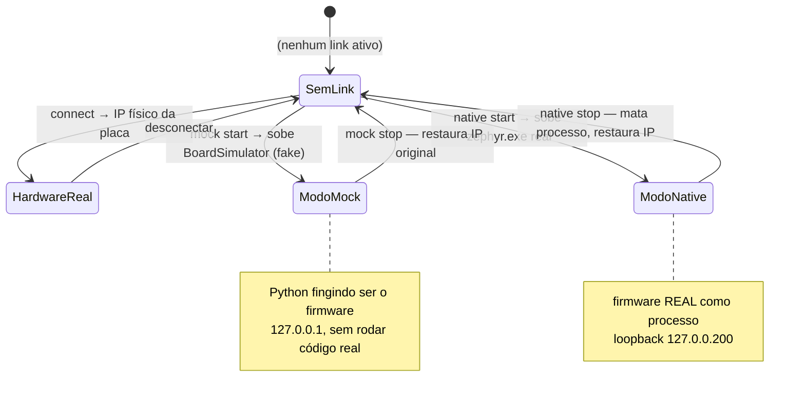
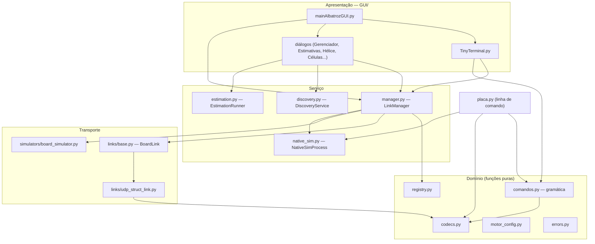
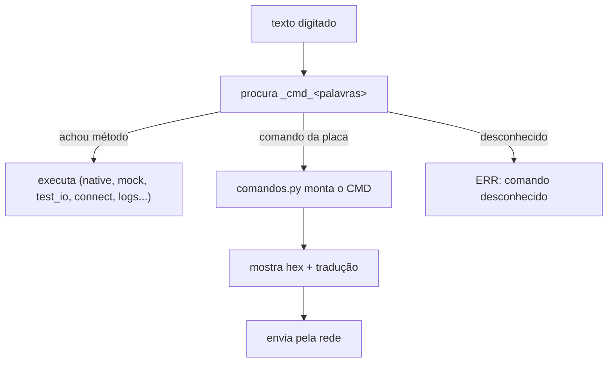
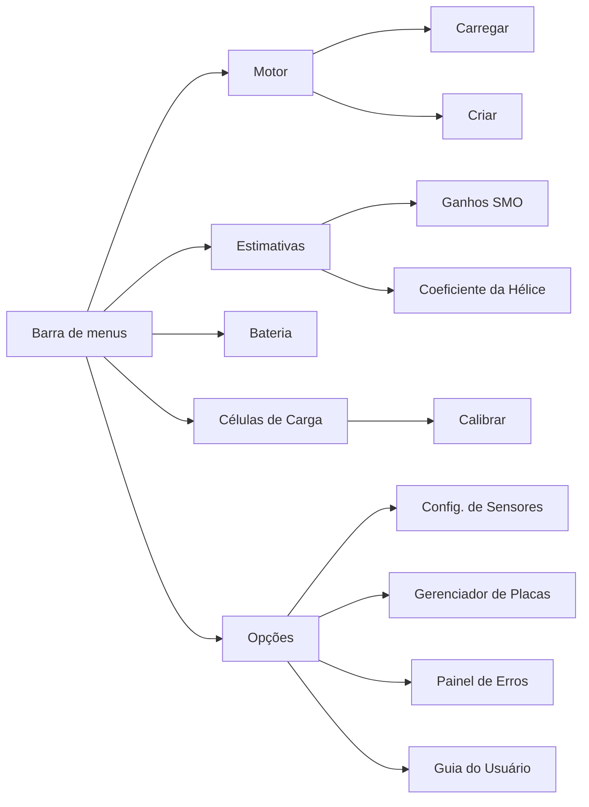

# gui — aplicação de supervisão da placa de medição

> [README principal](../README.md) · [Firmware](../firmware/README.md) · [Geração do protocolo](Config/README.md)

**Sumário:** [Como rodar](#como-rodar) · [Linha de comando](#linha-de-comando-placapy) · [Estrutura de pastas](#estrutura-de-pastas) · [Modos de conexão](#as-três-formas-de-conectar-e-quando-usar-cada-uma) · [Camadas](#estrutura-do-programa-e-o-porquê-de-cada-camada) · [Protocolo](#o-protocolo-de-comandotelemetria-por-dentro) · [Comandos](#comandos-da-placa) · [TinyTerminal](#tinyterminal--o-terminal-embutido-na-interface) · [Telas](#o-que-dá-para-fazer-tela-por-tela) · [Passo a passo](#passo-a-passo-prático-rodando-um-ensaio-do-zero)

## Para que serve este programa

Esta é a aplicação de PC que **comanda e lê a placa de medição** do sistema
de aquisição para ensaios de motores BLDC. Sem ela, a placa só fala um
protocolo binário de baixo nível; é a aplicação que transforma esses bytes
em gráficos em tempo real, calibração guiada e nos números que interessam
para quem projeta a aeronave: coeficientes de torque e tração da hélice e
ganhos do observador do motor.

**Por que isso importa para quem calcula o desempenho da aeronave**: para
prever alcance, autonomia e envelope de voo é preciso um modelo confiável
do conjunto motor+hélice, não só "quanto empuxo esse motor dá a plena
carga", mas como empuxo, torque e consumo variam com a rotação e com a
velocidade do ar. Sem um sistema instrumentado, esses números viriam só de
datasheet (que raramente bate com o conjunto realmente montado) ou de voos
de teste (caros, arriscados e difíceis de variar uma condição de cada vez).

Escrita em **Python com PySide6** (Qt) e **pyqtgraph**. Os cálculos da
própria GUI usam só **NumPy**; SciPy e Numba ficam restritos aos scripts de
estimação em `Scripts/`, que rodam como subprocessos.

## Como rodar

```bash
make gui                      # na raiz do repositório, ou:
.venv/bin/python mainApp.py   # Python >= 3.11 (dependências em pyproject.toml)
```

Ao abrir, o programa confere se as dependências do `pyproject.toml` estão
instaladas (instalando as que faltarem) e mata qualquer `zephyr.exe` órfão
de uma execução anterior. Sem essa limpeza, um `native_sim` esquecido
continuaria respondendo na mesma porta UDP, misturando dados de duas fontes
de um jeito difícil de diagnosticar.

## Linha de comando: `placa.py`

Os mesmos comandos do TinyTerminal funcionam fora da GUI, em qualquer shell
(Linux ou Windows), pelo `placa.py`. Ele usa a mesma gramática
(`Communication_Data/comandos.py`) e o mesmo protocolo da GUI.

```bash
python placa.py set i_a linear 0.0809     # um comando e sai
python placa.py tele v_batt i_batt        # última telemetria (campos escolhidos)
python placa.py errs                      # erros ativos, decodificados
python placa.py motor Scorpion_A-5025-310Kv   # aplica um perfil de Config/motors/
python placa.py -c arm -c "esc 20" -c "watch 5 rpm_same" -c off   # roteiro
python placa.py                           # prompt interativo (placa>)
python placa.py --native                  # sobe o firmware em native_sim (Linux)
python placa.py --ip 192.168.0.50 tele    # outro IP (padrão: o do protocolo.yaml)
```

Comandos que só enviam (`set`, `arm`, `esc`...) funcionam com a GUI aberta.
Os que leem telemetria (`tele`, `watch`, `errs`) precisam da porta 5555
livre, ou seja, com a GUI fechada. A lista completa está em
[Comandos da placa](#comandos-da-placa) e em `python placa.py --help`.

---

### Estrutura de pastas

```text
gui/
├── mainApp.py               ponto de entrada da GUI
├── placa.py                 comandos da placa pela linha de comando (qualquer shell)
├── test_emergencia.py       testa a lógica do botão de emergência pela rede
├── build.py                 empacota a aplicação com PyInstaller (--onedir)
├── debug_log.py             logs em arquivo (logs/crash.log, app.log, session.log)
├── debug_run.sh             roda a GUI sob o gdb para capturar segfaults em C/C++
├── pyproject.toml           dependências
├── Config/                  protocolo.yaml + generate.py (ver Config/README.md), comandos, gráficos, motores
├── Communication_Data/      transporte, domínio e serviço (seção "Estrutura do programa")
├── GUI/                     janela principal, TinyTerminal e diálogos
├── Ensaios/                 ensaios roteirizados pela rede (degraus de throttle, varredura do observador)
└── Scripts/                 estimação (SMO, hélice) e banco de testes de CMD
```

### Outras ferramentas de linha de comando

| Comando | Para que serve |
|---|---|
| `python Scripts/cmd_test.py [--send]` | Monta e decodifica **todos** os `CMD`; com `--send` sobe o `native_sim` e mede se a telemetria muda após cada comando |
| `python test_emergencia.py [--native]` | Exercita o botão de emergência e o "pronto" da GUI, conferindo os bits de erro |
| `python Ensaios/ensaio_degraus.py 20,25,30 6 15` | Ensaio em degraus de throttle, grava toda a telemetria em CSV (GUI fechada) |
| `python build.py` | Gera o executável com PyInstaller; no Linux embute o `native_sim` |
| `./debug_run.sh` | Roda a GUI sob o `gdb`; o backtrace vai para `logs/gdb_crash.log` |

---

## As três formas de conectar, e quando usar cada uma

1. **Hardware real**: a placa física, ligada por cabo Ethernet num IP
   link-local fixo (`169.254.97.200`). É o modo usado nos ensaios.

2. **Simulador em Python (mock)**: quando não há placa e só se quer testar
   a interface, a aplicação sobe uma thread Python que **finge** ser o
   firmware: decodifica os comandos e devolve telemetria senoidal com
   ruído. Esse modo **não executa nenhuma linha do firmware**; se o
   `protocolo.yaml` mudar, ele pode continuar respondendo de um jeito que
   não bate mais com o firmware. Serve para testar a interface gráfica,
   nunca para validar o protocolo.

3. **`native_sim`**: o **firmware de verdade**, compilado para rodar como
   processo do Linux (arquitetura POSIX do Zephyr, sem emulação de CPU).
   Troca pacotes UDP reais com a aplicação nas mesmas portas da placa, em
   loopback (`127.0.0.200`). Qualquer bug de protocolo, parsing ou lógica
   (não de hardware) aparece como apareceria na placa. Só funciona no Linux,
   e o pipeline das fases do motor (ADC + observador) não é simulado: as
   fases ficam em zero.



---

## Estrutura do programa e o porquê de cada camada

O código é organizado em quatro camadas, de baixo para cima. A separação
isola "como os bytes trafegam" de "o que a aplicação faz com eles": quem
gerencia o ciclo de vida da conexão (camada de Serviço) só chama `send`, e
o transporte cuida do resto. Endereço, portas e protocolo vêm do
`protocolo.yaml`, não do código.



### Camada de transporte (`Communication_Data/links/` e `simulators/`)

Uma thread própria de entrada/saída (`BoardLink`, classe abstrata), com
`send()` e contadores de pacotes que servem tanto para os LEDs de status
quanto para o diagnóstico de rede (`test_io`). A implementação concreta,
**`UdpStructLink`**, usa um socket UDP para recepção e envio no mesmo laço,
com timeout curto (0,1 s) na recepção. O `BoardSimulator` implementa o
modo mock.

### Camada de domínio (`comandos.py`, `registry.py`, `codecs.py`, `motor_config.py`, `errors.py`)

**Funções puras**, sem rede nem thread:

- `comandos.py` é a gramática dos comandos da placa: uma linha de texto
  (`set i_a linear 0.0809`) vira o `CMD` de 8 bytes, com os índices tirados
  do `protocolo.yaml`, e um `CMD` vira texto legível. É usada pelo
  TinyTerminal, pelo `placa.py`, pelos diálogos e pelo `cmd_test.py`.
- `registry.py` lê o bloco `link:` do `Config/protocolo.yaml` (IP, portas,
  transporte).
- `codecs.py` empacota/desempacota `CMD` e `TELEMETRY_LOG` com `struct`
  (`<BBBfb>`, little-endian como o RISC-V).
- `motor_config.py` lida com os perfis de motor (`Config/motors/*.yaml`) e
  monta os `CMD`s para aplicar um perfil inteiro na placa.
- `errors.py` traduz o `error_code` (mapa de bits) da telemetria para
  mensagens em português.

### Camada de serviço (`manager.py`, `discovery.py`, `estimation.py`, `native_sim.py`)

- **`LinkManager`**: mantém o link da placa e expõe os três modos de conexão
  (`start_link`, `set_mock_mode`, `start_native_sim`).
- **`DiscoveryService`**: manda um comando neutro e espera telemetria como
  confirmação de que a placa está presente; se nada chegar, tenta ping ICMP.
- **`EstimationRunner`**: roda os scripts de estimação como **subprocessos**
  e retransmite a saída linha a linha, para a otimização (Evolução
  Diferencial, vários segundos) não travar a interface.
- **`NativeSimProcess`**: sobe/derruba o `native_sim` e retransmite o log.

### Camada de apresentação (`GUI/`)

A janela principal (`mainAlbatrozGUI.py`), o TinyTerminal e os diálogos,
detalhados em "O que dá para fazer, tela por tela".

---

## O protocolo de comando/telemetria, por dentro

O conteúdo de cada struct está no `Config/protocolo.yaml` e no
[README do firmware](../firmware/README.md); aqui o que importa é como o
Python lida com o formato:

```python
CMD_FORMAT = "<BBBfb"  # func(1B) instr(1B) target(1B) value(4B float) action(1B)

def encode_cmd(func, instr, target, value, action):
    return struct.pack(CMD_FORMAT, func, instr, target, float(value), action)
```

O `<` força **little-endian**, a ordem do RISC-V. A telemetria
(`TELEMETRY_LOG`) é decodificada do mesmo jeito, mas o layout (quantos
campos, em que ordem) é lido do `protocolo.yaml`, não escrito no código.

---

## Comandos da placa

Mesma gramática no TinyTerminal e no `placa.py`, sem prefixo de placa.

| Comando | O que faz |
|---|---|
| `arm` | "Pronto": pré-carga → potência → ESC armado (`FUNC_START`/`STATUS_OK`) |
| `off` | Desarma o ESC e abre os relés (`FUNC_START`/`STATUS_ERROR`) |
| `estop` | Parada de emergência (`FUNC_STOP`) |
| `esc <0..100>` | Throttle em % (`FUNC_ESC`) |
| `reset` | Reinicia o firmware |
| `force on` / `off` | Ignora / volta a respeitar o botão físico de emergência. Só no terminal de propósito: é desvio de segurança, vale até a placa reiniciar |
| `set <sensor> linear\|offset\|min\|max <valor>` | Calibração e faixa válida de um sensor (gravada no NVM) |
| `set <sensor> reset` | Volta a calibração do sensor ao default |
| `set <parâmetro> <valor>` / `set <parâmetro> reset` | Parâmetro do motor/observador (gravado no NVM) |
| `bat p0..p4\|temp_limit\|relay <valor>` | Polinômio do SOC, limite de temperatura, só os relés |
| `raw <f> <i> <t> <valor> <ação>` | `CMD` cru pelos índices dos enums |
| `alvos` | Lista sensores e parâmetros aceitos pelo `set` |

**Sensores** usam os nomes da telemetria: `v_batt`, `i_batt`, `v_a`..`v_c`,
`i_a`..`i_c`, `load_cell_0`..`5` (o `comandos.py` traduz, por exemplo,
`v_batt` para `TARGET_VOLTAGE_DIVIDOR`). **Parâmetros**: `pole_pairs`,
`resistance`, `inductance`, `kv`, `gamma1`, `gamma2`, `gammat`, `bemf_lpf`,
`torque_lpf`, `ts_adc`. Alvo desconhecido dá erro em vez de cair num índice
qualquer.

Só no `placa.py`: `tele [campos]`, `watch [n] [campos]`, `errs`,
`motor [perfil]`, `shell <linha>` (com `--native`), `sleep <s>`.

---

## `TinyTerminal` — o terminal embutido na interface

Uma janela de texto **dentro da aplicação**, que fala com a placa pela
mesma rede que o resto da interface. Mostra, para cada comando, os 8 bytes
em hexadecimal e a tradução campo a campo. Tem histórico (↑/↓) e
autocompletar (Tab), alimentado por `Config/commands.yaml`.

O texto digitado é dividido em palavras e o terminal procura um método
`_cmd_<palavras>` do mais específico ao mais geral (`native start` →
`_cmd_native_start`). Se não houver, e a primeira palavra for um comando da
placa (`arm`, `set`, `esc`...), a linha vai para o `comandos.py`, que monta
o `CMD`.



**Comandos do próprio terminal**, além dos [comandos da placa](#comandos-da-placa):

| Comando | O que faz |
|---|---|
| `help [comando]` | Lista os comandos, ou detalha um |
| `connect [ip]` | Liga o link com a placa (troca o IP antes, se dado) e confere a sub-rede |
| `mock start` / `stop` | Liga/desliga o simulador Python |
| `native start` / `stop` | Sobe/derruba o firmware em `native_sim` (precisa de `make native_sim`) |
| `native shell <cmd>` | Linha para o shell de UART do firmware em `native_sim` (ex.: `native shell nvm`) |
| `test_io` | Testa TX e RX separadamente (abaixo) |
| `logs on` / `off` | Liga/desliga a telemetria no terminal (desligada por padrão) |
| `graph clear` / `graph mock_data start\|stop` | Limpa os gráficos / atalho para o mock |
| `clear`, `sudo`, `restart`, `exit [all]` | Tela, privilégios, reinício, saída |
| `ping <ip>`, `ipconfig`, `listing [porta]`, `tcpdump <ip> <s>` | Diagnóstico de rede do PC |

### Testando a conexão sem olhar gráfico nenhum

`test_io` manda um `CMD` inofensivo e espera telemetria, reportando
separadamente o **envio** (TX, o socket conseguiu mandar) e a **recepção**
(RX, algum pacote chegou). Funciona nos três modos, porque só observa
contadores do socket. Se TX falhar, o problema é de rede/porta/firewall no
PC; se só RX falhar, está do lado da placa.

---

## O que dá para fazer, tela por tela



### Tela principal

Gráficos da telemetria, botão "Conectar", slider de throttle e "Desligar
(Motor)". Mexer no slider arma a placa (pré-carga → potência → ESC) antes
do primeiro throttle; "Desligar" manda throttle 0 mais `FUNC_STOP`. A GUI
repete o "pronto" a cada 30 s enquanto conectada; "Desligar" suspende.

### Gerenciador de Placas

LED que fica verde quando a placa está mandando dados, IP/porta editável
**só para a sessão** (para tornar permanente, editar o `protocolo.yaml`),
botão "Detectar" e botão "Simulação Nativa" (desabilitado fora do Linux).

### Calibrar Célula de Carga

Média das últimas N leituras de uma célula, ao vivo, com diagnóstico de
célula desconectada (HX711 saturado) ou ainda sem calibração. "Tarar" zera
sem carga; "Calibrar pelo peso" informa o peso que está sobre a célula, e é
a placa quem calcula a escala.

### Configuração de Sensores

Tabela com os sensores calibráveis (bateria, fases do motor, células) e
quatro colunas (ganho, offset/tara, mínimo, máximo). Só as células editadas
são enviadas ao clicar "Aplicar" (destacadas enquanto pendentes).

### Painel de Erros e Alarmes

Uma lâmpada por bit do código de erro (tabela em `protocolo.yaml`, seção
`error_bits`), agrupadas por área, acesa quando o alarme está ativo.

### Estimar Ganhos do SMO

Recebe $R$ e $L$ do motor (pré-preenchidos do primeiro perfil em
`Config/motors/`), o período de amostragem e os parâmetros da Evolução
Diferencial. Mostra a curva de custo em tempo real e, ao fim, os três
ganhos na forma Γ. Só grava em `Config/estimativas.yaml` depois de
confirmação explícita; para enviar à placa, use "Motor → Criar" ou
`set gamma1 <valor>`.

### Estimar Coeficiente da Hélice

Consome um **CSV já exportado** pela tela principal. A pessoa escolhe a
coluna de tração, a de torque (padrão: o estimado pelo observador,
`torque_eletrico`) e a de RPM (padrão: `rpm_same`), mais o diâmetro da
hélice e a densidade do ar. O script calcula, por ponto, $C_T$, $C_Q$,
$C_P$ e $\eta$, e devolve uma **lista de pontos**, porque os coeficientes
variam com a razão de avanço. Grava em `Config/estimativas.yaml` só com
confirmação.

### Motor → Carregar / Criar

"Criar" abre um formulário com dados de fabricante e de ensaio (polos,
$K_v$ de placa, resistência e indutância de fase, tensão de barramento) e
os ganhos do observador. O $K_v$ de placa é por volt de barramento e o pico
de tensão de fase é $V_{bus}/\sqrt3$, então $K_{e1} = 60/(2\pi K_v\sqrt3)$
**sempre** e $K_t = 1{,}5\,K_{e1}$, mesma conta do firmware. O perfil é
salvo em `Config/motors/<nome>.yaml`. "Carregar" lista esses perfis e
aplica na placa, um `CMD` por parâmetro (o mesmo que `placa.py motor
<perfil>`).

---

## Passo a passo prático: rodando um ensaio do zero

1. **Ligue a placa.** Para testar sem bancada, `make native_sim` na raiz e
   `native start` no TinyTerminal (ou "Simulação Nativa" no Gerenciador de
   Placas). Confirme com `test_io` que TX e RX estão OK.
2. **Clique em "Conectar"** na tela principal.
3. **Rode o ensaio**: acelere pelo slider, em alguns níveis se for medir
   uma curva. Para degraus repetíveis, use `Ensaios/ensaio_degraus.py`
   (com a GUI fechada).
4. **Exporte os dados**: "Salvar CSV" grava todo o histórico (RAM e swap
   em disco) com timestamp e uma coluna por variável.
5. **Processe o CSV**: Estimativas → Coeficiente da Hélice, escolha o CSV,
   as colunas, o diâmetro e a densidade do ar.
6. **Confira e grave**: a tabela mostra um ponto por nível de operação;
   só depois de conferir se clica em "Gravar em estimativas.yaml".

---

Ver [`CLAUDE.md`](CLAUDE.md) para referência técnica voltada a quem for
mexer no código.

Licença: **MIT** (ver `../LICENSE`).
